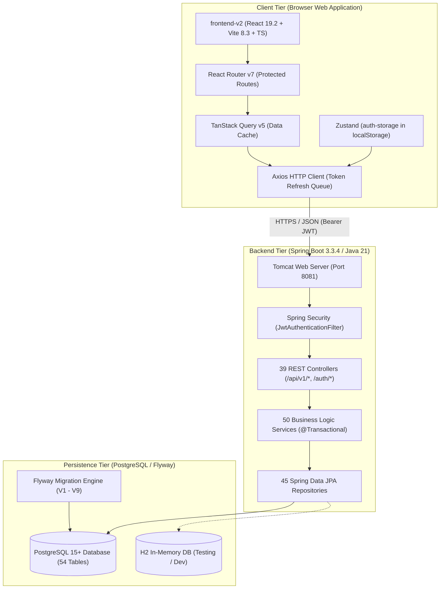

# Work Package 06A — Consolidated Desktop Migration Readiness Assessment

**Project:** EduPulse ERP — Desktop Transition Sprint (Week 00 / Day 01)  
**Date of Assessment:** 1 November 2026  
**Auditor:** Antigravity AI Engineering Assistant (Pair Programming Baseline)

---

## 1. Current System Architecture Overview

EduPulse is currently structured as a three-tier web-based Enterprise Resource Planning (ERP) platform designed for higher education institutions:

---

## 2. Existing System Health & Verification Scorecard

| Architectural Component | Health Status | Empirical Verification Evidence |
| :--- | :--- | :--- |
| **Frontend Codebase (`frontend-v2`)** | **PASSED (Production Ready)** | `npm run build` completed in 5.14s; 2,264 modules transformed; 0 errors. |
| **Backend Codebase (`backend/`)** | **PASSED (Production Ready)** | `mvnw.cmd test-compile` succeeded across 371 source files and 69 tests in 11.89s; 0 errors. |
| **Test Suite Execution** | **PASSED (100% Passing)** | `BatchControllerTest` ran 4/4 passing tests in 2.115s using SpringBootTest + H2 profile. |
| **Database Migrations** | **VERIFIED (Consistent)** | 9 sequential Flyway migrations (`V1` to `V9`) cleanly mapping 54 relational tables. |
| **Linting & Code Quality** | **PASSED (Clean)** | `oxlint` scanned 140 frontend files: 0 errors, 50 minor hook/linter hygiene warnings. |
| **CI/CD Pipeline** | **DEFECTIVE (Requires Fix)** | `ci.yml` targets dead `frontend/` directory and non-existent `postgres-it` profile. |
| **Secret Management** | **SECURE (Verified)** | Zero production credentials or Neon connection strings committed in application configurations. |

---

## 3. Desktop Framework Evaluation Criteria: Tauri vs Electron

As mandated for Day 01 reconnaissance, neither framework is selected prematurely. An objective, criteria-based evaluation framework has been established for the Day 02 decision gate:

| Evaluation Dimension | Candidate A: Tauri (v2) | Candidate B: Electron (v33+) | Strategic Impact on EduPulse Desktop |
| :--- | :--- | :--- | :--- |
| **Underlying Webview Engine** | Microsoft Edge WebView2 (Evergreen on Windows 10/11) | Bundled Chromium instance | Tauri relies on pre-installed Windows WebView2; Electron ships dedicated browser. |
| **Installed Binary Size** | ~10 MB – 20 MB installer | ~85 MB – 140 MB installer | Tauri provides significantly lighter download and faster institutional deployment. |
| **Idle RAM Footprint** | ~35 MB – 60 MB | ~150 MB – 300 MB | Critical for low-spec administrative office PCs with 4GB–8GB RAM. |
| **Build & Tooling Prerequisites** | Rust toolchain, Cargo, MSVC C++ Build Tools | Node.js, npm/pnpm | Electron requires only Node.js; Tauri requires Rust environment setup. |
| **Native Windows Security** | Rust memory safety, native Windows Credential Vault via plugins | Node.js runtime, `safeStorage` API | Both can securely encrypt tokens using Windows DPAPI. |
| **Backend Sidecar Management** | Native Rust child process management with IPC pipes | Node.js `child_process` (spawn, exec) | Both support bundling a Java JRE/JAR as a managed child process. |
| **Auto-Update Infrastructure** | Built-in cryptographic updater (`tauri-plugin-updater`) | `electron-updater` (Squirrel / NSIS) | Both support silent background updates for institutional workstations. |
| **Ecosystem & Plugin Maturity** | Rapidly growing (Tauri v2 stable) | Extremely mature (10+ years in production enterprise) | Electron has broader commercial deployment track record; Tauri is modern and resource-efficient. |

---

## 4. Backend & Database Deployment Topology Options

Three operational topologies have been analyzed for the desktop application:

### Option A: Central Institutional Server (Recommended Primary Architecture)
- **Architecture:** The desktop application functions as a high-performance native client connecting over HTTPS/WSS to an on-premise institutional server or cloud-hosted Spring Boot backend.
- **Advantages:**
  - Client installer remains small and lightweight (no bundled JRE or DB engine).
  - Real-time data synchronization across all campus departments.
  - Zero database administration on local end-user workstations.
- **Connectivity:** Requires LAN or internet connection to the campus server.

### Option B: Fully Embedded Local Workstation (Standalone Single-User Mode)
- **Architecture:** The desktop bundle embeds a lightweight Java 21 JRE (via `jlink`), launches the Spring Boot application on a dynamic loopback port (`127.0.0.1:<random_port>`), and runs an embedded SQLite or H2 database on disk.
- **Advantages:** Completely operational without any network access.
- **Trade-offs:** Significantly larger installer (~120MB+), complex cross-workstation data merging.

### Option C: Hybrid Online Client with Local Offline Read-Only Cache (Roadmap Architecture)
- **Architecture:** Primary operations connect to the institutional server; local SQLite or IndexedDB stores cached rosters, timetables, and fee structures for offline reference when connectivity drops.

---

## 5. Critical Desktop Migration Blockers & Prerequisites

Before desktop framework initialization on Day 03, the following technical prerequisites must be resolved on Day 02:

1. **Configurable Server Endpoint (Blocker):**
   - The frontend's hardcoded `/api` fallback must be replaced by a persistent configuration layer allowing the user to set their institution's server URL.
2. **Encrypted Token Vault Integration (Security Prerequisite):**
   - Replace unencrypted `localStorage` persistence with native OS credential storage (Windows DPAPI / Credential Manager).
3. **Desktop Routing & Navigation Hardening:**
   - Eliminate all instances of `window.location.href = ...` in favor of React Router navigation hooks to preserve webview runtime integrity.
4. **CORS Configuration for Desktop Protocols:**
   - Update `CorsConfig.java` in the backend to authorize desktop webview origins (`tauri://localhost`, `http://tauri.localhost`, or Electron custom schemes).
5. **Day 02 Framework Selection Decision:**
   - Finalize the selection between Tauri and Electron based on developer environment capabilities and institutional hardware profiles.
