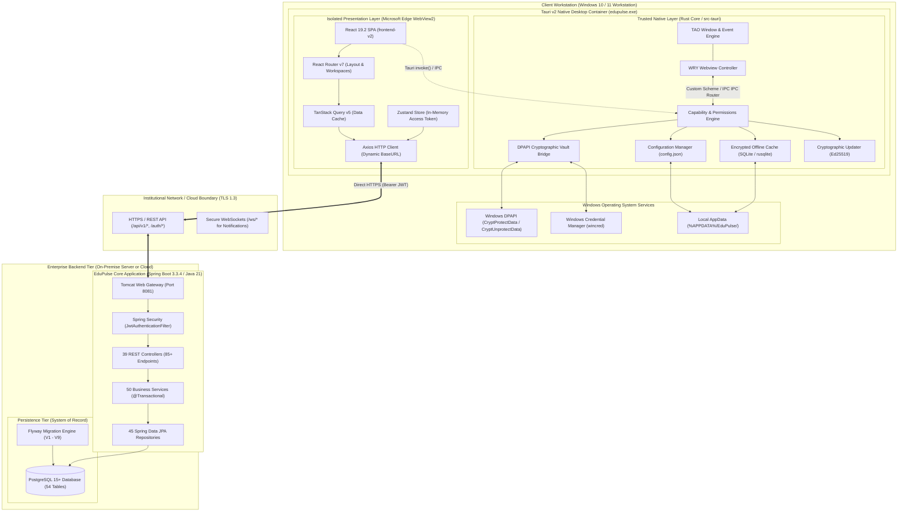
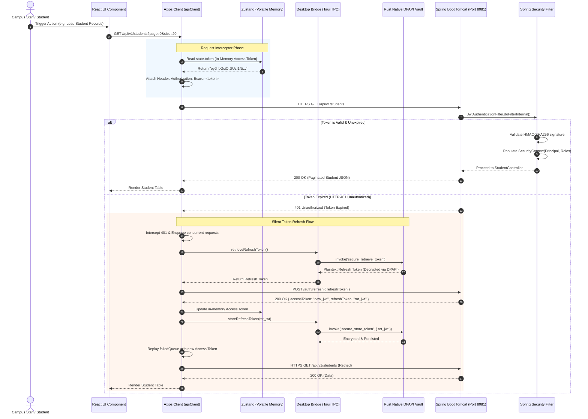
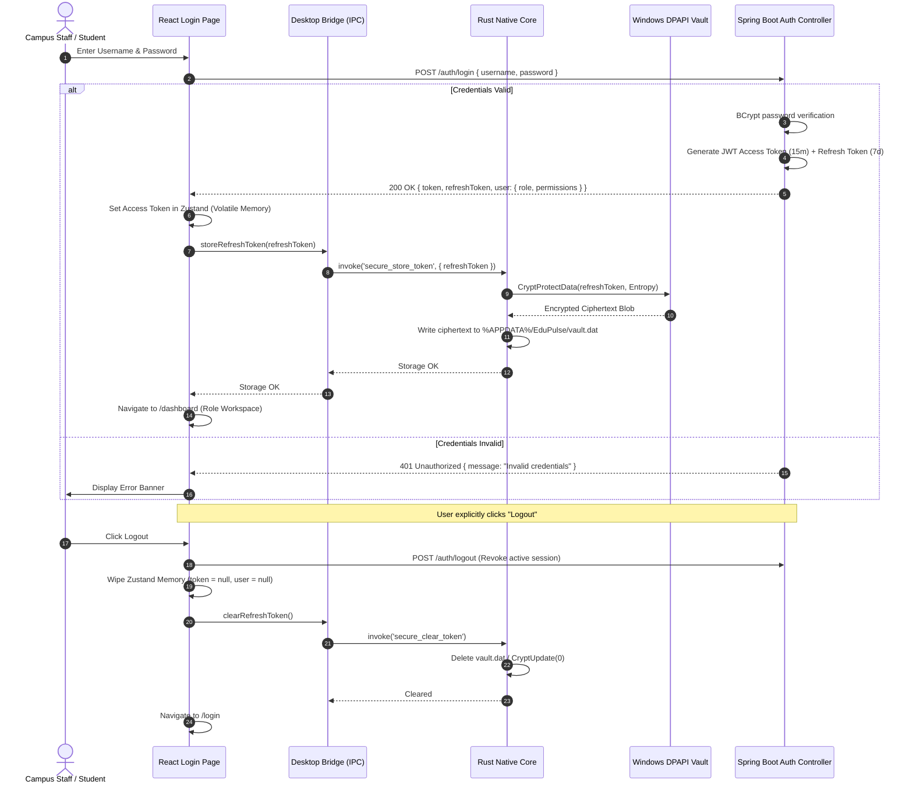
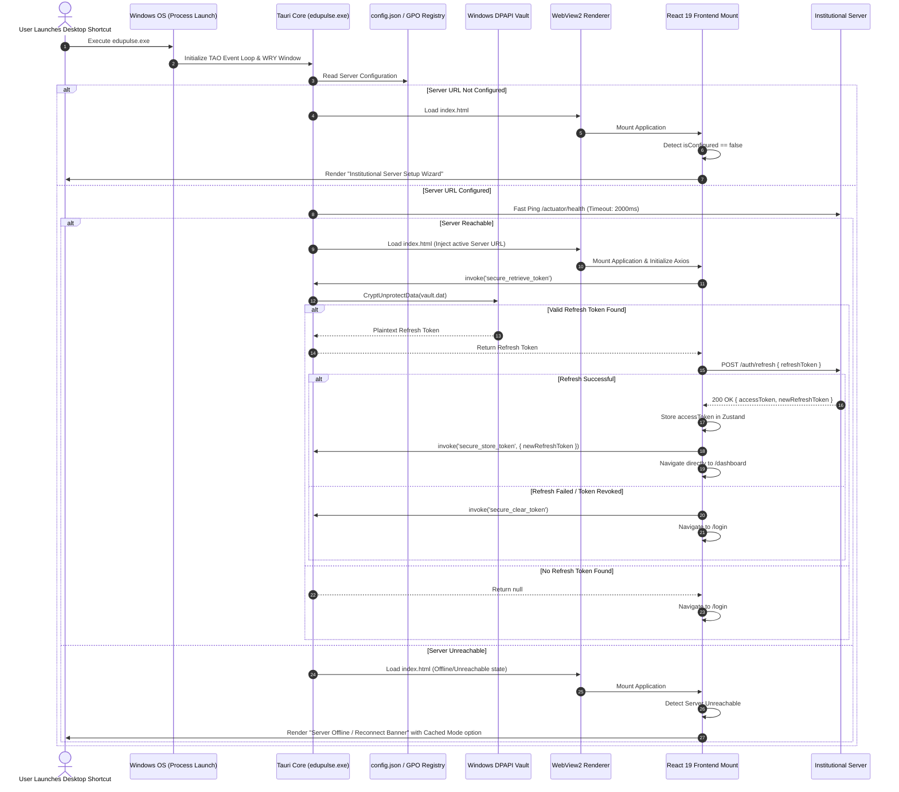
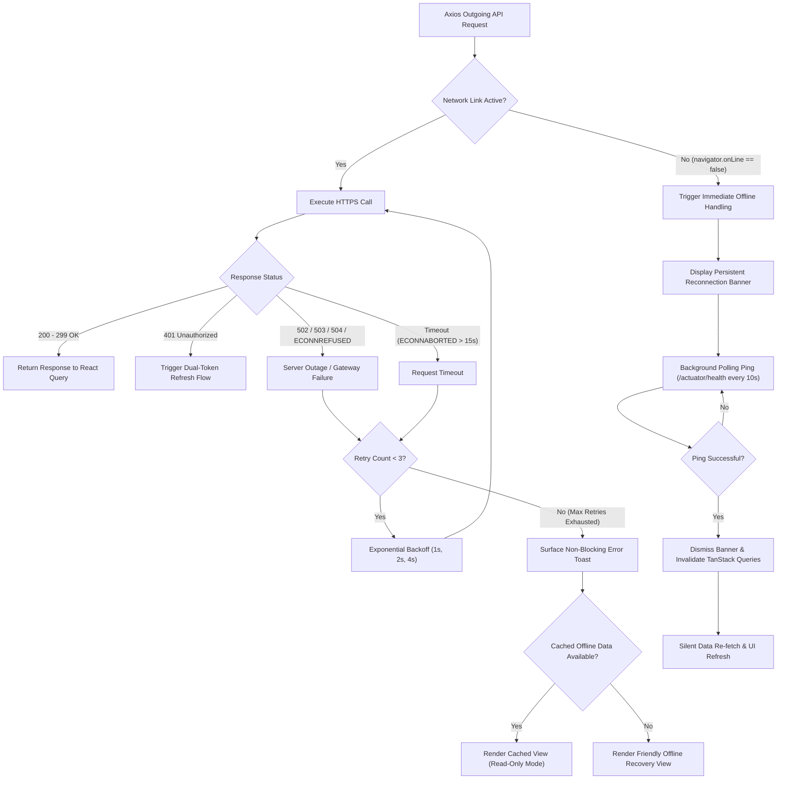
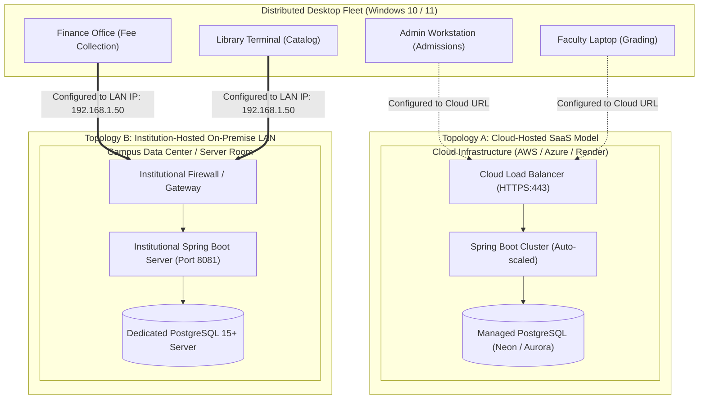

# EduPulse ERP — Desktop System Architecture Design
## Work Package 02 — Target Architecture Specification for Windows Desktop Edition (Tauri v2)

**Project:** EduPulse ERP — Desktop Transition Sprint (Week 00 / Day 02)  
**Target Platform:** Windows 10 / Windows 11 Enterprise (x64 / ARM64)  
**Recommended Framework:** Tauri v2 (with Microsoft Edge WebView2)  
**Author:** Antigravity AI Engineering Assistant (Pair Programming Baseline)  
**Date:** 2 November 2026  
**Document Status:** Authoritative Architectural Design Document  

---

## 1. Executive Summary & Guiding Principles

### 1.1 Context and Vision
EduPulse ERP is evolving from a browser-hosted Single Page Application (SPA) into a robust, high-performance, enterprise-grade Windows desktop application. The product contains **259 planned modules across 23 institutional domains**, serving higher education institutions ranging from single-campus colleges to large multi-tenant university systems.

This document establishes the definitive target architecture for the EduPulse Windows Desktop Edition using **Tauri v2** as the native desktop shell.

```
+----------------------------------------------------------------------------------------------------+
|                                    CORE ARCHITECTURAL PRINCIPLES                                   |
+----------------------------------------------------------------------------------------------------+
| 1. Complete Scope Preservation  | All 259 planned modules and 23 domains remain intact.            |
| 2. Maximum Frontend Reuse       | 100% reuse of frontend-v2/ (React 19.2 + Vite 8.3 + TS).           |
| 3. Single Business Authority    | Spring Boot 3.3.4 remains the sole business logic engine.        |
| 4. System of Record             | PostgreSQL 15+ remains the sole transactional source of truth.   |
| 5. Zero DB Credential Exposure  | Desktop clients never hold direct database credentials or ports. |
| 6. Zero Rust Logic Duplication  | Rust handles OS interop, security, and caching; zero ERP rules.  |
| 7. Secure Credential Boundary   | Refresh tokens stored encrypted via Windows DPAPI, not web store.|
| 8. Dynamic Server Configuration | Campus server endpoint is dynamically configurable by admins.   |
| 9. Read-Only Offline Initial    | Initial offline capabilities are strictly read-only and cached.  |
| 10. Enterprise IT Native        | Native MSI and GPO deployment support for institutional sysadmins.|
+----------------------------------------------------------------------------------------------------+
```

---

## 2. High-Level System Architecture

The EduPulse Desktop Application operates as a multi-tier, decoupled architecture consisting of an isolated client-side presentation layer, a native operating system integration layer, an encrypted OS credential vault, and a centralized enterprise backend.

### 2.1 Complete Architectural Topology Diagram



---

## 3. Layered Component Responsibilities & Division of Concerns

To guarantee long-term maintainability and prevent architectural rot, strict boundaries are enforced across all layers of the system:

```
+-------------------+-----------------------------------------------------------------------------------+
| System Component  | Core Architectural Responsibilities & Constraints                                 |
+-------------------+-----------------------------------------------------------------------------------+
| React Frontend    | - Renders all 259 ERP functional modules, workspaces, navigation, and charts.     |
| (frontend-v2/)    | - Manages client-side view state, form validation (Zod), and UI reactivity.       |
|                   | - Maintains short-lived Access Token in volatile JS memory (Zustand).             |
|                   | - Initiates REST API calls via Axios directly to Spring Boot backend.             |
|                   | - Interacts with Tauri native layer strictly through typed IPC commands.          |
|                   | - STRICT PROHIBITION: Zero storage of long-term credentials in localStorage.      |
+-------------------+-----------------------------------------------------------------------------------+
| Tauri Shell       | - Native OS lifecycle management: windowing, menus, system tray, crash reporting. |
| & Rust Core       | - Secure credential encryption/decryption via Windows DPAPI and Credential Vault. |
| (src-tauri/)      | - Configuration management: persistent storage of campus server URL.              |
|                   | - Network reachability probe and TLS certificate health checks.                   |
|                   | - Cryptographically verified background application auto-updates (Ed25519).       |
|                   | - Local encrypted read-only caching for offline emergency viewing.                |
|                   | - STRICT PROHIBITION: Zero duplication of Spring Boot ERP business logic.         |
+-------------------+-----------------------------------------------------------------------------------+
| Spring Boot       | - Sole authority for all institutional business rules, validations, and workflows.|
| Backend           | - Stateless JWT issuance, role-based access control (RBAC), and session auditing. |
| (backend/)        | - Database transaction management (@Transactional), entity validation, and logic. |
|                   | - Exposes 39 REST controllers and 85+ endpoints over HTTPS.                       |
|                   | - STRICT PROHIBITION: Zero awareness of client packaging (Tauri vs Web vs Mobile)|
+-------------------+-----------------------------------------------------------------------------------+
| PostgreSQL        | - Sole system of record for institutional data (students, finances, grades, etc.).|
| Database          | - Schema management and versioning strictly via Flyway migrations (V1 to V9+).    |
|                   | - Enforces relational integrity, foreign keys, unique constraints, and indexes.   |
|                   | - STRICT PROHIBITION: Never exposed directly to desktop client workstations.      |
+-------------------+-----------------------------------------------------------------------------------+
```

---

## 4. Frontend-to-Native IPC Protocol (Tauri Commands & Events)

Communication between the React presentation layer and the native Rust layer occurs via Tauri’s asynchronous, message-passing IPC bridge. All commands are strictly typed and audited against the **Tauri Capability System** (`src-tauri/capabilities/default.json`).

### 4.1 Native Command Inventory

```
+-----------------------------------+-----------------------+---------------------------------------------------+
| Command Name                      | Arguments             | Return Type / Functionality                       |
+-----------------------------------+-----------------------+---------------------------------------------------+
| `get_server_config`               | None                  | `ServerConfigResponse { url, isConfigured }`      |
| `save_server_config`              | `{ serverUrl: str }`  | `Result<ServerConfigResponse, ConfigError>`       |
| `test_server_connectivity`        | `{ serverUrl: str }`  | `Result<ConnectivityResult, NetworkError>`        |
| `secure_store_token`              | `{ refreshToken: str}`| `Result<(), SecurityError>` (DPAPI encrypt)       |
| `secure_retrieve_token`           | None                  | `Result<String, SecurityError>` (DPAPI decrypt)   |
| `secure_clear_token`              | None                  | `Result<(), SecurityError>` (Wipes DPAPI entry)   |
| `get_system_info`                 | None                  | `SystemInfo { osVersion, webviewVersion, arch }`  |
| `check_for_updates`               | None                  | `UpdateInfo { available, version, notes }`        |
| `install_update`                  | None                  | `Result<(), UpdateError>` (Triggers restart)      |
| `query_offline_cache`             | `{ entity, key }`     | `Result<JsonValue, CacheError>` (Encrypted SQLite)|
| `sync_offline_cache`              | `{ dataset: Json }`   | `Result<(), CacheError>` (Batch cache update)     |
+-----------------------------------+-----------------------+---------------------------------------------------+
```

### 4.2 Frontend Invocation Contract & Types
The desktop wrapper in `frontend-v2/src/services/desktopBridge.ts` encapsulates all Tauri commands, ensuring safe fallbacks if accessed from a standard browser:

```typescript
// Interface definitions for Tauri IPC communication
export interface ServerConfig {
  serverUrl: string;
  isConfigured: boolean;
  institutionName?: string;
}

export interface ConnectivityResult {
  reachable: boolean;
  statusCode: number;
  latencyMs: number;
  serverVersion?: string;
}

// Runtime detection
export const isDesktop = (): boolean => {
  return typeof window !== 'undefined' && '__TAURI_INTERNALS__' in window;
};

// Safe bridge execution
export const desktopBridge = {
  async getServerConfig(): Promise<ServerConfig> {
    if (!isDesktop()) return { serverUrl: '', isConfigured: false };
    const { invoke } = await import('@tauri-apps/api/core');
    return invoke<ServerConfig>('get_server_config');
  },

  async saveServerConfig(serverUrl: string): Promise<void> {
    if (!isDesktop()) return;
    const { invoke } = await import('@tauri-apps/api/core');
    return invoke('save_server_config', { serverUrl });
  },

  async testConnectivity(serverUrl: string): Promise<ConnectivityResult> {
    if (!isDesktop()) return { reachable: true, statusCode: 200, latencyMs: 0 };
    const { invoke } = await import('@tauri-apps/api/core');
    return invoke<ConnectivityResult>('test_server_connectivity', { serverUrl });
  },

  async storeRefreshToken(refreshToken: string): Promise<void> {
    if (!isDesktop()) return;
    const { invoke } = await import('@tauri-apps/api/core');
    return invoke('secure_store_token', { refreshToken });
  },

  async retrieveRefreshToken(): Promise<string | null> {
    if (!isDesktop()) return null;
    const { invoke } = await import('@tauri-apps/api/core');
    try {
      return await invoke<string>('secure_retrieve_token');
    } catch {
      return null;
    }
  },

  async clearRefreshToken(): Promise<void> {
    if (!isDesktop()) return;
    const { invoke } = await import('@tauri-apps/api/core');
    return invoke('secure_clear_token');
  }
};
```

---

## 5. Frontend-to-Backend API Communication Architecture

The desktop application communicates with the Spring Boot backend using standard HTTPS REST calls via Axios. Because the frontend runs inside Microsoft Edge WebView2, it can communicate directly over the network to the configured server endpoint without proxying through Rust for standard API transactions.

### 5.1 API Request Lifecycle Diagram



---

## 6. Configurable Institutional Backend Server URL Architecture

Unlike a public web SaaS where the frontend URL is statically hardcoded, an enterprise desktop client deployed in colleges and universities must connect to varied institutional hostnames (e.g., `https://erp.citycollege.edu:8081` or `https://cloud.edupulse.org`).

### 6.1 Server Discovery & Resolution Workflow
1. **Configuration Persistence:** The active backend server URL is persisted in the native Windows user profile:
   `%APPDATA%\com.edupulse.erp\config.json`
2. **Initial Launch Gate:** If `config.json` does not exist or `serverUrl` is blank, the desktop shell immediately renders the **Institutional Server Setup Screen** before showing the login view.
3. **Connectivity & Certificate Verification:**
   - When the user or administrator enters a campus URL, the Rust backend invokes a native HTTP probe (`reqwest` with Windows system root CA trust).
   - It performs an automated health check against `{serverUrl}/actuator/health` or `{serverUrl}/api/v1/auth/health`.
   - It verifies TLS certificate validity, latency, and expected response payloads before allowing the configuration to be saved.
4. **Active URL Injection:** Once verified, the URL is saved to `config.json` and communicated to `frontend-v2/src/config/api.ts`, dynamically setting `apiClient.defaults.baseURL`.
5. **Enterprise MDM / GPO Policy Override:**
   For mass institutional deployments via Active Directory Group Policy, the Rust configuration manager checks for a Windows Registry policy key:
   `HKLM\Software\Policies\EduPulse\ServerUrl`
   If present, the registry value takes precedence, locking the server endpoint so individual campus users cannot alter it.

---

## 7. Authentication & Secure Credential-Storage Boundaries

### 7.1 Threat Model of Token Storage
In browser web applications, storing tokens in `localStorage` exposes them to any malicious JavaScript executed via XSS or browser extensions. In a Windows desktop application, credentials must be safeguarded against both process-level memory inspection and local disk exfiltration:

```
+-----------------------------------+-----------------------------------+-----------------------------------+
| Security Dimension                | Access Token (15-Minute Expiry)   | Refresh Token (7-Day Expiry)      |
+-----------------------------------+-----------------------------------+-----------------------------------+
| Storage Location                  | Volatile JavaScript Memory        | Windows DPAPI / Credential Vault  |
| Storage Mechanism                 | Zustand In-Memory State           | Win32 CryptProtectData            |
| Persistence Across App Restarts   | NO (Purged when process exits)    | YES (Persists in encrypted form)  |
| Plaintext Disk Exposure           | NEVER written to disk             | NEVER written in plaintext        |
| Protection Scope                  | Process memory isolation          | Logged-in Windows User Account    |
| Mitigation Against Disk Theft     | 100% immune (non-persistent)      | 100% immune (unusable off-machine)|
+-----------------------------------+-----------------------------------+-----------------------------------+
```

### 7.2 Complete Authentication Sequence Diagram



---

## 8. Application Startup and Initialization Flow

The desktop initialization sequence must handle initial configuration, credential restoration, and network validation before rendering the user interface:

### 8.1 Application Startup Sequence Diagram



---

## 9. Network Failure, Disconnection, and Recovery Architecture

In higher education environments, local campus Wi-Fi fluctuations and power outages are common. The desktop application implements comprehensive resilience mechanisms to handle connectivity drops gracefully:

### 9.1 Network Failure and Recovery Flow Diagram



---

## 10. Update and Installer Architecture

Desktop deployments in educational institutions require two distinct distribution channels: individual user installations and mass enterprise administrative installations.

```
+-----------------------------------+-----------------------------------+-----------------------------------+
| Distribution Dimension            | NSIS Interactive Installer (.exe) | WiX Enterprise Installer (.msi)   |
+-----------------------------------+-----------------------------------+-----------------------------------+
| Primary Target                    | Individual faculty & student PCs  | Institutional IT Administrators   |
| Deployment Mechanism              | Manual download & execution       | Active Directory GPO / Intune     |
| Administrative Privileges         | Per-User (no UAC) or Machine      | Per-Machine (Silent /qn flag)     |
| Auto-Update Channel               | Automated background updater      | Managed by Campus IT or Updater   |
| Cryptographic Verification        | Ed25519 signature check           | Authenticode & Ed25519 signature  |
| Payload Size                      | ~12 MB                            | ~14 MB                            |
+-----------------------------------+-----------------------------------+-----------------------------------+
```

### 10.1 Cryptographically Enforced Auto-Update Flow
1. **Signature Verification:** The Tauri core utilizes `tauri-plugin-updater`. Every update artifact (`.zip` / `.tar.gz`) is signed during CI/CD using an **Ed25519 private key**. The corresponding public key is hardcoded into `src-tauri/tauri.conf.json`.
2. **Update Manifest:** The desktop client periodically queries an update manifest JSON file hosted on a campus mirror or secure cloud storage:
   ```json
   {
     "version": "1.1.0",
     "notes": "EduPulse ERP 1.1.0: Enhanced fee reconciliation and examination seating modules.",
     "pub_date": "2026-11-15T10:00:00Z",
     "platforms": {
       "windows-x86_64": {
         "signature": "dW50cnVzdGVkIGNvbW1lbnQ6IHRhdXJpIHNpZ25hdHVyZQpSV1F5...",
         "url": "https://updates.edupulse.org/releases/EduPulse_1.1.0_x64.msi.zip"
       }
     }
   }
   ```
3. **Execution & Silent Restart:** If a new signature-verified version is detected, the client downloads the payload in the background, unpacks it to a staging directory, and prompts the user or silently replaces the binary upon application close.

---

## 11. Deployment Topologies: Cloud-Hosted vs. Institution-Hosted

EduPulse ERP supports two primary enterprise deployment topologies without requiring separate desktop application builds:

### 11.1 Deployment Topology Comparison Diagram



### 11.2 Architectural Differentiation
- **Topology A (Cloud-Hosted SaaS):**
  - Desktop client connects over public WAN via HTTPS (`https://cloud.edupulse.org`).
  - Managed SSL/TLS termination, automated database backups, multi-AZ high availability.
  - Ideal for institutions lacking dedicated on-premise IT infrastructure.
- **Topology B (Institution-Hosted On-Premise LAN):**
  - Desktop client connects over campus Gigabit LAN (`https://erp-server.campus.local:8081`).
  - Data remains strictly within institutional physical boundaries (critical for government and strict data-sovereignty mandates).
  - High throughput for bulk student document uploads and instantaneous report generation.

---

## 12. Initial Offline Read-Only Architecture

### 12.1 Design Constraints and Safety Rules
In higher education ERP systems, offline write transactions (such as fee collections, student enrollment, or grade submission) present severe data collision and financial reconciliation risks. Therefore, the initial desktop release enforces strict architectural boundaries:
- **Strictly Read-Only:** The offline mode allows viewing previously cached institutional data only. All write, update, and delete actions are disabled in the UI when offline.
- **Zero Local Write Queues (Phase 1):** No offline mutation queueing is permitted until Phase 2 bidirectional conflict-resolution protocols are formally designed and audited.

### 12.2 Local Caching Engine & Data Flow
1. **Engine:** Lightweight SQLite database embedded via `tauri-plugin-sql` or direct Rust `rusqlite` with table-level encryption (`SQLCipher` or DPAPI key derivation).
2. **Cache Target Datasets:**
   - Active user profile, roles, and granular permissions.
   - Academic calendar, semester timetables, and lecture schedules.
   - Student directories and course registration catalogs.
   - Historical fee receipts (PDF/JSON representations) for verification.
3. **Cache-on-Read Synchronization:**
   Whenever the user navigates through the ERP while online, successful TanStack Query responses for whitelisted cacheable endpoints are asynchronously forwarded to the native cache:
   ```
   React Query Success -> desktopBridge.syncOfflineCache(key, data) -> SQLite INSERT OR REPLACE
   ```
4. **Offline Read-Through:**
   If a network request fails and the application is offline, the React data hook falls back to `desktopBridge.queryOfflineCache(key)`, rendering the view with an explicit **"Cached Read-Only Data"** indicator and timestamp.

---

## 13. Trust Boundaries, Security Controls & Threat Mitigation

### 13.1 Trust Boundary Mapping
The architecture enforces five discrete security zones with strict isolation between each boundary:

```
[Zone 1: External Network]
          │
     (TLS 1.3 HTTPS)
          ▼
[Zone 2: Sandboxed Webview]  ◄──(Tauri Capabilities)──►  [Zone 3: Trusted Rust Core]
(React DOM, JS Heap Memory)                                  │
                                                    (Win32 CryptProtectData)
                                                             ▼
                                                [Zone 4: OS Security Subsystem]
                                                (DPAPI, Credential Vault, Files)
```

```
+----------------------------------------------------------------------------------------------------+
|                                    SECURITY CONTROLS MATRIX                                        |
+------------------------------------+---------------------------------------------------------------+
| Threat / Vulnerability             | Implemented Architectural Security Control                    |
+------------------------------------+---------------------------------------------------------------+
| Cross-Site Scripting (XSS) in UI   | Node.js is completely absent from renderer; strict Content   |
|                                    | Security Policy (CSP); Tauri capability scoping blocks        |
|                                    | unauthorized native system command execution.                 |
+------------------------------------+---------------------------------------------------------------+
| Local Token Theft / Inspection     | Refresh tokens are encrypted via Windows DPAPI, binding the   |
|                                    | secret to the user's Windows login credentials.               |
+------------------------------------+---------------------------------------------------------------+
| Man-in-the-Middle (MitM) Attacks   | Enforced HTTPS / TLS 1.3; validation of server certificates;  |
|                                    | option for institutional CA certificate bundle pinning.       |
+------------------------------------+---------------------------------------------------------------+
| Malicious Update Injection         | All auto-update binaries require cryptographic Ed25519       |
|                                    | signature verification prior to staging or execution.         |
+------------------------------------+---------------------------------------------------------------+
| Direct Database Tampering          | PostgreSQL port (5432) is never exposed to desktop clients;   |
|                                    | all DB interactions occur solely through Spring Boot JPA.     |
+------------------------------------+---------------------------------------------------------------+
| Privilege Escalation via IPC       | Granular JSON capability permissions define exact command     |
|                                    | names, arguments, and window scopes permitted to invoke Rust. |
+------------------------------------+---------------------------------------------------------------+
```

---

## 14. Architectural Trade-offs & Unresolved Decisions

### 14.1 Key Architecture Trade-offs

| Decision | Selected Option | Alternative Considered | Architectural Justification |
| :--- | :--- | :--- | :--- |
| **Native Container** | **Tauri v2** | Electron v33+ | Prevents severe RAM bloat on 4GB campus workstations; leverages OS-managed WebView2 Evergreen patching. |
| **Credential Storage** | **Windows DPAPI** | Tauri Stronghold | DPAPI does not require asking users for a master passphrase every time the application opens. |
| **Server URL Storage** | **App Config JSON** | Build-time env vars | Enables a single generic installer to be distributed across multiple distinct college campuses. |
| **Initial Offline Scope**| **Strictly Read-Only** | Read/Write Offline Sync | Prevents split-brain financial reconciliation conflicts and complex distributed state collisions. |
| **Offline DB Engine** | **SQLite (rusqlite)** | Browser IndexedDB | Provides robust file-level encryption and longevity independent of browser cache clearing policies. |

### 14.2 Unresolved Decisions (Scheduled for Day 02 WP03–WP06)
1. **Decision 1 (WP03 - Credential Architecture):** Evaluate whether to use `keyring-rs` (Windows Credential Manager) or direct Win32 `CryptProtectData` (DPAPI) for the primary token persistence implementation.
2. **Decision 2 (WP04 - Backend Connectivity):** Establish the exact JSON schema and registry override location for the institutional server URL configuration.
3. **Decision 3 (WP05 - CORS & API Compatibility):** Verify whether Tauri's custom origin (`https://tauri.localhost`) requires updating Spring Boot's `CorsConfigurationSource` in `SecurityConfig.java`.
4. **Decision 4 (WP06 - Offline Architecture):** Define the exact list of the initial 10 high-priority read-only datasets for local SQLite caching.

---

## 15. Conclusion & Next Steps

This document establishes the authoritative system architecture for EduPulse ERP Windows Desktop Edition. It preserves all 259 existing modules, ensures zero frontend rewrite, retains Spring Boot and PostgreSQL as the sole backend authority, and enforces operating-system-grade security.

Proceed immediately to **Work Package 03: Credential Storage & Secure Authentication Design**.
