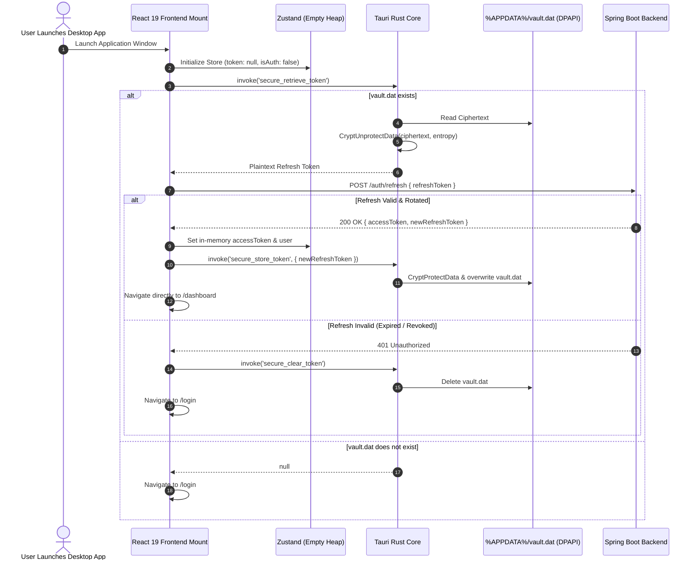

# EduPulse ERP — Desktop Token Lifecycle Design
## Work Package 03B — Authentication Token Lifecycle & State Management

**Project:** EduPulse ERP — Desktop Transition Sprint (Week 00 / Day 02)
**Target Platform:** Windows 10 / Windows 11 Enterprise (Tauri v2 + React 19 + Spring Boot 3.3.4)
**Author:** Antigravity AI Engineering Assistant (Security Baseline)
**Date:** 2 November 2026
**Document Status:** Approved Engineering Architecture Specification

---

## 1. Executive Summary & Architectural Overview

The EduPulse Windows Desktop Edition implements a secure, stateless dual-token authentication lifecycle. This design decouples credential persistence from browser-level storage and establishes a cryptographically protected boundary between the React 19 presentation layer, the Tauri v2 native Rust core, and the Spring Boot 3.3.4 enterprise backend.

```
+----------------------------------------------------------------------------------------------------+
|                                    TOKEN PROPERTIES & CONSTRAINTS                                  |
+------------------------------------+---------------------------------------------------------------+
| Attribute                          | Access Token Specification    | Refresh Token Specification   |
+------------------------------------+---------------------------------------------------------------+
| Token Format                       | Signed JSON Web Token (JJWT)  | Signed JSON Web Token (JJWT)  |
| Cryptographic Signing Algorithm    | HMAC-SHA256 (Keys.hmacShaKey) | HMAC-SHA256 (Keys.hmacShaKey) |
| Standard Expiration Lifespan       | 15 Minutes (900,000 ms)       | 7 Days (604,800,000 ms)       |
| Claim: `token_type`                | "ACCESS"                      | "REFRESH"                     |
| Claim: `id` (JTI)                  | Random UUID (UUID.randomUUID) | Random UUID (UUID.randomUUID) |
| Claim: `authorities`               | Roles & Granted Permissions   | Excluded (Subject only)       |
| Client Storage Location            | Volatile JS Heap (Zustand)    | Windows DPAPI (%APPDATA%)     |
| Persistence Across App Exit        | Strictly NO (Lost on exit)    | YES (Encrypted at rest)       |
| Rotation Policy                    | Re-issued on refresh          | Strictly Single-Use (Rotated) |
+------------------------------------+---------------------------------------------------------------+
```

---

## 2. Component Responsibility Matrix

```
+-------------------+-----------------------------------------------------------------------------------+
| Component         | Architectural Responsibilities in Token Lifecycle                                |
+-------------------+-----------------------------------------------------------------------------------+
| React Frontend    | - Renders login form, captures username/password, dispatches HTTP requests.       |
| (frontend-v2/)    | - Holds Access Token strictly in volatile memory (`useAuthStore`).                |
|                   | - Injects Bearer token into Axios `Authorization` header via request interceptor. |
|                   | - Intercepts HTTP 401 Unauthorized responses; queues concurrent failed requests.  |
|                   | - Marshals refresh token to/from Rust layer via typed Tauri IPC.                  |
|                   | - PROHIBITION: Never saves tokens to browser `localStorage` or `sessionStorage`.   |
+-------------------+-----------------------------------------------------------------------------------+
| Rust Native Core  | - Manages Windows DPAPI encryption bridge (`CryptProtectData` / `CryptUnprotect`).|
| (src-tauri/)      | - Stores encrypted ciphertext in `%APPDATA%\com.edupulse.erp\vault.dat`.          |
|                   | - Exposes typed IPC commands (`secure_store_token`, `secure_retrieve_token`).     |
|                   | - Securely scrubs (zeroizes) plaintext token memory buffers after encryption.     |
|                   | - PROHIBITION: Zero token decoding, validation, or business logic in Rust.       |
+-------------------+-----------------------------------------------------------------------------------+
| Spring Boot       | - Validates user credentials against database (`BCryptPasswordEncoder`).          |
| Backend           | - Issues Access Token (15m) and Refresh Token (7d) signed with HMAC-SHA256.       |
| (backend/)        | - Validates signatures and expiration via `JwtAuthenticationFilter`.              |
|                   | - Executes single-use refresh token rotation in `AuthService.refreshToken()`.     |
|                   | - Tracks active sessions and token revocation blacklist in `SessionService`.      |
|                   | - Invalidates user sessions upon explicit logout or password change.              |
+-------------------+-----------------------------------------------------------------------------------+
```

---

## 3. End-to-End Lifecycle Stages

### 3.1 Initial Authentication (User Login)
1. **User Action:** The user enters credentials (username, password, optional role selection) into the React login form.
2. **API Dispatch:** React dispatches `POST /auth/login` to the configured Spring Boot endpoint with `LoginRequest`.
3. **Backend Validation:**
   - `AuthService.login()` verifies username and matches password via `BCryptPasswordEncoder`.
   - Account status is checked (`user.isEnabled()`). If disabled, throws `DisabledException`.
   - Dual tokens are generated: Access Token (15-min expiry) and Refresh Token (7-day expiry).
   - A new session is recorded in `SessionService.registerSession()` mapping `username -> UserSessionInfo(tokenId, clientIp)`.
4. **Client Ingestion:**
   - React receives `AuthResponse` containing `accessToken`, `refreshToken`, and user metadata.
   - React writes `accessToken`, `user`, and `permissions` into in-memory Zustand store.
   - React invokes Tauri command `desktopBridge.storeRefreshToken(refreshToken)`.
5. **Native DPAPI Encryption:**
   - Rust receives `store_refresh_token(refreshToken)`.
   - Rust invokes `CryptProtectData` with user-scope protection and application-specific entropy.
   - Encrypted ciphertext blob is written to `%APPDATA%\com.edupulse.erp\vault.dat`.
   - Rust scrubs the plaintext string from memory using the `zeroize` crate.
   - React navigates to the authenticated dashboard (`/dashboard`).

---

### 3.2 Access Token Expiration & Silent Refresh Queue
The access token expires exactly 15 minutes after issuance. When an expired token is transmitted:

1. **Server Rejection:** `JwtAuthenticationFilter` catches `ExpiredJwtException`, sets `auth_error_code = "TOKEN_EXPIRED"`, and Spring Security returns `HTTP 401 Unauthorized`.
2. **Axios Response Interception:** The response interceptor in `api.ts` catches the 401 error.
3. **Concurrent Request Queueing:**
   - If an existing refresh call is already in progress (`isRefreshing === true`), subsequent failing requests push their resolve/reject handlers to `failedQueue` and pause.
   - If this is the first failing request, `isRefreshing` is set to `true`, and `originalRequest._retry` is flagged.
4. **Native Retrieval:** React invokes `desktopBridge.retrieveRefreshToken()`. Rust calls `CryptUnprotectData` on `vault.dat` and returns the plaintext refresh token.
5. **Token Refresh Call:** React dispatches `POST /auth/refresh` with `{ refreshToken }`.

---

### 3.3 Token Rotation & Replay Detection
EduPulse enforces strict **Single-Use Refresh Token Rotation**:

1. **Validation & Revocation:**
   - In `AuthService.refreshToken()`, the backend extracts the Token ID (JTI) of the incoming refresh token.
   - It checks `sessionService.isTokenRevoked(tokenId)`. If already revoked, the request is rejected immediately with `InvalidTokenException`.
   - The backend revokes the presented refresh token by calling `sessionService.revokeToken(tokenId, oldExpiry)`.
2. **New Token Pair Issuance:**
   - Spring Boot generates a fresh `newAccessToken` (15m) and a fresh `newRefreshToken` (7d).
   - The active session is updated with the new token ID in `SessionService.registerSession()`.
3. **Client State Update:**
   - React receives the new tokens.
   - In-memory `accessToken` in Zustand is updated.
   - React immediately calls `desktopBridge.storeRefreshToken(newRefreshToken)` to overwrite `vault.dat` with the newly rotated refresh token ciphertext.
4. **Queue Drainage:**
   - The interceptor updates `originalRequest.headers.Authorization = 'Bearer ' + newAccessToken`.
   - `processQueue(null, newAccessToken)` drains `failedQueue`, replaying all queued requests with the new access token.
   - `isRefreshing` is reset to `false`.

---

### 3.4 Refresh Failure Handling
If the refresh call fails:
- **Scenario A (Invalid/Revoked/Expired Token):** Server returns HTTP 401 or 403.
  - `processQueue(err, null)` rejects all pending requests.
  - Zustand auth state is purged (`useAuthStore.getState().logout()`).
  - React calls `desktopBridge.clearRefreshToken()` to delete `vault.dat`.
  - Application redirects the user to `/login` with an informative banner ("Session expired. Please log in again.").
- **Scenario B (Network Outage / Server Offline):** Network error (`ECONNABORTED`, timeout, `ERR_NETWORK`).
  - Refresh tokens are **not cleared**.
  - Requests remain queued or fail with network error toasts.
  - The application enters offline/reconnection state, allowing cached views to render.

---

### 3.5 Explicit User Logout
When a user explicitly logs out:
1. **Frontend Action:** User clicks "Logout" in the navigation bar.
2. **Backend Notification:** React dispatches `POST /auth/logout` with `Authorization: Bearer <accessToken>`.
3. **Backend Invalidation:**
   - `AuthService.logout()` extracts the access token JTI and revokes it in `sessionService.revokeToken()`.
   - The user session is terminated via `sessionService.invalidateSession(username)`.
4. **Client Cleanup:**
   - React resets Zustand store (`token = null, user = null, isAuthenticated = false`).
   - React calls `desktopBridge.clearRefreshToken()`.
   - Rust zeroes and deletes `%APPDATA%\com.edupulse.erp\vault.dat`.
   - React redirects to `/login`.

---

### 3.6 Application Restart (Cold Startup Session Resumption)
When the user closes the desktop application and relaunches it later:



---

## 4. Analysis of Existing Backend Implementation vs. Required Changes

An inspection of the existing Java backend source code (`AuthController.java`, `AuthService.java`, `SessionService.java`, `JwtAuthenticationFilter.java`) reveals the following gap analysis:

```
+------------------------------------+-----------------------+---------------------------------------------------+
| Authentication Capability          | Current Backend State | Required Desktop Enhancement / Mitigation         |
+------------------------------------+-----------------------+---------------------------------------------------+
| Dual-Token Issuance (Access+Refresh)| FULLY IMPLEMENTED     | Ready for use without changes.                    |
| Single-Use Token Rotation          | FULLY IMPLEMENTED     | Old refresh token revoked in AuthService:129.     |
| Revocation Check in Filter         | FULLY IMPLEMENTED     | JwtAuthenticationFilter:75 checks isTokenRevoked. |
| In-Memory Revocation Persistence   | LIMITATION            | Current revokedTokens is an in-memory HashMap.   |
|                                    |                       | If Spring Boot restarts, revoked tokens are lost! |
|                                    |                       | Required: Back SessionService with DB / Redis.    |
| Single Active Session Limitation   | LIMITATION            | activeSessions.put(username, ...) overwrites      |
|                                    |                       | prior device session. Multi-device desktop use    |
|                                    |                       | needs composite key (username + deviceId).        |
| Refresh Token Revocation on Logout | DEFECT                | AuthController.logout() revokes access token JTI, |
|                                    |                       | but does NOT revoke refresh token JTI!            |
|                                    |                       | Required: Accept refreshToken in logout endpoint. |
| Password Change Session Invalidation| DEFECT               | AuthService.changePassword() does NOT call        |
|                                    |                       | invalidateSession(). Stolen tokens remain valid!  |
|                                    |                       | Required: Invalidate all sessions on pwd change.  |
+------------------------------------+-----------------------+---------------------------------------------------+
```

---

## 5. Conclusion & Actionable Directives

1. **Frontend Directives:**
   - Remove `auth-storage` persistence configuration from `useAuthStore.ts`.
   - Update `api.ts` response interceptor to retrieve refresh tokens exclusively through `desktopBridge`.
2. **Native Directives:**
   - Implement `secure_store_token`, `secure_retrieve_token`, and `secure_clear_token` in `src-tauri` using Windows DPAPI.
3. **Backend Directives (Scheduled for Backend Hardening Sprint):**
   - Update `AuthController.logout` to revoke both the access token and refresh token JTIs.
   - Add session invalidation to `AuthService.changePassword`.
   - Migrate in-memory `revokedTokens` to a persistent PostgreSQL table (`revoked_tokens`).

Proceed to **Work Package 03C: Windows DPAPI Storage Design**.
