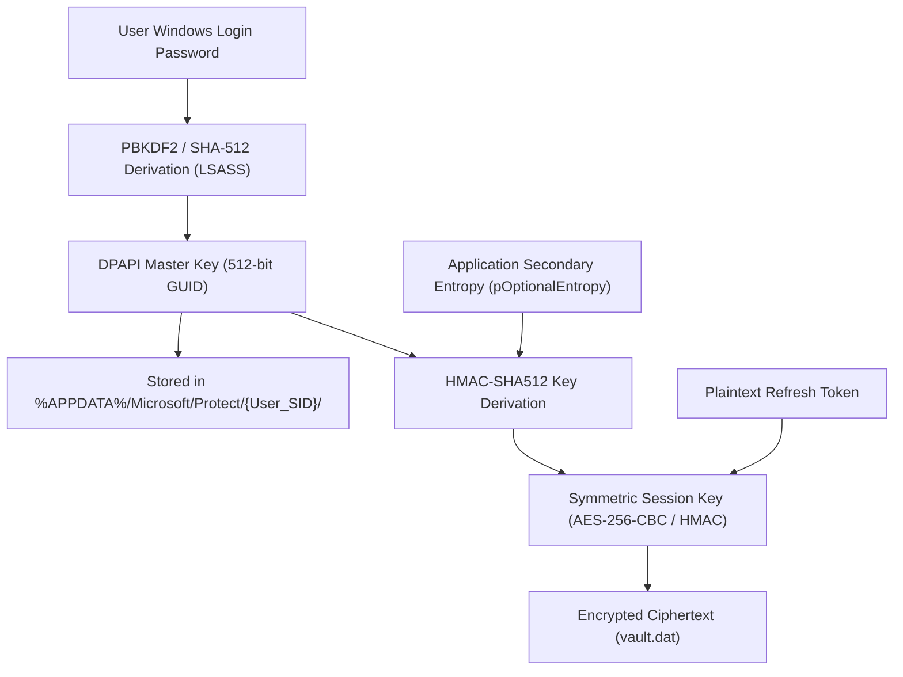

# EduPulse ERP — Windows DPAPI Storage Design
## Work Package 03C — Native Cryptographic Storage Specification

**Project:** EduPulse ERP — Desktop Transition Sprint (Week 00 / Day 02)
**Target Platform:** Windows 10 / Windows 11 Enterprise (Tauri v2 + Rust Native Subsystem)
**Author:** Antigravity AI Engineering Assistant (Security Baseline)
**Date:** 2 November 2026
**Document Status:** Approved Engineering Architecture Specification

---

## 1. Executive Summary & Technological Context

In the EduPulse Windows Desktop Edition, persistent refresh tokens (7-day lifespan) must be secured at rest without exposing them to disk-scraping malware or cross-user extraction on multi-user academic workstations.

This specification details the native integration of the **Windows Data Protection API (DPAPI)** inside the Tauri v2 Rust core layer. DPAPI is the native Windows Win32 cryptographic subsystem (`Crypt32.dll`) that binds data encryption directly to the active Windows user’s cryptographic logon session.

```
+----------------------------------------------------------------------------------------------------+
|                                    WINDOWS DPAPI ARCHITECTURAL SUMMARY                             |
+------------------------------------+---------------------------------------------------------------+
| Core Win32 API Functions           | CryptProtectData / CryptUnprotectData (Crypt32.lib)           |
| Rust Language Binding              | windows-rs (windows::Win32::Security::Cryptography)           |
| Primary Cryptographic Scope        | Current-User Scope (Default: 0x0)                             |
| Execution Flags                    | CRYPTPROTECT_UI_FORBIDDEN (0x1)                              |
| Secondary Entropy Strategy         | Application-Specific Constant Entropy (pOptionalEntropy)     |
| Persistence Artifact               | %APPDATA%\com.edupulse.erp\vault.dat                          |
| Roaming / Cross-Device Assumption  | Machine-Bound (No automatic cross-PC roaming assumed)         |
| Secure Deletion Strategy           | Cryptographic In-Place Overwrite before File Unlink          |
+------------------------------------+---------------------------------------------------------------+
```

---

## 2. Windows DPAPI Mechanics & Win32 Cryptographic Primitives

### 2.1 Core API Functions & Signatures
The Windows DPAPI subsystem exposes two foundational functions within `Crypt32.dll`:

```c
BOOL WINAPI CryptProtectData(
  [in]           DATA_BLOB*                 pDataIn,
  [in, optional] LPCWSTR                    szDataDescr,
  [in, optional] DATA_BLOB*                 pOptionalEntropy,
  [in]           PVOID                      pvReserved,
  [in, optional] CRYPTPROTECT_PROMPTSTRUCT* pPromptStruct,
  [in]           DWORD                      dwFlags,
  [out]          DATA_BLOB*                 pDataOut
);

BOOL WINAPI CryptUnprotectData(
  [in]           DATA_BLOB*                 pDataIn,
  [out, optional] LPWSTR*                   ppszDataDescr,
  [in, optional] DATA_BLOB*                 pOptionalEntropy,
  [in]           PVOID                      pvReserved,
  [in, optional] CRYPTPROTECT_PROMPTSTRUCT* pPromptStruct,
  [in]           DWORD                      dwFlags,
  [out]          DATA_BLOB*                 pDataOut
);
```

### 2.2 Protection Scope: Current-User vs. Local-Machine
- **Current-User Scope (`dwFlags = 0x0` or `CRYPTPROTECT_UI_FORBIDDEN`):**
  - **Mechanics:** The encryption key is derived from the logged-in Windows user's Master Key, which is in turn derived from the user's password hash and Security Identifier (SID).
  - **Security Guarantee:** **Only processes running under the exact same Windows user credentials can decrypt the data.** Other user accounts on the same computer (e.g. students or other staff) receive `SEC_E_DECRYPT_FAILURE` (`0x8009000D`).
  - **Design Decision for EduPulse:** **Enforced.** Every academic workstation user operates under their own user context.
- **Local-Machine Scope (`CRYPTPROTECT_LOCAL_MACHINE = 0x4`):**
  - **Mechanics:** Encrypts data using a system-wide machine key.
  - **Vulnerability:** Any local user account or service running on that physical computer can decrypt the payload.
  - **Design Decision for EduPulse:** **Strictly Prohibited.** Would allow students to extract administrative tokens on shared lab machines.

---

## 3. Cryptographic Key Lifecycle, Derivation & Entropy

### 3.1 DPAPI Master Key Hierarchy


1. **Master Key Storage:** Master keys are stored in the user's profile under `%APPDATA%\Microsoft\Protect\{User_SID}\{MasterKey_GUID}`.
2. **Password Changes:** When a user changes their Windows password normally through Windows OS (`Ctrl+Alt+Del`), the Local Security Authority Subsystem Service (LSASS) automatically re-encrypts the DPAPI Master Key with the new password hash. Existing credentials remain valid.
3. **Administrative Resets:** If a Windows domain or local administrator forcefully resets a user's password without knowledge of the old password, the user's local Master Key becomes unrecoverable unless an Active Directory Domain Backup Key is deployed. In standalone installations, this invalidates `vault.dat`, cleanly forcing the user to log in again to EduPulse.

### 3.2 Secondary Entropy (`pOptionalEntropy`)
By default, any software running under the user's account can call `CryptUnprotectData` on any DPAPI blob found on the machine. To prevent generic infostealers or third-party utilities from decrypting `vault.dat`, EduPulse supplies a secondary entropy `DATA_BLOB`:
- **Entropy Formulation:** A composite salt combining an internal application signature with the institution's configured backend hostname:
  ```
  Entropy = HMAC-SHA256("EduPulse_Desktop_v1_Salt", Normalized_Server_URL)
  ```
- **Security Impact:** An attacker who steals the `vault.dat` file cannot decrypt it without both the user's Windows credentials AND the application-specific entropy value.

---

## 4. Operational Boundaries: Restarts, Roaming & Secure Deletion

### 4.1 Application Restart Behavior
1. **File Location:** The ciphertext is persisted to `%APPDATA%\com.edupulse.erp\vault.dat`.
2. **Cold Launch Sequence:**
   - On startup, the Rust backend verifies that `vault.dat` exists.
   - Rust invokes `CryptUnprotectData` passing the ciphertext buffer and the required application entropy.
   - If successful, the decrypted refresh token is returned to the frontend via IPC.
   - Plaintext memory in Rust is instantly scrubbed using the `zeroize` crate.
3. **Ciphertext Corruption Handling:** If `vault.dat` has been modified, truncated, or tampered with, `CryptUnprotectData` returns `ERROR_INVALID_DATA` or `SEC_E_DECRYPT_FAILURE`. The Rust layer detects this, securely unlinks the corrupt file, and returns `CredentialError::CorruptVault` to the frontend, directing the user to `/login`.

### 4.2 Domain, Active Directory & Roaming Profile Realities
- **Verified Fact:** While Windows Active Directory supports DPAPI Master Key synchronization across roaming profiles via Domain Backup Keys, modern university environments frequently use hybrid Azure AD (Entra ID), workgroup labs, or local user profiles with deep freeze software (e.g. Faronics Deep Freeze).
- **Architectural Policy:** **EduPulse Desktop does NOT assume cross-device credential roaming.**
- **Behavior:** The refresh token stored on Workstation A is cryptographically bound to Workstation A. If a faculty member moves to Workstation B, they perform a standard login. The Spring Boot backend issues a new token pair for Workstation B, allowing both sessions to coexist or rotating them according to institutional security policy.

### 4.3 Secure Deletion Limitations on Modern SSDs
When a user logs out, `vault.dat` must be deleted. However, on modern Solid State Drives (SSDs) with wear-leveling and write amplification algorithms, simply unlinking a file (`std::fs::remove_file`) leaves old NAND flash blocks holding readable data until TRIM garbage collection occurs.

#### In-Place Cryptographic Wipe Implementation:
To eliminate forensic token recovery from discarded or reassigned institutional laptops:
1. Open `%APPDATA%\com.edupulse.erp\vault.dat` with write permissions.
2. Overwrite the file with cryptographically secure pseudo-random bytes (`rand::fill`) of identical length.
3. Call `FlushFileBuffers` / `file.sync_all()` to force the write through OS and disk write caches.
4. Overwrite a second time with all zeros (`0x00`).
5. Call `FlushFileBuffers` again.
6. Finally, execute `std::fs::remove_file("vault.dat")`.

---

## 5. Architectural Comparison of Credential Storage Approaches

```
+-----------------------------------+-----------------------------------+-----------------------------------+
| Feature / Criterion               | Approach A: Direct Win32 DPAPI    | Approach B: Windows Cred Manager  |
+-----------------------------------+-----------------------------------+-----------------------------------+
| Underlying Subsystem              | Crypt32.dll (CryptProtectData)    | Advapi32.dll (CredWrite/CredRead) |
| Storage Location                  | %APPDATA%\com.edupulse.erp\       | Windows Credential Vault (SAM)    |
| Maximum Payload Size              | Virtually unlimited (Megabytes)   | Max 512 bytes per credential blob |
| Visibility in Windows UI          | ZERO (Hidden from end users)      | VISIBLE in Control Panel          |
| Accidental User Deletion Risk     | Very Low (Hidden app directory)   | Moderate (User can click delete)  |
| Custom Secondary Entropy          | Native support (pOptionalEntropy) | Not supported                     |
| Cross-Platform Abstraction        | Windows only                      | Windows only (keyring on others)  |
| Forensically Secure Deletion      | Multi-pass overwrite supported    | Delegated to OS CredDelete()      |
| Rust Tooling Maturity             | Excellent via windows-rs          | Excellent via keyring-rs crate    |
+-----------------------------------+-----------------------------------+-----------------------------------+
```

---

## 6. Definitive Architecture Recommendation

### **Recommendation: Direct Windows DPAPI Integration via `windows-rs`**

#### Engineering Justification:
1. **Control Panel Stealth:** Windows Credential Manager exposes credentials inside `Control Panel -> User Accounts -> Credential Manager`. In academic institutions, curious students or staff frequently inspect and delete entries, triggering unexpected logout bugs. DPAPI storage in `%APPDATA%` is completely invisible in the Credential Manager UI.
2. **Cryptographic Entropy Layering:** Direct DPAPI supports `pOptionalEntropy`, allowing EduPulse to bind the ciphertext to both the user account AND the institutional domain endpoint, thwarting automated generic credential-dumping tools.
3. **Payload Flexibility:** While a standard JWT refresh token is currently ~300 bytes (fitting under Credential Manager's 512-byte limit), future institutional multi-tenant tokens, enterprise session cookies, or encrypted offline keys will exceed 512 bytes. DPAPI supports arbitrary payload lengths.
4. **Verified Toolchain:** Fully supported in safe, idiomatic Rust through Microsoft’s official `windows-rs` crate (`windows::Win32::Security::Cryptography`).

Proceed to **Work Package 03D: Tauri IPC Security Contract**.
