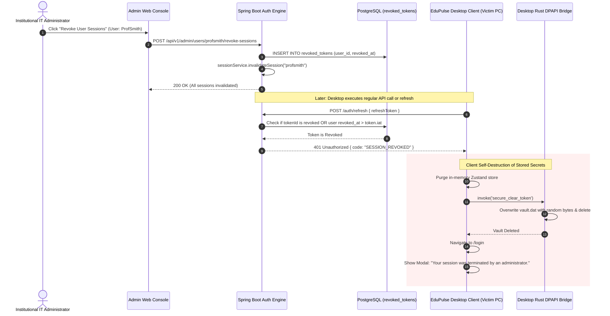

# EduPulse ERP — Session Revocation & Logout Architecture
## Work Package 03E — Enterprise Session Lifecycle & Revocation Specification

**Project:** EduPulse ERP — Desktop Transition Sprint (Week 00 / Day 02)
**Target Platform:** Windows 10 / Windows 11 Enterprise (Tauri v2 + Spring Boot 3.3.4)
**Author:** Antigravity AI Engineering Assistant (Security Baseline)
**Date:** 2 November 2026
**Document Status:** Approved Engineering Architecture Specification

---

## 1. Executive Summary & Session Philosophy

In an enterprise academic ERP, session security extends beyond simple client-side cookies or localStorage deletion. Because EduPulse processes student personal data, financial ledgers, and academic examination grades, session revocation must be enforceable from both the client workstation and the central backend authority.

This specification details the comprehensive session lifecycle across nine operational scenarios, defining the coordinated responsibilities of the **React frontend**, **Tauri Rust native core**, and **Spring Boot enterprise backend**.

```
+----------------------------------------------------------------------------------------------------+
|                                    SESSION LIFECYCLE DIRECTIVES                                    |
+------------------------------------+---------------------------------------------------------------+
| Client-Side Forensics              | Cryptographic in-place overwrite of vault.dat on logout.      |
| Single-Use Rotation Guarantee      | Every refresh token presentation invalidates that token JTI.  |
| Administrative Session Killing     | Centralized revocation of all active sessions per user.       |
| Multi-Device Session Isolation     | Distinct session tracking per physical client workstation.    |
| Inactivity Lockout Policy          | 15-minute idle timer on shared campus workstations.           |
+------------------------------------+---------------------------------------------------------------+
```

---

## 2. Nine Core Session & Revocation Scenarios

---

### Scenario 01: Normal User Logout
- **Trigger:** The authenticated user clicks "Logout" in the desktop application header.
- **Frontend Behavior (`frontend-v2`):**
  1. Reads active `refreshToken` via `credentialBridge.retrieveRefreshToken()`.
  2. Dispatches `POST /auth/logout` with `Authorization: Bearer <accessToken>` and body `{ refreshToken }`.
  3. Purges in-memory Zustand store: `set({ token: null, refreshToken: null, user: null, isAuthenticated: false })`.
  4. Calls `credentialBridge.clearRefreshToken()`.
  5. Navigates user to `/login`.
- **Rust Native Behavior (`src-tauri`):**
  1. Opens `%APPDATA%\com.edupulse.erp\vault.dat`.
  2. Executes two-pass cryptographic wipe (random bytes, followed by zeros, with `sync_all()`).
  3. Deletes `vault.dat` from the filesystem.
- **Spring Boot Backend Behavior (`backend/`):**
  1. `AuthService.logout()` extracts Access Token JTI and adds it to `sessionService.revokeToken()`.
  2. Extracts Refresh Token JTI and blacklists it until its natural 7-day expiration timestamp.
  3. Calls `sessionService.invalidateSession(username)` to purge the active session map.

---

### Scenario 02: Shared Campus Computer Logout & Inactivity Lockout
- **Trigger:** Computer in a library or lab running under a generic Windows user (e.g., `LabWorkstation`).
- **Shared Mode Feature:** User toggles "Shared Computer Mode" at login.
  - **Volatile Execution:** Rust skips writing to `vault.dat`. The refresh token is kept strictly in volatile memory.
  - **Window Close Destruction:** Closing the window immediately destroys all credentials.
- **Inactivity Detection:**
  1. React global listener monitors `mousemove`, `keydown`, `mousedown`, and `touchstart`.
  2. If zero interaction occurs for **15 consecutive minutes**, the application triggers **Emergency Inactivity Lockout**.
  3. Memory tokens are wiped, local vault is scrubbed, and the UI locks into a modal requiring full credential re-entry.

---

### Scenario 03: Refresh-Token Revocation & Token Replay Trapping
- **Trigger:** Normal scheduled token refresh or an attempted replay of a compromised token.
- **Mechanics:**
  1. When `/auth/refresh` is called, the backend extracts the Token ID (JTI).
  2. If the JTI already exists in the revoked tokens registry, **a token replay attack is flagged**.
  3. **Immediate Penalty:** Spring Boot invalidates **all** active sessions for that user account across all devices, under the assumption that the refresh token was intercepted.
  4. Returns `HTTP 401 Unauthorized { error: "TOKEN_REVOKED" }`.
  5. Client purges all local credentials.

---

### Scenario 04: Naturally Expired Credentials
- **Trigger:** Workstation remained powered off or disconnected for > 7 days.
- **Behavior:**
  1. On launch, React calls `credentialBridge.retrieveRefreshToken()` and dispatches `POST /auth/refresh`.
  2. Spring Boot `JwtService.isTokenExpired()` evaluates the token against current epoch time.
  3. Backend throws `InvalidTokenException("Refresh token has expired. Please log in again.")`.
  4. Desktop client receives HTTP 401, invokes `credentialBridge.clearRefreshToken()`, and renders `/login` with an informational toast.

---

### Scenario 05: User Password Change
- **Trigger:** User changes their password via `/auth/change-password` or administrative reset.
- **Security Mandate:** Changing a password MUST invalidate all existing sessions on all devices.
- **Backend Behavior:**
  1. `AuthService.changePassword()` encodes the new password via BCrypt.
  2. Calls `sessionService.invalidateAllUserSessions(username)`.
  3. Blacklists all previously issued JTIs associated with that user.
  4. Returns `HTTP 200 OK`.
- **Client Behavior:** The active desktop client either re-authenticates silently with the new password or prompts the user to re-login. All other active devices receive 401 on their next request.

---

### Scenario 06: User Account Deactivation / Suspension
- **Trigger:** Registrar or HR administrator suspends a student or terminates a staff member (`user.setEnabled(false)`).
- **Backend Enforcement:**
  1. In `JwtAuthenticationFilter`, after extracting username, the filter loads `UserDetails`.
  2. Verifies `userDetails.isEnabled()`. If `false`, the filter aborts request processing immediately and returns `HTTP 403 Forbidden { message: "Account has been deactivated" }`.
  3. The desktop client intercepts HTTP 403, calls `clearRefreshToken()`, and displays an account suspension notice.

---

### Scenario 07: Lost or Stolen Workstation
- **Trigger:** Faculty laptop is reported lost or stolen.
- **Mitigation Workflow:**
  1. Institutional IT administrator logs into EduPulse Administrative Console.
  2. Navigates to User Administration -> Target User -> "Revoke All Active Sessions".
  3. Backend flags all tokens issued prior to `Instant.now()` for that user as revoked.
  4. Even if the thief bypasses the Windows login or dumps `vault.dat`, any attempt to communicate with the Spring Boot server is rejected with HTTP 401.

---

### Scenario 08: Multi-Device Session Management
- **Trigger:** User runs EduPulse Desktop on an office desktop, home laptop, and mobile browser simultaneously.
- **Architecture Requirement:** Session tracking must isolate devices so that logging in on Device B does NOT prematurely terminate Device A.
- **Backend Model:**
  ```
  User -> [Session 1: Office Desktop (UUID-1)]
       -> [Session 2: Home Laptop (UUID-2)]
       -> [Session 3: Mobile Client (UUID-3)]
  ```
- Each session possesses its own independent refresh token and JTI chain.

---

### Scenario 09: Administrative Centralized Force-Logout
- **Trigger:** System maintenance window, security breach containment, or scheduled term end.
- **Backend Action:**
  1. Administrator triggers global or department-level session termination.
  2. Spring Boot publishes a session revocation event (via Redis Pub/Sub or WebSocket broadcast `/topic/system-alerts`).
  3. Active desktop clients receiving the event immediately flush local tokens, wipe `vault.dat`, and disconnect gracefully.

---

## 3. Existing Backend Audit vs. Required Backend Enhancements

An empirical audit of `AuthController.java`, `AuthService.java`, and `SessionService.java` identifies the following precise gap analysis:

```
+------------------------------------+-----------------------+---------------------------------------------------+
| Feature / Scenario                 | Current Implementation| Required Production Enhancement                   |
+------------------------------------+-----------------------+---------------------------------------------------+
| Logout Token Revocation            | PARTIAL DEFECT        | AuthController:54 revokes Access Token JTI, but   |
|                                    |                       | does NOT accept or revoke Refresh Token JTI!      |
|                                    |                       | FIX: Update logout to revoke both JTIs.           |
+------------------------------------+-----------------------+---------------------------------------------------+
| Password Change Invalidation       | DEFECT                | AuthService:206 updates password, but never calls  |
|                                    |                       | invalidateSession(). Stolen tokens remain active! |
|                                    |                       | FIX: Call sessionService.invalidateSession().     |
+------------------------------------+-----------------------+---------------------------------------------------+
| Revocation Storage Persistence     | CRITICAL DEFECT       | SessionService:19 stores revoked tokens in an     |
|                                    |                       | in-memory ConcurrentHashMap. On server restart,   |
|                                    |                       | ALL revoked tokens become valid again!            |
|                                    |                       | FIX: Back revokedTokens with DB/Redis table.      |
+------------------------------------+-----------------------+---------------------------------------------------+
| Account Deactivation in Filter     | DEFECT                | JwtAuthenticationFilter:86 checks isTokenValid,   |
|                                    |                       | but does NOT verify userDetails.isEnabled()!      |
|                                    |                       | FIX: Add enabled check in filter before dispatch. |
+------------------------------------+-----------------------+---------------------------------------------------+
| Multi-Device Session Map           | LIMITATION            | SessionService:39 uses activeSessions map keyed   |
|                                    |                       | solely by username. Login on PC-2 overwrites PC-1!|
|                                    |                       | FIX: Key sessions by composite (user + deviceId). |
+------------------------------------+-----------------------+---------------------------------------------------+
```

---

## 4. Architectural Sequence: Coordinated Force-Revocation Flow



Proceed to **Work Package 03F: Credential Security Validation Plan**.
