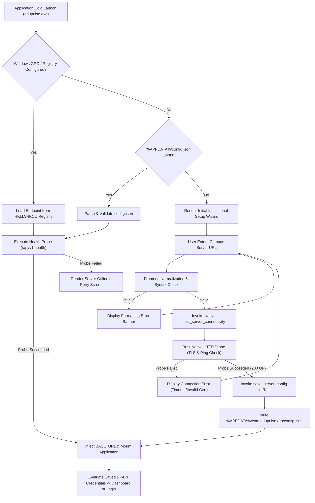

# EduPulse ERP — Backend Endpoint Configuration Architecture
## Work Package 04A — Configurable Backend Endpoint Specification

**Project:** EduPulse ERP — Desktop Transition Sprint (Week 00 / Day 02)
**Target Platform:** Windows 10 / Windows 11 Enterprise (Tauri v2 + Spring Boot 3.3.4)
**Author:** Antigravity AI Engineering Assistant (Architecture Baseline)
**Date:** 2 November 2026
**Document Status:** Approved Engineering Architecture Specification

---

## 1. Executive Summary & Problem Statement

In the web version of EduPulse ERP (`frontend-v2/src/config/api.ts`), the backend API endpoint is resolved via build-time environment variables or browser relative paths:

```typescript
// Verified existing web implementation (frontend-v2/src/config/api.ts:4-7)
const envBaseUrl = import.meta.env.VITE_API_BASE_URL;
export const BASE_URL = envBaseUrl || (import.meta.env.DEV ? 'http://localhost:8081' : '/api');
```

In the Windows Desktop Edition, this approach is fundamentally unworkable:
1. **Packaging Invariance:** A single desktop installer (`.msi` or `.exe`) must be deployed across hundreds of independent colleges, universities, and polytechnics without recompiling the application per institution.
2. **Custom Protocol Isolation:** Because the desktop frontend runs within Microsoft Edge WebView2 under custom local schemes (`https://tauri.localhost`), relative paths such as `/api` resolve to `https://tauri.localhost/api`, resulting in immediate `HTTP 404 Not Found` errors.
3. **Deployment Diversity:** EduPulse must seamlessly connect to both cloud-hosted multi-tenant backends (`https://cloud.edupulse.org`) and on-premise campus LAN servers (`https://erp.citycollege.edu:8081` or `https://192.168.1.50:8081`).

This specification establishes the target architecture for dynamic, secure, and persistent backend endpoint configuration.

---

## 2. Configuration Ownership & Storage Architecture

### 2.1 Configuration Ownership Model
Configuration ownership is divided into two distinct scopes:
- **Administrative Machine Scope:** Enforced centrally by institutional IT administrators via Windows Group Policy (GPO) or installer arguments. User modifications are locked out.
- **Local User Scope:** Owned by the logged-in Windows user when unmanaged. Configured via the first-launch setup wizard and stored in the user’s local profile.

### 2.2 Storage Location & Security
The user configuration is stored as a structured JSON file on the local filesystem:
- **Path:** `%APPDATA%\com.edupulse.erp\config.json`
  *(Resolved natively in Rust via `tauri::path::BaseDirectory::AppData`)*
- **Filesystem Permissions (NTFS ACLs):** Created with restrictive access control lists granting read/write permissions exclusively to the active Windows User SID and `NT AUTHORITY\SYSTEM`.
- **Integrity Validation:** Monitored via SHA-256 checksum verification upon load to detect external file tampering.

### 2.3 Configuration Schema (`v1`)
The configuration schema is strictly typed and versioned:

```json
{
  "$schema": "https://edupulse.org/schemas/desktop-config-v1.json",
  "schema_version": 1,
  "server": {
    "base_url": "https://erp.campus.edu:8081",
    "normalized_url": "https://erp.campus.edu:8081",
    "institution_id": "INST-CITY-COLLEGE",
    "institution_name": "City Engineering College",
    "environment": "production",
    "is_managed_policy": false
  },
  "network": {
    "connect_timeout_ms": 5000,
    "read_timeout_ms": 15000,
    "max_retries": 3,
    "health_check_interval_seconds": 30
  },
  "security": {
    "enforce_https": true,
    "allow_self_signed": false,
    "custom_ca_cert_path": null,
    "pinned_spki_hashes": []
  },
  "metadata": {
    "configured_at": "2026-11-02T14:30:00Z",
    "configured_by": "Domain\\ProfSmith",
    "client_version": "1.0.0"
  }
}
```

---

## 3. Backend Base URL Format & Normalization Rules

To eliminate URL path formatting bugs and trailing slash inconsistencies across Axios requests:

```
+----------------------------------------------------------------------------------------------------+
|                                    URL NORMALIZATION ALGORITHM                                     |
+------------------------------------+---------------------------------------------------------------+
| Input String Processing            | Description & Example                                         |
+------------------------------------+---------------------------------------------------------------+
| 1. Trim Whitespace                 | Strip leading/trailing spaces, tabs, and newlines.            |
| 2. Scheme Canonicalization         | Force scheme to lowercase ("HTTPS://" -> "https://").        |
| 3. Default Scheme Injection        | If user omits scheme ("erp.college.edu"), prepend "https://". |
| 4. Hostname Canonicalization       | Convert FQDN to lowercase ("ERP.COLLEGE.EDU" -> "erp.college.edu").|
| 5. Port Normalization              | Omit default ports (:443 for HTTPS, :80 for HTTP).             |
| 6. Trailing Slash Removal          | Strip trailing slashes ("https://erp.edu:8081/" -> "...:8081")|
| 7. Context Path Preservation       | Retain valid context paths ("https://host/edupulse-api").     |
+------------------------------------+---------------------------------------------------------------+
```

### Validation Invariants:
1. **RFC 3986 Compliance:** Must parse successfully into standard URI components (scheme, host, optional port, optional path).
2. **Scheme Restriction:** Must be `https://` in production. `http://` is rejected unless the host is `localhost` or `127.0.0.1` and `environment == "development"`.
3. **Port Bounds:** Must be an integer between `1` and `65535`.
4. **No Fragments or Query Strings:** Any trailing `#fragment` or `?query=param` is stripped and rejected.

---

## 4. Initial Setup Flow (First-Launch Experience)

When EduPulse Desktop launches, the application verifies whether a valid backend endpoint is configured before presenting any login or authentication views:



---

## 5. Development versus Production Configuration

To support software development, quality engineering, and campus testing without compromising production security boundaries:

```
+-----------------------------------+-----------------------------------+-----------------------------------+
| Configuration Dimension           | Development Profile (`DEV`)       | Production Profile (`PROD`)       |
+-----------------------------------+-----------------------------------+-----------------------------------+
| Allowed Schemes                   | `http://` and `https://`          | Strictly `https://`               |
| Loopback Hosts                    | Allowed (`localhost`, `127.0.0.1`)| Blocked (Requires FQDN or LAN IP) |
| Non-Standard Ports                | Allowed (e.g. `:8081`, `:3000`)   | Allowed (e.g. `:8081` for campus) |
| Self-Signed TLS Certificates      | Allowed via explicit dev flag     | Strictly Blocked (Must trust CA)  |
| Build Profile Compilation         | `cargo build` (Debug symbols)     | `cargo build --release` (Stripped)|
| Configuration Source              | `VITE_API_BASE_URL` or config.json| config.json or GPO Registry       |
+-----------------------------------+-----------------------------------+-----------------------------------+
```

---

## 6. Server URL Changes & Multi-Institutional Environment Switching

In educational consulting, multi-institution administration, or testing across Dev/Staging/Prod environments, a user or technician may need to switch the active backend server URL.

### 6.1 Security Risk: Cross-Tenant Credential & Cache Bleed
If a user switches the backend URL from `https://college-a.edu` to `https://college-b.edu`, any active authentication tokens or cached student dossiers belonging to College A must **never** be transmitted to College B.

### 6.2 Atomic Server URL Switching Protocol:
Whenever `save_server_config` is called with a new backend URL:
1. **Eviction of Local Secrets:**
   - The Rust core immediately calls `secure_clear_token()`, forensically wiping `%APPDATA%\com.edupulse.erp\vault.dat`.
   - The React layer purges in-memory Zustand stores (`token = null, user = null`).
2. **Offline Cache Purge:**
   - The local SQLite offline cache database is cleared of all institution-specific records (`DELETE FROM offline_cache`).
   - TanStack Query cache is purged via `queryClient.clear()`.
3. **Endpoint Persistence:**
   - The new normalized URL is saved to `config.json`.
4. **Axios Client Re-initialization:**
   - `apiClient.defaults.baseURL` is updated to the new endpoint.
5. **Forced Re-authentication:**
   - The user is redirected to `/login`, requiring clean authentication against the newly selected institution.

---

## 7. Configuration Versioning & Schema Migration

To ensure backwards compatibility as desktop versions evolve:
- Every `config.json` stores an integer `schema_version`.
- The Rust configuration manager executes sequential migration functions:
  ```rust
  pub fn migrate_config(mut raw_json: serde_json::Value) -> Result<ConfigV1, ConfigError> {
      let current_version = raw_json.get("schema_version").and_then(|v| v.as_u64()).unwrap_or(0);

      if current_version == 0 {
          // Migrate legacy unversioned flat format to structured v1
          raw_json = migrate_v0_to_v1(raw_json)?;
      }

      serde_json::from_value(raw_json).map_err(ConfigError::Deserialization)
  }
  ```
- If a migration fails or the file contains unparseable syntax, the corrupt file is backed up to `config.json.corrupt.{timestamp}` and a fresh default configuration template is provisioned.

Proceed to **Work Package 04B: Institutional Configuration Precedence & Policies**.
