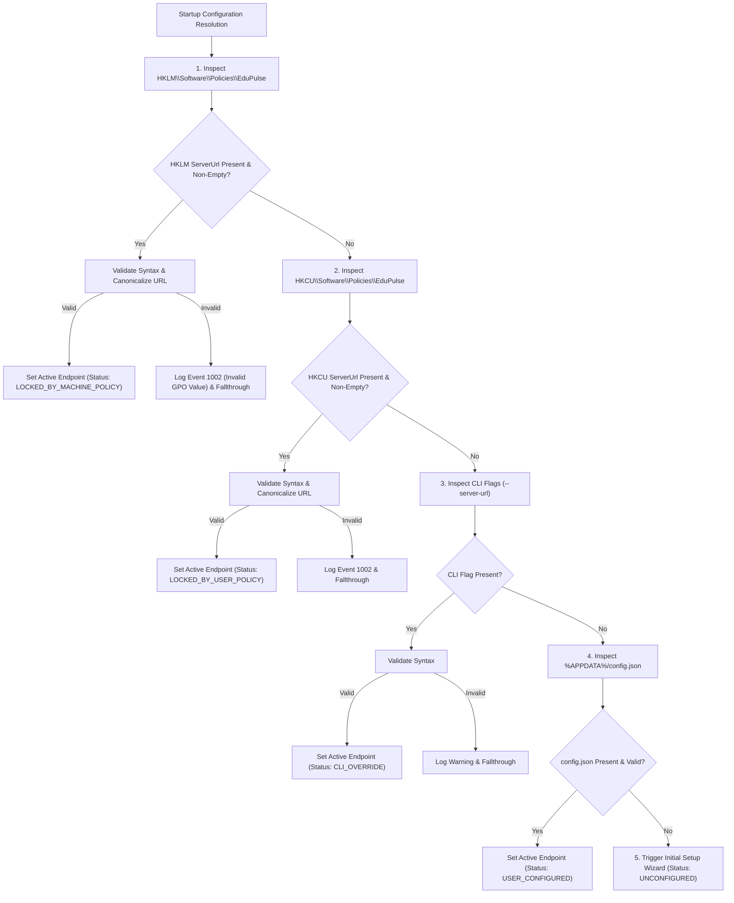

# EduPulse ERP — Institutional Configuration Precedence & Policies
## Work Package 04B — Configuration Hierarchy, Policy Enforcement & Auditing

**Project:** EduPulse ERP — Desktop Transition Sprint (Week 00 / Day 02)
**Target Platform:** Windows 10 / Windows 11 Enterprise (Tauri v2 + Active Directory GPO)
**Author:** Antigravity AI Engineering Assistant (Architecture Baseline)
**Date:** 2 November 2026
**Document Status:** Approved Engineering Architecture Specification

---

## 1. Executive Summary & Policy Overview

In an institutional environment, the desktop client operates across diverse administrative hierarchies. In some colleges, a central IT department enforces a mandatory campus server URL across 500 managed workstations using Microsoft Active Directory or Microsoft Intune. In other scenarios, faculty use personal laptops (BYOD) where they must configure the connection manually.

To reconcile these competing operational models without compromising system security, this document establishes the **Five-Tier Configuration Precedence Hierarchy** and defines tamper-resistance, validation, and audit logging standards.

```
+----------------------------------------------------------------------------------------------------+
|                               FIVE-TIER CONFIGURATION PRECEDENCE HIERARCHY                         |
+-------+----------------------------------+-----------------------------+---------------------------+
| Rank  | Configuration Source             | Storage Subsystem           | Authority / Scope         |
+-------+----------------------------------+-----------------------------+---------------------------+
| 1     | Machine Group Policy (GPO)       | HKLM\Software\Policies\...  | Central IT / Machine Wide |
| 2     | User Group Policy (GPO)          | HKCU\Software\Policies\...  | Central IT / User Profile |
| 3     | Command-Line CLI Override        | edupulse.exe --server-url   | Diagnostic / Tech Support |
| 4     | Local User Configuration File    | %APPDATA%\...\config.json   | End User / Single Account |
| 5     | Application Baseline Default     | Built-in / Setup Wizard     | Unconfigured Fallback     |
+-------+----------------------------------+-----------------------------+---------------------------+
```

---

## 2. In-Depth Evaluation of Configuration Sources

### Tier 1: Windows Machine Group Policy (HKLM Override)
- **Registry Key:** `HKEY_LOCAL_MACHINE\Software\Policies\EduPulse`
- **Values:**
  - `ServerUrl` (REG_SZ): Mandatory backend URL (e.g. `"https://erp.campus.edu:8081"`).
  - `LockConfiguration` (REG_DWORD): If `1`, disables all user configuration interfaces in the desktop UI.
  - `EnforceHttps` (REG_DWORD): If `1`, strictly forbids unencrypted HTTP connections.
  - `CustomCaCertPath` (REG_SZ): Path to institutional root certificate for private campus TLS.
- **Authority:** Absolute highest precedence. Overrides all local user files and command-line arguments.
- **Security Boundary:** Protected by Windows NT kernel permissions. Only accounts with `Administrators` or `SYSTEM` privileges can write to `HKLM`. Standard students or staff cannot alter or delete this key.

### Tier 2: Windows User Group Policy (HKCU Policy)
- **Registry Key:** `HKEY_CURRENT_USER\Software\Policies\EduPulse`
- **Values:** Mirrors Tier 1 schema.
- **Authority:** Second highest precedence. Used in domain environments where policy is applied based on Active Directory User Security Groups rather than Computer Organizational Units (OUs).
- **Security Boundary:** Machine policies in `HKLM` always take precedence over `HKCU`.

### Tier 3: Managed Deployment & Command-Line Arguments
- **Invocation:** `edupulse.exe --server-url="https://staging-erp.campus.edu:8081"`
- **Purpose:** Enables institutional IT staff, remote support engineers, and automated test harnesses to launch the application against specific backend instances without modifying registry keys.
- **Restriction:** If `HKLM\...\LockConfiguration == 1`, command-line server URL overrides are **ignored and logged as policy violations**, preventing non-admin users from launching custom endpoints on locked-down lab machines.

### Tier 4: Local User Configuration File
- **Location:** `%APPDATA%\com.edupulse.erp\config.json`
- **Authority:** Default storage location for unmanaged workstations and BYOD laptops.
- **Behavior:** Generated during initial first-launch setup wizard or updated via in-app Settings.

### Tier 5: Application Baseline Defaults
- **Behavior:** If tiers 1 through 4 yield no valid configuration:
  - In `RELEASE` builds: Renders the **Initial Setup Wizard**. No hardcoded fallback endpoint is assumed.
  - In `DEVELOPMENT` builds: Falls back to `http://localhost:8081` for developer convenience.

---

## 3. Configuration Precedence Resolution Algorithm

The native Rust runtime executes the following resolution sequence during application startup:



---

## 4. Threat Modeling of GPO & Registry Overrides

A common architectural vulnerability is assuming that registry keys are completely secure. The table below analyzes registry threat vectors and counter-measures:

```
+-----------------------------------+-----------------------------------+-----------------------------------+
| Registry Threat Vector            | Vulnerability Scenario            | Implemented Counter-Measure       |
+-----------------------------------+-----------------------------------+-----------------------------------+
| Malicious Admin Injection         | Rogue local administrator points  | TLS certificate validation. Even  |
|                                   | HKLM to an external phishing URL. | with rogue URL, invalid TLS cert  |
|                                   |                                   | terminates connection immediately.|
+-----------------------------------+-----------------------------------+-----------------------------------+
| HKCU Tampering by Standard User   | Standard lab student edits HKCU   | HKLM machine policy overrides HKCU|
|                                   | to redirect attendance logging.   | unconditionally.                  |
+-----------------------------------+-----------------------------------+-----------------------------------+
| Malformed GPO Value               | Sysadmin typos URL into GPO       | Strict Rust parsing rejects mal-  |
| (e.g. missing scheme or host)     | ("http//erp:campus").             | formed GPO values; logs Event 1002|
|                                   |                                   | and halts with clear error modal. |
+-----------------------------------+-----------------------------------+-----------------------------------+
| Insecure Scheme Downgrade         | Attacker injects "http://" into   | Application checks EnforceHttps.  |
| (Plaintext HTTP via GPO)          | HKLM policy to enable MITM.       | Production builds reject http://  |
|                                   |                                   | regardless of registry value.     |
+-----------------------------------+-----------------------------------+-----------------------------------+
```

---

## 5. UI Policy Enforcement & User Experience

When configuration is managed via Windows Policy, the React frontend reflects this state in the user interface:

1. **Settings Page Lockout:**
   - The Server URL input field is disabled (`readOnly: true`).
   - A lock icon and enterprise badge are displayed:
     > *"This workstation's server endpoint is managed by your institution's central IT policy."*
2. **Setup Wizard Suppression:**
   - First-time users are never prompted with the setup wizard; the app proceeds directly to network health check and login.
3. **Reset Button Deactivation:**
   - "Change Server" and "Reset Configuration" buttons are hidden from standard users.

---

## 6. Audit Logging & Event Tracking

All endpoint configuration resolutions and modifications are formally audited to the **Windows Application Event Log** (Source: `EduPulse ERP`):

```
+----------------------------------------------------------------------------------------------------+
|                                    WINDOWS EVENT LOG SPECIFICATIONS                                |
+----------+---------------+-------------------------------------------------------------------------+
| Event ID | Event Type    | Description & Audit Payload                                             |
+----------+---------------+-------------------------------------------------------------------------+
| 1001     | Information   | Server URL Configured / Changed.                                        |
|          |               | Payload: { user: "SID", old_url: "...", new_url: "...", source: "GPO" } |
+----------+---------------+-------------------------------------------------------------------------+
| 1002     | Warning       | Invalid GPO / Registry Configuration Rejected.                          |
|          |               | Payload: { raw_value: "...", error: "Invalid URI scheme" }              |
+----------+---------------+-------------------------------------------------------------------------+
| 1003     | Information   | Secret Vault Purged Due to Server Switch.                               |
|          |               | Payload: { timestamp: "...", previous_institution: "..." }              |
+----------+---------------+-------------------------------------------------------------------------+
| 1004     | Warning       | Policy Override Attempt Blocked (CLI ignored due to HKLM lock).         |
|          |               | Payload: { attempted_url: "...", active_policy_url: "..." }             |
+----------+---------------+-------------------------------------------------------------------------+
```

Proceed to **Work Package 04C: Backend Health and Connectivity Architecture**.
