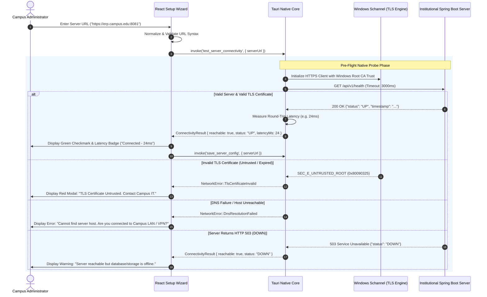

# EduPulse ERP — Backend Health & Connectivity Architecture
## Work Package 04C — Connectivity Probing, Health Monitoring & Fault Recovery

**Project:** EduPulse ERP — Desktop Transition Sprint (Week 00 / Day 02)
**Target Platform:** Windows 10 / Windows 11 Enterprise (Tauri v2 + Spring Boot 3.3.4)
**Author:** Antigravity AI Engineering Assistant (Architecture Baseline)
**Date:** 2 November 2026
**Document Status:** Approved Engineering Architecture Specification

---

## 1. Executive Summary & Codebase Audit Findings

A resilient desktop ERP must maintain active awareness of network connectivity and server availability. In higher education environments, network disruptions occur regularly due to intermittent Wi-Fi coverage, campus subnet routing shifts, and off-campus VPN transitions.

### 1.1 Empirical Audit of Existing Spring Boot Health Endpoints
An inspection of the backend source code confirms that EduPulse **already contains an active, public health controller**:
- **Source File:** `backend/src/main/java/com/erp/common/controller/HealthController.java`
- **Mapped Endpoints:**
  ```java
  @GetMapping({"/api/health", "/api/v1/health", "/actuator/health"})
  ```
- **Security Policy:** Explicitly configured as `.permitAll()` in `SecurityConfig.java:46`:
  ```java
  .requestMatchers("/api/health", "/api/v1/health", "/actuator/health").permitAll()
  ```
- **Response Payload:** Returns HTTP 200 OK with:
  ```json
  {
    "status": "UP",
    "timestamp": "2026-11-02T14:45:00.123Z"
  }
  ```
  *(If persistent storage is unmounted or read-only, it returns HTTP 503 SERVICE_UNAVAILABLE with `"status": "DOWN"`).*

The desktop health monitoring system directly leverages these verified endpoints.

---

## 2. Initial Connection Verification (Pre-Flight Setup Probe)

When an administrator or user configures a new server URL in the Initial Setup Wizard, the desktop shell executes an automated pre-flight probe before persisting the setting to disk:



---

## 3. Connection Timeouts & TLS Security Policy

### 3.1 Strict Timeout Parameters
To avoid hanging UI threads during network drops:

```
+------------------------------------+-----------------------+---------------------------------------------------+
| Timeout Parameter                  | Duration Threshold    | Architectural Justification                       |
+------------------------------------+-----------------------+---------------------------------------------------+
| Pre-Flight Health Probe Connect    | 2,000 ms (2.0s)       | Fast feedback during initial server setup.        |
| Pre-Flight Health Probe Read       | 3,000 ms (3.0s)       | Total setup probe window capped at 5s.            |
| Active REST API Connect Timeout    | 5,000 ms (5.0s)       | Accommodates congested campus Wi-Fi connections.  |
| Active REST API Read Timeout       | 15,000 ms (15.0s)     | Matches existing Axios config (api.ts:17).        |
| Heavy Report Generation Timeout    | 60,000 ms (60.0s)     | For large student grade sheets & PDF exports.     |
+------------------------------------+-----------------------+---------------------------------------------------+
```

### 3.2 TLS Certificate Validation & Zero-Bypass Policy
- **STRICT PROHIBITION:** The native layer and WebView2 will **never bypass TLS certificate validation**. Flags such as `danger_accept_invalid_certs(true)`, `rejectUnauthorized: false`, or ignoring certificate errors are strictly prohibited in all codebases.
- **Windows Root CA Store Integration:** The Rust native probe utilizes `native-tls` (backed by Windows Schannel and CryptoAPI), automatically inheriting all corporate, institutional, and government root certificates deployed via Active Directory Group Policy.
- **Institutional Custom Root CAs:** If a university operates an internal private Public Key Infrastructure (PKI), the desktop configuration schema supports `security.custom_ca_cert_path` pointing to an approved PEM/CRT certificate bundle.

---

## 4. DNS Failures & Campus Split-Horizon DNS Realities

Higher education campuses frequently utilize **Split-Horizon DNS**:
- When connected to **Campus Wi-Fi / LAN**, `erp.campus.edu` resolves to internal IP `10.0.5.20`.
- When connected to **Public Home Internet without VPN**, `erp.campus.edu` either resolves to a public DMZ gateway or fails with `NXDOMAIN`.

### Operational Handling:
1. **Error Detection:** When DNS query fails (`WSAHOST_NOT_FOUND` / `11001`), the native layer intercepts the error and flags `NetworkError::DnsResolutionFailed`.
2. **Actionable UI Guidance:** The application surfaces an immediate helper modal:
   > **"Campus Network Not Found"**
   > *EduPulse cannot reach your institution's internal network (`erp.campus.edu`). If you are working remotely, please connect to your college VPN and retry.*
3. **Automatic Reconnection:** As soon as the user connects to the institutional VPN, the background probe detects DNS resolution and restores the active session automatically.

---

## 5. Network Failure, Retry Policies & Idempotency Safeguards

To prevent duplicate database mutations (e.g. charging student fees twice or duplicate exam enrollment):

```
+----------------------------------------------------------------------------------------------------+
|                                    HTTP METHOD RETRY POLICY MATRIX                                 |
+-------------+-----------------------+---------------------+----------------------------------------+
| HTTP Method | Idempotent Standard   | Automated Retries   | Backoff Strategy                       |
+-------------+-----------------------+---------------------+----------------------------------------+
| GET         | YES (RFC 9110)        | 3 Retries           | Exponential Backoff (1s, 2s, 4s)       |
| HEAD        | YES (RFC 9110)        | 3 Retries           | Exponential Backoff (1s, 2s, 4s)       |
| OPTIONS     | YES (RFC 9110)        | 3 Retries           | Exponential Backoff (1s, 2s, 4s)       |
| POST        | NO (Unsafe mutation)  | ZERO Retries        | Fails immediately with error toast     |
| PUT         | CONDITIONAL (By spec) | ZERO Retries (Safe) | Requires user-confirmed retry          |
| PATCH       | NO (Non-idempotent)   | ZERO Retries        | Requires user-confirmed retry          |
| DELETE      | CONDITIONAL (By spec) | ZERO Retries (Safe) | Requires user-confirmed retry          |
+-------------+-----------------------+---------------------+----------------------------------------+
```

*Exception:* If a mutation request includes a verified `Idempotency-Key` header (supported in `CorsConfig.java:20`), the client may safely retry up to two times.

---

## 6. Health-Check Frequency & Background Polling Intervals

To minimize unnecessary server load across hundreds of active campus workstations while maintaining real-time awareness of server state:

```
+-----------------------------------+-----------------------+---------------------------------------------------+
| Application Operating State       | Polling Frequency     | Targeted Endpoint                                 |
+-----------------------------------+-----------------------+---------------------------------------------------+
| Active Window in Foreground       | Every 30 Seconds      | `GET /api/v1/health` (Lightweight probe)          |
| Window Minimized to Taskbar/Tray  | Every 120 Seconds     | `GET /api/v1/health`                              |
| System Idle (>15m no user input)  | Polling Suspended     | None (Saves server resources)                     |
| Disconnected / Outage State       | Exponential Backoff   | 5s, 10s, 20s, capped at max 60s                   |
+-----------------------------------+-----------------------+---------------------------------------------------+
```

---

## 7. User-Facing Connection Status Indicators

The desktop UI communicates real-time connection status across three visual zones:

1. **Header Status Dot:**
   - **Green Pulse Dot:** *"Connected to City Engineering College (22ms)"*
   - **Amber Warning Dot:** *"Connection Latency High (>500ms) or Degraded"*
   - **Red Dot:** *"Disconnected / Server Offline"*
2. **Persistent Non-Blocking Reconnection Banner:**
   Appears below the main header when connection drops:
   > ⚠️ **Connection Lost:** *Unable to reach `https://erp.campus.edu:8081`. Reconnecting in 5s... [Retry Now] [Work Offline]*
3. **Automatic Restoration Toast:**
   When connectivity returns:
   > 🟢 **Connection Restored:** *Reconnected to institutional server. Data refreshed.*
   *(TanStack Query queries are automatically invalidated and re-fetched).*

Proceed to **Work Package 04D: Multi-Institution and Campus Configuration Architecture**.
