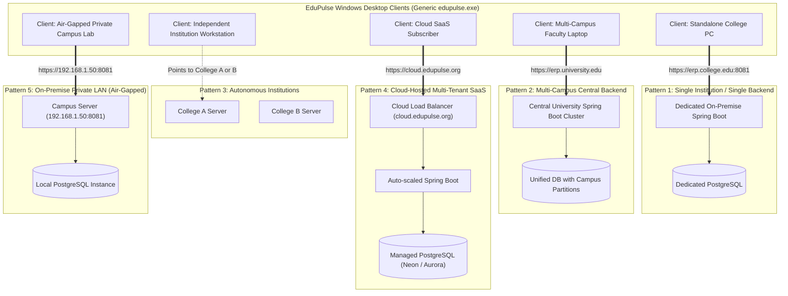

# EduPulse ERP — Multi-Institution Deployment Configuration
## Work Package 04D — Multi-Tenancy, Campus Topologies & Tenant Isolation

**Project:** EduPulse ERP — Desktop Transition Sprint (Week 00 / Day 02)
**Target Platform:** Windows 10 / Windows 11 Enterprise (Tauri v2 + Spring Boot 3.3.4)
**Author:** Antigravity AI Engineering Assistant (Architecture Baseline)
**Date:** 2 November 2026
**Document Status:** Approved Engineering Architecture Specification

---

## 1. Executive Summary & Core Definitions

EduPulse ERP is designed to serve a diverse spectrum of educational organizations—from standalone community colleges to sprawling state university systems with multiple physical campuses, as well as cloud-hosted software-as-a-service (SaaS) environments.

To ensure strict tenant isolation, avoid security vulnerabilities during server switching, and provide architectural clarity, this document establishes the formal definitions and boundaries governing **Institution Identity**, **Campus Identity**, and **Backend Network Endpoints**.

```
+----------------------------------------------------------------------------------------------------+
|                                    FOUNDATIONAL TENANCY DEFINITIONS                                |
+------------------------+---------------------------------------------------------------------------+
| Entity / Concept       | Definition & Architectural Role                                           |
+------------------------+---------------------------------------------------------------------------+
| Institution Identity   | The legal, accredited educational organization (e.g., "National Institute|
|                        | of Technology", Code: "NIT-DELHI", Database Entity: `institution`).       |
+------------------------+---------------------------------------------------------------------------+
| Campus Identity        | A physical or geographical facility operating under an institution        |
|                        | (e.g., "North Campus", "Medical Campus", "City Center Branch").           |
+------------------------+---------------------------------------------------------------------------+
| Backend Network URL    | The physical or logical transport endpoint where the Spring Boot API is   |
|                        | listening (e.g., "https://erp.nitdelhi.ac.in:8081" or cloud FQDN).         |
+------------------------+---------------------------------------------------------------------------+
```

---

## 2. Five Primary Architectural Deployment Topologies

The desktop application must support five distinct deployment patterns without requiring customized binaries:



---

### 2.1 Pattern 1: Single Institution with Single Dedicated Backend
- **Characteristics:** Standard deployment for a single autonomous college.
- **Topology:** One physical/virtual server running Spring Boot 3.3.4 (port 8081) and one PostgreSQL database.
- **Client Configuration:** Server URL is configured once via GPO or setup wizard (e.g., `https://erp.college.edu:8081`).
- **Tenancy:** Single-tenant database; `institution_id` in database has a single primary record.

### 2.2 Pattern 2: Multi-Campus Institution Using Unified Backend
- **Characteristics:** A large university with geographically distributed colleges or branch campuses (e.g., Engineering Campus, Medical Campus, Business School).
- **Topology:** A unified Spring Boot server cluster backed by a shared PostgreSQL database.
- **Client Configuration:** All desktop clients connect to the **same single URL** (`https://erp.stateuniversity.edu`).
- **Tenancy Enforcement:** Campus identity is **not** selected via URL switching. Instead, campus affinity is resolved via the user's authenticated role and department claims inside the JWT token (`user.getDepartment().getCampus()`).

### 2.3 Pattern 3: Multiple Independent Institutions Using Separate Backends
- **Characteristics:** Consortium of affiliated colleges where each institution hosts its own server and maintains physical data sovereignty.
- **Topology:** College A runs `https://erp.college-a.edu:8081`; College B runs `https://erp.college-b.edu:8081`.
- **Client Configuration:** Same generic EduPulse installer is used. IT at College A points GPO to College A's URL; IT at College B points GPO to College B's URL.

### 2.4 Pattern 4: Cloud-Hosted Multi-Tenant SaaS
- **Characteristics:** Commercial cloud deployment where small to mid-sized colleges subscribe without hosting local servers.
- **Topology:** Single central domain (`https://cloud.edupulse.org`).
- **Tenancy Enforcement:** Multi-tenancy is enforced through `tenant_id` headers or institutional slug subdomains (`https://citycollege.edupulse.org`).

### 2.5 Pattern 5: Institution-Hosted On-Premise Private LAN (Air-Gapped)
- **Characteristics:** High-security defense academy or government university with zero internet connectivity.
- **Topology:** Campus server operating on a private subnet (`https://192.168.1.50:8081` or `https://erp.campus.local:8081`).
- **Client Configuration:** The desktop application connects locally over LAN without ever contacting external cloud update servers.

---

## 3. Strict Tenant Isolation & Security Boundary During URL Switching

```
+----------------------------------------------------------------------------------------------------+
|                                    TENANT ISOLATION BOUNDARY RULES                                 |
+----------------------------------------------------------------------------------------------------+
| 1. Cross-Tenant Credential Replay Prohibited  | Tokens from Institution A must NEVER reach Inst B. |
| 2. Forensic Vault Wipe on URL Change          | Switching URL deletes DPAPI vault.dat immediately. |
| 3. Local SQLite Cache Purge                   | Switching URL clears all offline cached tables.    |
| 4. Memory Heap Sanitization                   | Zustand stores and Axios headers are wiped clean.  |
| 5. Mandatory Re-Authentication                | User must authenticate afresh on the new server.   |
+----------------------------------------------------------------------------------------------------+
```

### 3.1 Attack Scenario: Cross-Tenant Credential Bleed
If an administrative consultant or traveling faculty member switches their desktop connection from **College A** (`https://college-a.edu`) to **College B** (`https://college-b.edu`):
- If the application retained College A's refresh token and transmitted it to College B during an automated silent refresh, College A's credentials would be leaked to College B's server logs!
- If College B utilized identical JWT signing secrets (e.g. default development secrets), College A's token might mistakenly authenticate the user at College B, causing severe multi-tenant data corruption!

### 3.2 Automated Isolation Protocol (Native Enforcement):
Whenever a server URL change is requested via `save_server_config`:
```rust
pub async fn change_server_endpoint(
    new_url: String,
    state: tauri::State<'_, AppState>,
) -> Result<(), ConfigError> {
    // 1. Forensically wipe the DPAPI credential vault
    state.vault_manager.secure_clear_token()?;

    // 2. Drop all rows in the offline cache database
    state.offline_db.purge_all_cached_data().await?;

    // 3. Atomically persist the new normalized URL
    state.config_manager.update_server_url(&new_url)?;

    // 4. Emit native event to frontend to clear in-memory state
    state.emit("edupulse://server-changed", new_url)?;

    Ok(())
}
```

---

## 4. Institutional Metadata Resolution

When the desktop client connects to a validated backend endpoint, it queries the backend's institutional identity metadata:

### Endpoint: `GET /api/v1/health`
```json
{
  "status": "UP",
  "timestamp": "2026-11-02T14:50:00Z",
  "institution": {
    "id": 1,
    "code": "CITY-ENG-COLLEGE",
    "name": "City Engineering College",
    "portal_title": "EduPulse Institutional Portal",
    "theme_primary_color": "#1E40AF"
  }
}
```

The desktop shell caches this metadata to display the institution's official name and branded portal header on the login view, providing visual reassurance to faculty and students that they are connected to the correct campus server.

Proceed to **Work Package 04E: Endpoint Configuration Security Validation Plan**.
