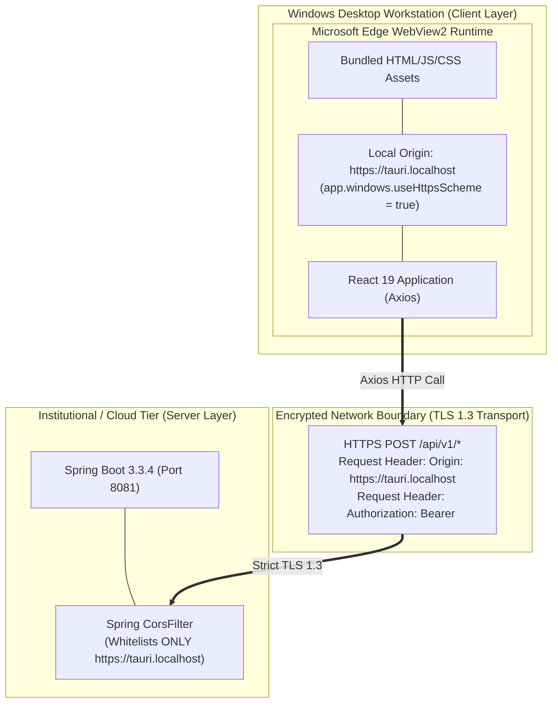
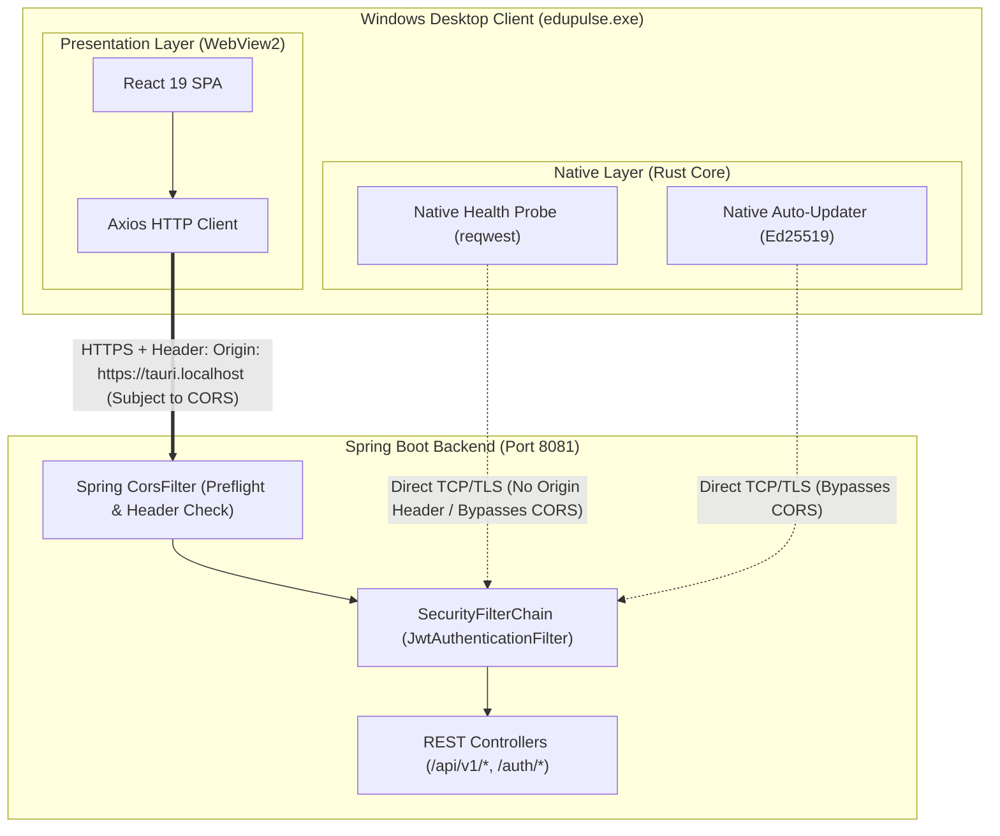
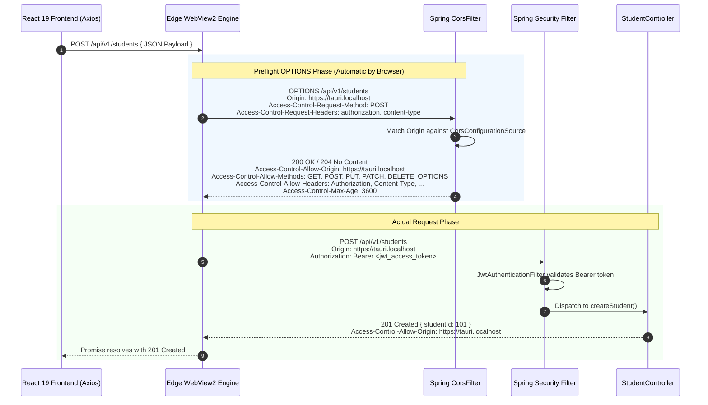

# EduPulse ERP — Tauri WebView2 CORS Architecture
## Work Package 05B — Cross-Origin Resource Sharing Specification for Windows Desktop

**Project:** EduPulse ERP — Desktop Transition Sprint (Week 00 / Day 02)
**Target Platform:** Windows 10 / Windows 11 Enterprise (Tauri v2 + Spring Boot 3.3.4)
**Author:** Antigravity AI Engineering Assistant (Architecture Baseline)
**Date:** 2 November 2026
**Document Status:** Approved Engineering Architecture Specification

---

## 1. Executive Summary & Core Architectural Premise

When a Single Page Application runs inside a standard web browser, its origin is defined by the web server serving the HTML (e.g., `https://erp.campus.edu` or `http://localhost:5173`). In **Tauri v2 on Windows**, the user interface is rendered inside **Microsoft Edge WebView2**, which loads local embedded static assets (`frontend-v2/dist`) under a dedicated local scheme.

### Official Tauri v2 Windows Origin Specification:
- **Default Windows WebView2 Origin:** **`http://tauri.localhost`** (Default custom protocol scheme on Windows).
- **Configured HTTPS Scheme:** Setting **`app.windows[].useHttpsScheme = true`** in `tauri.conf.json` elevates the local WebView origin to **`https://tauri.localhost`**.

Because WebView2 enforces standard W3C browser security rules, any HTTP request initiated from JavaScript (via Axios or `window.fetch()`) to an external Spring Boot backend (e.g. `https://erp.campus.edu:8081`) constitutes a **cross-origin request**.

```
+----------------------------------------------------------------------------------------------------+
|                                    CORS ARCHITECTURE AT A GLANCE                                   |
+------------------------------------+---------------------------------------------------------------+
| Selected Production Desktop Origin | `https://tauri.localhost` (via app.windows.useHttpsScheme=true)|
| Default Unconfigured Origin        | `http://tauri.localhost` (Default Tauri v2 Windows scheme)    |
| Browser Web Client Origins         | `https://erp.campus.edu`, `http://localhost:5173` (Dev)       |
| Preflight OPTIONS Interception     | Spring Security CorsFilter (Ordered FIRST before Auth)        |
| Credentialed Security Model        | `Authorization: Bearer <JWT>` (Stateless; zero session cookies)|
| Allowed Methods                    | `GET`, `POST`, `PUT`, `PATCH`, `DELETE`, `OPTIONS`             |
| Production Origin Policy           | Explicit Single Whitelist (No dual-scheme or wildcard clutter)|
| Native Rust HTTP Bypass            | Rust reqwest probes bypass CORS (No Origin header emitted)    |
+------------------------------------+---------------------------------------------------------------+
```

---

## 2. Fundamental Distinction: Local WebView Origin vs. HTTPS Backend API Connection

To avoid architectural confusion between local asset rendering and network transport, the distinction between the two layers must be explicitly understood:



### 1. The Local WebView Origin (`window.location.origin`):
- Operates entirely **inside the local desktop process**.
- By default in Tauri v2 on Windows, it is `http://tauri.localhost`.
- When `app.windows.useHttpsScheme = true` is configured, it becomes `https://tauri.localhost`.
- It dictates the value of the `Origin` header attached by WebView2 to outgoing `fetch()` and Axios requests.

### 2. The HTTPS Backend API Connection:
- The actual TCP/IP and TLS network connection between the client workstation and the Spring Boot server (`https://erp.campus.edu:8081` or `https://cloud.edupulse.org`).
- **Invariance:** This connection is **always encrypted over TLS/HTTPS**, with strict certificate chain verification against the Windows Root Certificate Store.
- **Independence:** The local WebView scheme does **not** alter, weaken, or downgrade backend network security. The backend API connection remains strictly HTTPS regardless of whether the local webview is running on `http://` or `https://`.

---

## 3. Browser / WebView2 Requests vs. Native Rust HTTP Requests

An essential architectural distinction exists between requests originating from the presentation layer versus the native runtime:



1. **WebView2 Presentation Requests (Subject to CORS):**
   - Initiated by React via Axios (`apiClient.get()`, `apiClient.post()`).
   - WebView2 automatically injects the request header: `Origin: https://tauri.localhost`.
   - The browser runtime mandates preflight `OPTIONS` requests for non-simple methods (`PUT`, `DELETE`, `PATCH`, or `Content-Type: application/json`).
   - If Spring Boot does not return `Access-Control-Allow-Origin: https://tauri.localhost`, WebView2 blocks the response before React can read it.
2. **Native Rust Requests (Bypass CORS):**
   - Initiated by the Rust core via `reqwest` for initial connectivity testing (`test_server_connectivity`), server health checks, and update downloads.
   - These are native socket connections that **do not execute within a web browser context**. They emit no `Origin` header and are completely immune to CORS restrictions.

---

## 4. Preflight OPTIONS Request Lifecycle

When the React desktop frontend executes a mutating call (such as student registration or grade submission):



---

## 5. Hardening Production CORS: Explicit Single-Origin Policy

### 5.1 Rejection of Blind Dual-Scheme Whitelisting
A common but flawed pattern is blindly adding both `http://tauri.localhost` and `https://tauri.localhost` to the backend CORS configuration.

**Architectural Policy for EduPulse:**
- **Do not blindly whitelist both HTTP and HTTPS origins.**
- Whitelisting an unencrypted HTTP origin in a production enterprise backend weakens the security posture and creates configuration ambiguity.
- Instead, the application must **explicitly select, configure, and validate ONE production origin**.

### 5.2 Recommendation: Explicit `https://tauri.localhost` via `useHttpsScheme`
EduPulse explicitly standardizes on **`https://tauri.localhost`** for production desktop deployment by declaring in `src-tauri/tauri.conf.json`:

```json
{
  "app": {
    "windows": [
      {
        "title": "EduPulse ERP",
        "useHttpsScheme": true
      }
    ]
  }
}
```

#### Strategic Advantages:
1. **Secure Context Compliance:** Modern web standards (Web Crypto API, secure storage interfaces, credential management) require a Secure Context (`isSecureContext === true`). An `https://` origin satisfies this natively in WebView2.
2. **Deterministic Backend Whitelisting:** Spring Boot whitelists strictly `https://tauri.localhost`, rejecting any unauthorized or downgraded `http://` variants.
3. **Institutional Security Audit Compliance:** Campus security auditors require all client-facing origin definitions to reflect HTTPS.

### 5.3 Target Production CORS Configuration (`application.yml`):

```yaml
edupulse:
  security:
    cors:
      allowed-origins:
        - "https://tauri.localhost"              # Validated Single Desktop Production Origin
        - "https://erp.campus.edu"               # Production Institutional Web Portal
        - "https://cloud.edupulse.org"           # Multi-Tenant Cloud Web Portal
      allowed-dev-origins:
        - "http://localhost:5173"                # Vite Web Dev Server (Development Only)
        - "http://localhost:3000"
      max-age-seconds: 3600
```

### 5.4 Proposed Production `CorsConfig.java` Bean:
```java
@Configuration
public class CorsConfig {

    @Value("${edupulse.security.cors.allowed-origins:https://tauri.localhost}")
    private List<String> allowedOrigins;

    @Value("${edupulse.security.cors.max-age-seconds:3600}")
    private long maxAge;

    @Bean
    public CorsConfigurationSource corsConfigurationSource() {
        CorsConfiguration config = new CorsConfiguration();

        // Explicitly set single validated production origins (Never use wildcard "*" with credentials)
        config.setAllowedOrigins(allowedOrigins);
        config.setAllowCredentials(true);
        config.setAllowedHeaders(Arrays.asList(
            "Origin", "Content-Type", "Accept", "Authorization",
            "X-Requested-With", "Idempotency-Key", "idempotency-key"
        ));
        config.setAllowedMethods(Arrays.asList(
            "GET", "POST", "PUT", "PATCH", "DELETE", "OPTIONS"
        ));
        config.setExposedHeaders(Arrays.asList(
            "Authorization", "Content-Disposition"
        ));
        config.setMaxAge(maxAge);

        UrlBasedCorsConfigurationSource source = new UrlBasedCorsConfigurationSource();
        source.registerCorsConfiguration("/**", config);
        return source;
    }
}
```

---

## 6. Spring Security Filter Chain Ordering Guarantees

In Spring Security 6 / Spring Boot 3.3.4, CORS preflight handling must occur before authentication filters to prevent unauthenticated preflight rejections.

```
+----------------------------------------------------------------------------------------------------+
|                                    SPRING SECURITY FILTER PIPELINE                                 |
+-------+-------------------------------+------------------------------------------------------------+
| Order | Filter Class                  | Purpose & Operational Behavior                             |
+-------+-------------------------------+------------------------------------------------------------+
| 1     | `CorsFilter`                  | Inspects HTTP method and Origin. If `OPTIONS`, resolves    |
|       |                               | CORS headers and returns 200/204 immediately.              |
+-------+-------------------------------+------------------------------------------------------------+
| 2     | `CsrfFilter` (Disabled)       | Disabled via `csrf(AbstractHttpConfigurer::disable)` since |
|       |                               | API relies on stateless Bearer JWTs, not session cookies.  |
+-------+-------------------------------+------------------------------------------------------------+
| 3     | `JwtAuthenticationFilter`     | Extracts `Authorization: Bearer <token>`, validates token, |
|       |                               | checks revocation in SessionService, populates context.   |
+-------+-------------------------------+------------------------------------------------------------+
| 4     | `ExceptionTranslationFilter`  | Translates AuthenticationException to 401 Unauthorized.    |
+-------+-------------------------------+------------------------------------------------------------+
| 5     | `AuthorizationFilter`         | Evaluates method security (`@PreAuthorize`) and RBAC roles.|
+-------+-------------------------------+------------------------------------------------------------+
```

*Verification:* Line 38 of `SecurityConfig.java` (`.cors(Customizer.withDefaults())`) guarantees that `CorsFilter` executes prior to `JwtAuthenticationFilter`.

---

## 7. Development vs. Production Origin Matrix

```
+-----------------------------------+-----------------------------------+-----------------------------------+
| Origin URI                        | Development Environment           | Production Environment            |
+-----------------------------------+-----------------------------------+-----------------------------------+
| `https://tauri.localhost`         | ALLOWED (useHttpsScheme = true)   | ALLOWED (Explicit Desktop Origin) |
| `http://tauri.localhost`          | ALLOWED (Default unconfigured dev)| REJECTED (Blocked in Production)  |
| `http://localhost:5173`           | ALLOWED (Vite HMR dev server)     | REJECTED (Blocked)                |
| `https://erp.campus.edu`          | OPTIONAL (Local override)         | ALLOWED (Institutional Domain)    |
| `*` (Arbitrary Internet Origins)  | ALLOWED (Flexible development)    | REJECTED (Strict Security Rule)   |
+-----------------------------------+-----------------------------------+-----------------------------------+
```

Proceed to **Work Package 05C: Unified Web and Desktop API Compatibility**.
