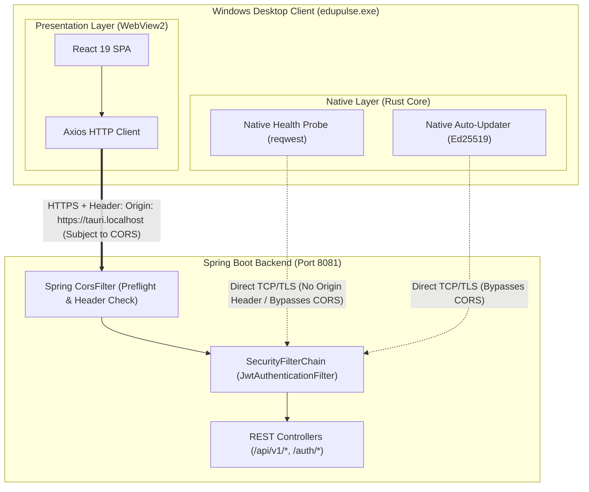
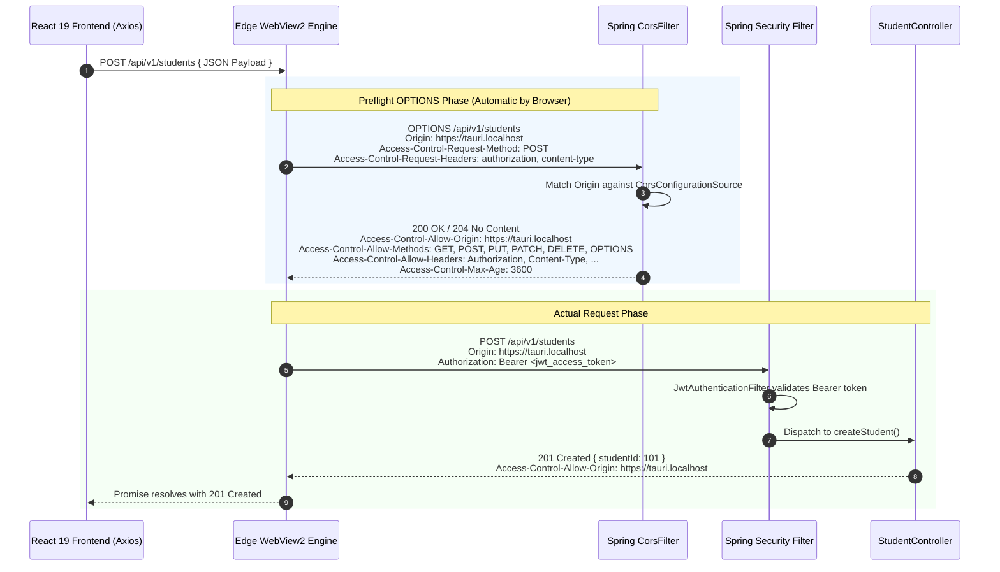

# EduPulse ERP — Tauri WebView2 CORS Architecture
## Work Package 05B — Cross-Origin Resource Sharing Specification for Windows Desktop

**Project:** EduPulse ERP — Desktop Transition Sprint (Week 00 / Day 02)
**Target Platform:** Windows 10 / Windows 11 Enterprise (Tauri v2 + Spring Boot 3.3.4)
**Author:** Antigravity AI Engineering Assistant (Architecture Baseline)
**Date:** 2 November 2026
**Document Status:** Approved Engineering Architecture Specification

---

## 1. Executive Summary & Core Architectural Premise

When a Single Page Application runs inside a standard web browser, its origin is defined by the web server serving the HTML (e.g., `https://erp.campus.edu` or `http://localhost:5173`). In **Tauri v2 on Windows**, the user interface is rendered inside **Microsoft Edge WebView2**, which loads local embedded static assets (`frontend-v2/dist`) under a dedicated local scheme:
- **Default Windows WebView2 Origin:** `https://tauri.localhost` (or `http://tauri.localhost` in legacy modes).

Because WebView2 enforces standard W3C browser security rules, any HTTP request initiated from JavaScript (via Axios or `window.fetch()`) to an external Spring Boot backend (e.g. `https://erp.campus.edu:8081`) constitutes a **cross-origin request**.

This specification defines the complete CORS architecture ensuring seamless, secure communication for both the web application and the Windows desktop client.

```
+----------------------------------------------------------------------------------------------------+
|                                    CORS ARCHITECTURE AT A GLANCE                                   |
+------------------------------------+---------------------------------------------------------------+
| Desktop Client Origin              | `https://tauri.localhost`                                     |
| Browser Web Client Origins         | `https://erp.campus.edu`, `http://localhost:5173` (Dev)       |
| Preflight OPTIONS Interception     | Spring Security CorsFilter (Ordered FIRST before Auth)        |
| Credentialed Security Model        | `Authorization: Bearer <JWT>` (Stateless; zero session cookies)|
| Allowed Methods                    | `GET`, `POST`, `PUT`, `PATCH`, `DELETE`, `OPTIONS`             |
| Production Origin Policy           | Explicit Whitelist (Zero unrestricted wildcards)             |
| Native Rust HTTP Bypass            | Rust reqwest probes bypass CORS (No Origin header)           |
+------------------------------------+---------------------------------------------------------------+
```

---

## 2. Browser / WebView2 Requests vs. Native Rust HTTP Requests

An essential architectural distinction exists between requests originating from the presentation layer versus the native runtime:



1. **WebView2 Presentation Requests (Subject to CORS):**
   - Initiated by React via Axios (`apiClient.get()`, `apiClient.post()`).
   - WebView2 automatically injects the request header: `Origin: https://tauri.localhost`.
   - The browser runtime mandates preflight `OPTIONS` requests for non-simple methods (`PUT`, `DELETE`, `PATCH`, or `Content-Type: application/json`).
   - If Spring Boot does not return `Access-Control-Allow-Origin: https://tauri.localhost`, WebView2 blocks the response before React can read it.
2. **Native Rust Requests (Bypass CORS):**
   - Initiated by the Rust core via `reqwest` for initial connectivity testing (`test_server_connectivity`), server health checks, and update downloads.
   - These are native socket connections that **do not execute within a web browser context**. They emit no `Origin` header and are completely immune to CORS restrictions.

---

## 3. Preflight OPTIONS Request Lifecycle

When the React desktop frontend executes a mutating call (such as student registration or grade submission):



---

## 4. Hardening Production CORS: Eliminating Wildcard Patterns

### 4.1 Vulnerability of the Current Implementation
As audited in WP05A, `backend/src/main/java/com/erp/config/CorsConfig.java` currently uses:
```java
config.setAllowCredentials(true);
config.setAllowedOriginPatterns(Arrays.asList("*"));
```
While functional during initial prototyping, this dynamically reflects *any* origin back in `Access-Control-Allow-Origin`. If a campus faculty member visits a malicious website while logged into their browser, the malicious site can execute authenticated API requests against an on-premise ERP server reachable on the user's intranet.

### 4.2 Target Production CORS Configuration
The proposed architecture externalizes allowed origins into `application.yml`, combining institutional web FQDNs with the Tauri desktop origin:

```yaml
# Target application.yml configuration
edupulse:
  security:
    cors:
      allowed-origins:
        - "https://tauri.localhost"              # Tauri Windows Desktop Edition
        - "http://tauri.localhost"               # Tauri legacy loopback fallback
        - "https://erp.campus.edu"               # Production Institutional Web Portal
        - "https://cloud.edupulse.org"           # Multi-Tenant Cloud Web Portal
      allowed-dev-origins:
        - "http://localhost:5173"                # Vite Web Dev Server
        - "http://localhost:3000"                # Alternative Dev Server
        - "http://127.0.0.1:5173"
      max-age-seconds: 3600
```

### 4.3 Proposed Production `CorsConfig.java` Bean:
```java
@Configuration
public class CorsConfig {

    @Value("${edupulse.security.cors.allowed-origins:https://tauri.localhost}")
    private List<String> allowedOrigins;

    @Value("${edupulse.security.cors.max-age-seconds:3600}")
    private long maxAge;

    @Bean
    public CorsConfigurationSource corsConfigurationSource() {
        CorsConfiguration config = new CorsConfiguration();

        // Explicitly set allowed origins (Never use wildcard "*" with credentials)
        config.setAllowedOrigins(allowedOrigins);
        config.setAllowCredentials(true);
        config.setAllowedHeaders(Arrays.asList(
            "Origin", "Content-Type", "Accept", "Authorization",
            "X-Requested-With", "Idempotency-Key", "idempotency-key"
        ));
        config.setAllowedMethods(Arrays.asList(
            "GET", "POST", "PUT", "PATCH", "DELETE", "OPTIONS"
        ));
        config.setExposedHeaders(Arrays.asList(
            "Authorization", "Content-Disposition"
        ));
        config.setMaxAge(maxAge);

        UrlBasedCorsConfigurationSource source = new UrlBasedCorsConfigurationSource();
        source.registerCorsConfiguration("/**", config);
        return source;
    }
}
```

---

## 5. Spring Security Filter Chain Ordering Guarantees

In Spring Security 6 / Spring Boot 3.3.4, CORS preflight handling must occur before authentication filters to prevent unauthenticated preflight rejections.

```
+----------------------------------------------------------------------------------------------------+
|                                    SPRING SECURITY FILTER PIPELINE                                 |
+-------+-------------------------------+------------------------------------------------------------+
| Order | Filter Class                  | Purpose & Operational Behavior                             |
+-------+-------------------------------+------------------------------------------------------------+
| 1     | `CorsFilter`                  | Inspects HTTP method and Origin. If `OPTIONS`, resolves    |
|       |                               | CORS headers and returns 200/204 immediately.              |
+-------+-------------------------------+------------------------------------------------------------+
| 2     | `CsrfFilter` (Disabled)       | Disabled via `csrf(AbstractHttpConfigurer::disable)` since |
|       |                               | API relies on stateless Bearer JWTs, not session cookies.  |
+-------+-------------------------------+------------------------------------------------------------+
| 3     | `JwtAuthenticationFilter`     | Extracts `Authorization: Bearer <token>`, validates token, |
|       |                               | checks revocation in SessionService, populates context.   |
+-------+-------------------------------+------------------------------------------------------------+
| 4     | `ExceptionTranslationFilter`  | Translates AuthenticationException to 401 Unauthorized.    |
+-------+-------------------------------+------------------------------------------------------------+
| 5     | `AuthorizationFilter`         | Evaluates method security (`@PreAuthorize`) and RBAC roles.|
+-------+-------------------------------+------------------------------------------------------------+
```

*Verification:* Line 38 of `SecurityConfig.java` (`.cors(Customizer.withDefaults())`) guarantees that `CorsFilter` executes prior to `JwtAuthenticationFilter`.

---

## 6. Development vs. Production Origin Matrix

```
+-----------------------------------+-----------------------------------+-----------------------------------+
| Origin URI                        | Development Environment           | Production Environment            |
+-----------------------------------+-----------------------------------+-----------------------------------+
| `https://tauri.localhost`         | ALLOWED (Tauri desktop preview)   | ALLOWED (Primary Desktop Origin)  |
| `http://tauri.localhost`          | ALLOWED (Debug desktop builds)    | ALLOWED (Fallback Desktop Origin) |
| `http://localhost:5173`           | ALLOWED (Vite HMR dev server)     | REJECTED (Blocked)                |
| `https://erp.campus.edu`          | OPTIONAL (Local override)         | ALLOWED (Institutional Domain)    |
| `*` (Arbitrary Internet Origins)  | ALLOWED (Flexible development)    | REJECTED (Strict Security Rule)   |
+-----------------------------------+-----------------------------------+-----------------------------------+
```

Proceed to **Work Package 05C: Unified Web and Desktop API Compatibility**.
