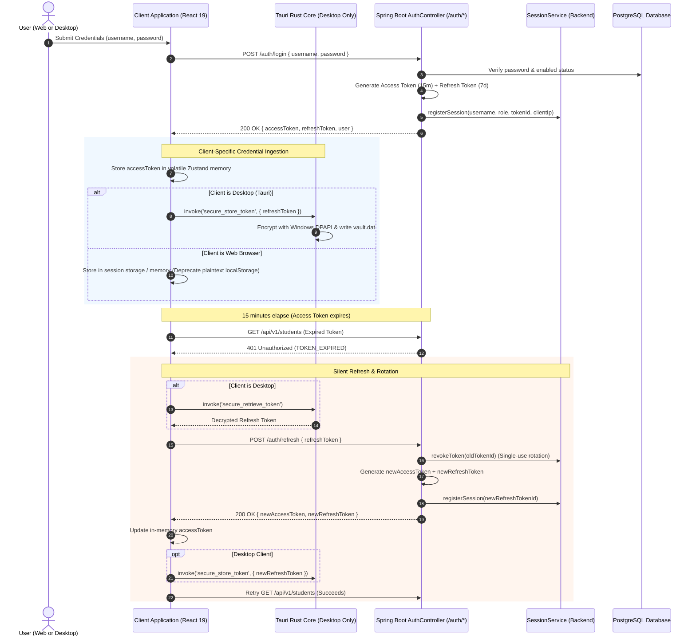

# EduPulse ERP — Web & Desktop Authentication Compatibility
## Work Package 05D — Coordinated Authentication Architecture & Backend Remediation

**Project:** EduPulse ERP — Desktop Transition Sprint (Week 00 / Day 02)
**Target Platform:** Windows 10 / Windows 11 Enterprise (Tauri v2 + Spring Boot 3.3.4)
**Author:** Antigravity AI Engineering Assistant (Security Baseline)
**Date:** 2 November 2026
**Document Status:** Approved Engineering Architecture Specification

---

## 1. Executive Summary & Dual-Client Authentication Strategy

EduPulse ERP requires a unified backend authentication architecture capable of supporting both browser-hosted web users (e.g. students accessing portal from home) and enterprise desktop users (e.g. faculty, registrars, and finance officers running `edupulse.exe` on Windows workstations).

While the wire protocol (`POST /auth/login`, `POST /auth/refresh`, `POST /auth/logout`) and token signing (HMAC-SHA256 JJWT) are completely identical between web and desktop clients, the **client-side storage boundary** diverges significantly:

```
+----------------------------------------------------------------------------------------------------+
|                                    CLIENT STORAGE DIVERGENCE SUMMARY                               |
+------------------------------------+-------------------------------+-------------------------------+
| Dimension                          | Web Application Client        | Windows Desktop Client (Tauri)|
+------------------------------------+-------------------------------+-------------------------------+
| Access Token Storage (15-min)      | Volatile JS Heap / Zustand    | Volatile JS Heap / Zustand    |
| Refresh Token Storage (7-day)      | Browser localStorage (Legacy) | Windows DPAPI Vault (%APPDATA%)|
| Persistence Across App Restart     | Vulnerable to XSS extraction  | Protected by Windows User SID |
| Multi-Device Identification        | User-Agent String             | Client Workstation Device ID  |
| Server Switching Capability        | Bound to domain origin        | Supported with dynamic purge  |
+------------------------------------+-------------------------------+-------------------------------+
```

---

## 2. Coordinated Authentication Protocol



---

## 3. Explicit Backend Remediation Requirements (WP03 Defects)

During the empirical security audit of `AuthController.java`, `AuthService.java`, and `SessionService.java` in Work Package 03, critical architectural limitations were uncovered. To ensure production enterprise security for both web and desktop clients, these defects are formally recorded as **mandatory backend remediation requirements**:

```
+----+----------------------------------+-----------------------+------------------------------------+
| ID | Identified Backend Defect        | Current Impact        | Required Backend Production Fix    |
+----+----------------------------------+-----------------------+------------------------------------+
| R1 | In-Memory Token Revocation Map   | Critical Defect       | Migrate `SessionService:19` from   |
|    | (`ConcurrentHashMap<String,Date>`) | Server restart wipes | `ConcurrentHashMap` to persistent  |
|    |                                  | all blacklists! Stolen| database table `revoked_tokens` or |
|    |                                  | tokens become valid!  | Redis distributed cache.           |
+----+----------------------------------+-----------------------+------------------------------------+
| R2 | Single Session Per Username Bug  | Functional Defect     | Replace single-entry map with      |
|    | (`activeSessions.put(username)`) | Login on PC-2 kills   | multi-device session tracking      |
|    |                                  | session on PC-1!      | keyed by `(username, device_id)`.  |
+----+----------------------------------+-----------------------+------------------------------------+
| R3 | Refresh Token Leak on Logout     | Security Defect       | Update `AuthController.logout()` to|
|    | (`logout` ignores refresh token) | Refresh token remains | accept `{ refreshToken }` and add  |
|    |                                  | unrevoked in backend! | its JTI to the revocation table.   |
+----+----------------------------------+-----------------------+------------------------------------+
| R4 | Password Change Ignores Sessions | Security Defect       | In `AuthService.changePassword()`, |
|    | (No session invalidation called) | Stolen tokens remain  | call `sessionService.invalidateAll`|
|    |                                  | valid after pwd change| to revoke all existing user tokens.|
+----+----------------------------------+-----------------------+------------------------------------+
| R5 | Disabled User Bypass in Filter   | Security Defect       | In `JwtAuthenticationFilter:86`,   |
|    | (`filter` omits isEnabled check) | Disabled user can make| enforce `userDetails.isEnabled()`; |
|    |                                  | API calls until expiry| reject with 403 Forbidden if false.|
+----+----------------------------------+-----------------------+------------------------------------+
```

---

## 4. Multi-Device & Concurrent Session Coordination

In a university setting, a faculty member frequently runs the desktop application in their department office while accessing the portal via mobile browser.

### 4.1 Required Composite Session Model
To eliminate the single-session collision bug (Defect R2), the backend session registry will be refactored to support composite session identifiers:

```java
public record UserSessionKey(String username, String clientType, String deviceId) {}

// Storage model in SessionService:
// ConcurrentMap<UserSessionKey, UserSessionInfo> activeSessions
```

- **Web Client:** Transmits `X-Client-Type: WEB` with a persistent browser fingerprint or session UUID.
- **Desktop Client:** Transmits `X-Client-Type: DESKTOP` with the machine-specific hardware GUID derived from Windows Machine GUID.
- **Result:** Office PC session, home laptop session, and mobile web session coexist independently without premature session invalidation.

---

## 5. Server Switching & Institutional Tenant Isolation

When a desktop user switches the backend server URL (e.g. from Staging to Production, or between affiliated colleges):

```
+----------------------------------------------------------------------------------------------------+
|                                    ISOLATION DIRECTIVE: ZERO CROSS-TALK                            |
+------------------------------------+---------------------------------------------------------------+
| Client Memory Eviction             | Zustand auth state (`token`, `user`, `roles`) set to null.    |
| Native Vault Overwrite             | `%APPDATA%\vault.dat` overwritten with random bytes and unlinked|
| Local SQLite Cache Purge           | `DELETE FROM offline_cache` executed in native database.      |
| Network Header Reset               | Axios `Authorization` header completely removed.              |
| Forced Fresh Login                 | User directed to `/login` against the new institutional URL.  |
+------------------------------------+---------------------------------------------------------------+
```

*Guarantee:* Under no circumstances will credentials or cached data issued by Institution A be transmitted to Institution B.

Proceed to **Work Package 05E: CORS and API Compatibility Validation Plan**.
