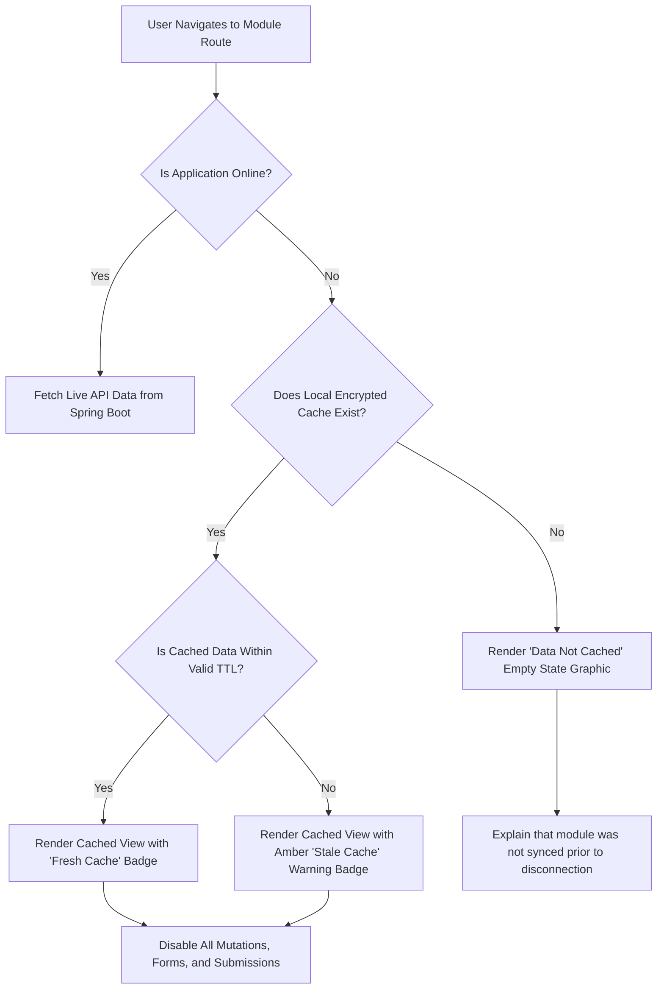

# EduPulse ERP — Day 02, Work Package 06
# Deliverable 06a: Offline Requirements, Scope, and Feature Availability Matrix

## 1. Executive Summary and Operational Rationale

Educational institutions in developing and emerging markets frequently operate in challenging technical environments. School campuses, colleges, and polytechnics experience frequent disruptions:
- Intermittent WAN/broadband connectivity and ISP upstream fiber cuts.
- Bandwidth saturation during morning peak arrival hours when hundreds of staff and thousands of students access campus networks simultaneously.
- Unscheduled power outages causing campus router restarts, PoE switch resets, and temporary local area network (LAN) severance.
- Geographically isolated rural or satellite campuses with high-latency 4G/satellite links.

When network connectivity fails, institutional operations cannot completely halt. Academic staff require immediate access to class schedules, student emergency contact numbers, medical alerts, and course syllabi. Front-office administrators must be able to verify student enrollments and fee receipt history even during prolonged connectivity drops.

### Core Architectural Principle: Strictly Read-Only Offline Initial Release

To maintain data integrity across the 259 modules of EduPulse ERP, **the initial desktop offline architecture is strictly READ-ONLY**.

```
+-----------------------------------------------------------------------------------+
|                            AUTHORITY HIERARCHY                                   |
|                                                                                   |
|   +---------------------------------------------------------------------------+   |
|   |                  PostgreSQL Database & Spring Boot 3.3.4                  |   |
|   |         SOLE AUTHORITATIVE SYSTEM OF RECORD & BUSINESS LOGIC ENGINE       |   |
|   +---------------------------------------------------------------------------+   |
|                                     |                                             |
|                             One-Way Downstream                                    |
|                             Replication & Cache                                   |
|                                     v                                             |
|   +---------------------------------------------------------------------------+   |
|   |              Tauri v2 Desktop Local Storage (SQLCipher / SQLite)           |   |
|   |                 EPHEMERAL, READ-ONLY, DOWNSTREAM PROJECTION               |   |
|   |          * No offline writes  * No offline queuing  * No mutations        |   |
|   +---------------------------------------------------------------------------+   |
+-----------------------------------------------------------------------------------+
```

The desktop application functions as an ephemeral, read-only downstream projection of the authoritative PostgreSQL database. Spring Boot remains the single source of truth and the exclusive validation and business-logic authority.

---

## 2. Supported vs. Unsupported Scenarios

### 2.1 Supported Scenarios (Read-Only Queries Against Cached Data)

The following operational tasks are fully supported in offline mode, provided the data has been previously synchronized during an authenticated online session:

1. **Student Profile Lookup:** Viewing basic student demographics, student ID, roll number, assigned grade/section, parent/guardian contact information, and blood group/medical alerts.
2. **Timetable & Schedule Inspection:** Viewing daily, weekly, and monthly class schedules, teacher room assignments, substitution notices, and lab schedules.
3. **Curriculum & Academic Resources:** Browsing course catalogs, syllabi, unit lesson plans, reference reading lists, and academic calendar events.
4. **Institutional Announcements:** Reading cached notices, administrative circulars, holiday schedules, and department memoranda.
5. **Fee Structure & Historical Receipts:** Viewing student fee categories, historical fee receipts, payment ledger summaries, and dues calculations generated prior to disconnection.
6. **Library Catalog Inquiries:** Searching book titles, authors, ISBNs, shelf/rack locations, and checking historical borrowing records.
7. **Emergency Contacts & Transport Routes:** Accessing school bus routes, pickup points, driver/attendant contact numbers, and campus infirmary contact protocols.

### 2.2 Unsupported Scenarios (Prohibited Offline Mutations)

The following actions are **strictly prohibited** when the desktop client is disconnected from the Spring Boot backend:

| Prohibited Action | Operational Rationale for Prohibition |
| :--- | :--- |
| **Attendance Submission** | Prevents concurrent overwrites by multiple teachers, prevents falsification of attendance records on unmonitored local machines, and guarantees immediate SMS/push alert dispatch to parents. |
| **Marks & Grade Entry** | Preserves academic audit trails, prevents conflicting grade edits by co-evaluators, and enforces server-side GPA/CGPA computation formulas. |
| **Student Admission & Registration** | Guarantees uniqueness of institutional Student Roll Numbers, national student identifiers, and avoids database sequence collisions. |
| **Fee Collection & Payment Processing** | Compliance with financial reconciliation standards, cash receipt sequential numbering, anti-double-spending guarantees, and regulatory auditing mandates. |
| **Library Book Issue & Return** | Prevents multiple desktop clients from concurrently issuing the same physical copy of a book to different students. |
| **User Profile & Credential Changes** | Password resets, email updates, and role modifications require live authentication and active directory synchronization to prevent privilege escalation. |
| **Asset & Inventory Allocation** | Prevents negative inventory balances and concurrent asset checkout conflicts. |

### 2.3 Why Offline Writes Are Deferred from Initial Release

Attempting two-way offline synchronization in an enterprise-grade ERP with 259 modules introduces severe failure modes:
1. **Multi-Master Conflict Resolution:** If Teacher A marks Student X absent on Desktop 1 while Teacher B marks Student X present on the Web Application, automated resolution rules (e.g., Last-Write-Wins) silently discard valid academic data.
2. **Audit & Non-Repudiation Violations:** Institutional regulators require tamper-proof audit timestamps recorded by the authoritative server, not client-supplied local clocks that can be skewed or spoofed.
3. **Financial Sequence Integrity:** Institutional accounting law forbids gaps or duplicates in official fee receipt vouchers. Offline numbering guarantees collision or non-contiguous sequences upon reconciliation.
4. **Security Vulnerability of Queued Mutations:** Local outbox queues stored on Windows endpoints can be tampered with or replayed by malicious users prior to network re-establishment.

---

## 3. Comprehensive 23-Domain / 259-Module Feature Availability Matrix

The table below defines the exact operational behavior for each of the 23 functional domains of EduPulse ERP when operating in disconnected desktop mode.

| Domain # | Domain Name | Module Scope | Offline Capability | Cached Entities & Datasets | Disconnected UX & Fallback Behavior |
| :--- | :--- | :--- | :--- | :--- | :--- |
| **01** | Core & System Admin | 14 Modules (Auth, Users, Roles, Institutions, Audit, Settings) | **Read-Only / Blocked** | Current user profile, assigned role permissions snapshot, active institution metadata. | Admin configuration and user creation buttons are disabled. Audit logs viewer shows local session events only. |
| **02** | Student Management | 18 Modules (Profiles, Admissions, Enrollment, Identity, History) | **Read-Only Cached** | Active student rosters, demographics, emergency contacts, guardian records. | "New Admission" and "Edit Profile" forms are locked with modal: *"Requires active campus network connection."* |
| **03** | Academics & Curriculum | 16 Modules (Courses, Subjects, Syllabi, Lesson Plans, Terms) | **Read-Only Cached** | Current term courses, syllabus outlines, assigned text materials, academic calendar. | Course creation, syllabus modification, and term closing operations are hidden or grayed out. |
| **04** | Timetable & Scheduling | 12 Modules (Master Schedule, Teacher Rotations, Room Bookings) | **Read-Only Cached** | Master schedule, section timetables, room assignments, active substitutions. | Room booking and schedule rescheduling tools display: *"Scheduling requires real-time conflict validation."* |
| **05** | Attendance Management | 10 Modules (Daily Attendance, Period Attendance, Leaves, Biometrics) | **Read-Only History / Mutation Prohibited** | Historical attendance summaries (past 30 days), student attendance percentage. | Daily attendance entry sheet renders in read-only review mode. "Submit Attendance" button is replaced with *"Live Connection Required"*. |
| **06** | Examination & Grading | 15 Modules (Exam Schedules, Marksheets, Report Cards, Transcripts) | **Read-Only Inspection / Mutation Prohibited** | Published exam dates, examination room seating plans, previously published report cards. | Mark entry inputs are disabled. "Generate Transcripts" button triggers toast: *"Grade finalization requires backend authority."* |
| **07** | Finance & Fee Management | 17 Modules (Fee Structures, Invoices, Receipts, Dues, Concessions) | **Read-Only Inspection / Mutation Prohibited** | Fee structure schedules, past payment receipts, student outstanding dues balance. | "Collect Fee" and "Issue Receipt" interfaces are locked with warning banner: *"Financial transactions prohibited while offline."* |
| **08** | Accounting & General Ledger | 14 Modules (Vouchers, Journals, Ledger, Balance Sheet, Cashbook) | **Blocked - Live Required** | None (Sensitive financial accounting is excluded from local offline cache). | Accessing accounting screens displays a full-page lock: *"General Ledger requires direct connection to authoritative database."* |
| **09** | HR & Staff Management | 15 Modules (Staff Directory, Contracts, Designations, Documents) | **Read-Only Cached** | Staff directory, department listings, contact extensions, designations. | "Add Employee" and salary structure adjustments are disabled. |
| **10** | Payroll & Compensation | 11 Modules (Salary Generation, Payslips, Tax Deductions) | **Blocked - Live Required** | Historical personal payslips of the logged-in staff member only (encrypted). | Bulk payroll processing, salary disbursement, and tax configurations are inaccessible offline. |
| **11** | Leave & Absence (Staff) | 8 Modules (Leave Applications, Approvals, Leave Balances) | **Read-Only History** | Personal leave balance, approved leave history. | "Apply for Leave" and "Approve Leave" buttons display: *"Leave requests require real-time workflow approval."* |
| **12** | Library Management | 12 Modules (Catalog, Issues, Returns, Reservations, Fines) | **Read-Only Search** | Book catalog index (Title, Author, ISBN, Rack Location, Total Copies). | "Check Out Book" and "Return Book" actions are disabled. Live availability status warns: *"Availability may not reflect transactions made on other terminals."* |
| **13** | Transport & Fleet | 10 Modules (Bus Routes, Stops, Driver Allocation, Vehicle Tracking) | **Read-Only Cached** | Bus route maps, designated stops, driver/attendant names, emergency numbers. | Real-time GPS bus tracking shows: *"Live telematics unavailable offline. Displaying static route master."* |
| **14** | Hostel & Accommodation | 9 Modules (Room Allocation, Bed Inventory, Mess Passes) | **Read-Only Cached** | Room and bed allocation lists, resident directory, warden emergency contacts. | Bed reassignments and visitor pass registrations are disabled. |
| **15** | Inventory & Assets | 11 Modules (Stock Ledger, Purchase Orders, Vendors, Consumables) | **Read-Only Inspection** | Asset catalog, room asset registers, vendor contact details. | Stock adjustments and purchase requisition submissions are locked. |
| **16** | Noticeboard & Comms | 8 Modules (Circulars, SMS/Email Templates, Broadcasts) | **Read-Only Cached** | Published institutional circulars, department announcements, calendar events. | "Compose Notice" and "Send Broadcast" are blocked: *"Broadcast engine requires active server connection."* |
| **17** | Health & Infirmary | 8 Modules (Medical Profiles, Incident Logs, Prescriptions) | **Read-Only Cached** | Student critical allergies, chronic conditions, blood groups, campus clinic doctor contact. | New medical incident entry is blocked; emergency triage guidelines remain visible. |
| **18** | Cafeteria & Mess | 7 Modules (Meal Plans, Menu Schedules, Dietary Requirements) | **Read-Only Cached** | Weekly mess menus, dietary requirement matrices. | Mess bill settlement and card recharges are blocked. |
| **19** | Parent / Student Portal | 10 Modules (Student Dashboard, Homework, Diary, Progress) | **Read-Only Cached** | Assigned homework tasks, syllabus progress, teacher remarks from last sync. | Homework submission and feedback messaging are locked. |
| **20** | Alumni Management | 7 Modules (Alumni Directory, Chapters, Giving/Donations) | **Blocked - Live Required** | None (Non-essential operational data omitted to conserve endpoint disk and sync bandwidth). | Module displays: *"Alumni portal unavailable in offline desktop mode."* |
| **21** | Placement & Careers | 8 Modules (Recruiters, Job Drives, Applications, Offers) | **Read-Only Cached** | Upcoming recruitment drive schedules, eligibility criteria, registered company profiles. | Application submission is disabled. |
| **22** | Sports & Extracurricular | 6 Modules (Club Memberships, Sports Equipment, Tournaments) | **Read-Only Cached** | Team rosters, tournament schedules, club officer directories. | Tournament score registration is locked. |
| **23** | Reports & Analytics | 9 Modules (Executive Dashboards, Compliance Reports, Exports) | **Degraded / Limited** | Local operational reports based exclusively on cached dataset (e.g., cached roster export). | Global institutional analytical dashboards display: *"Real-time enterprise analytics require server aggregation."* |

---

## 4. Uncached Data Warnings and Graceful Degradation

### 4.1 Global Status Presentation

The desktop shell maintains a continuous network state monitor. When disconnected, a non-dismissible yet unobtrusive amber notification banner is pinned to the top of the viewport:

```
+---------------------------------------------------------------------------------------------------------+
| [!] OFFLINE MODE (READ-ONLY) | Last Synced: 2026-11-02 08:30 IST | Spring Boot Backend: Unreachable     |
+---------------------------------------------------------------------------------------------------------+
```

### 4.2 Module-Level and Record-Level States

When navigating across the application in offline mode, views render one of three deterministic states:



1. **Fully Cached Module (Within Freshness TTL):**
   - Renders data immediately with a green subtle badge: `Cached (2 hrs ago)`.
   - All inputs (buttons, dropdowns, text fields, checkboxes) are automatically set to `disabled`.
   - An explanatory tool-tip appears on hover over any action button: *"Action unavailable offline. Connect to institutional server to modify records."*
2. **Stale Cache (Exceeding Recommended TTL):**
   - Renders data with an amber warning badge: `Stale Data (Cached 36 hrs ago)`.
   - Header banner indicates: *"This information may have changed on the central server. Verify with administration if urgent."*
3. **Uncached Module or Entity:**
   - Instead of a blank screen, crashing, or infinite loading spinner, the UI presents a structured fallback screen:
     - **Title:** Data Unavailable Offline
     - **Description:** *"The requested records for 'Examination Marksheets (Semester 2)' were not synchronized before disconnecting. This module requires live access to the institution server."*
     - **Action:** Primary button labeled *"Check Connection & Sync"* which initiates an immediate health check ping against `/api/v1/health`.

### 4.3 Form Submission Interception

To guarantee that no user ever completes a lengthy form only to encounter an unexpected failure upon clicking "Submit", the React frontend component library implements global mutation guards:
- Form elements inspect the Zustand `useNetworkStore((s) => s.isOnline)`.
- If `isOnline === false`, form containers render in disabled display-card mode rather than editable input mode.
- Contextual badges explicitly display why fields cannot be typed into, providing full transparency to teachers and administrative clerks.
