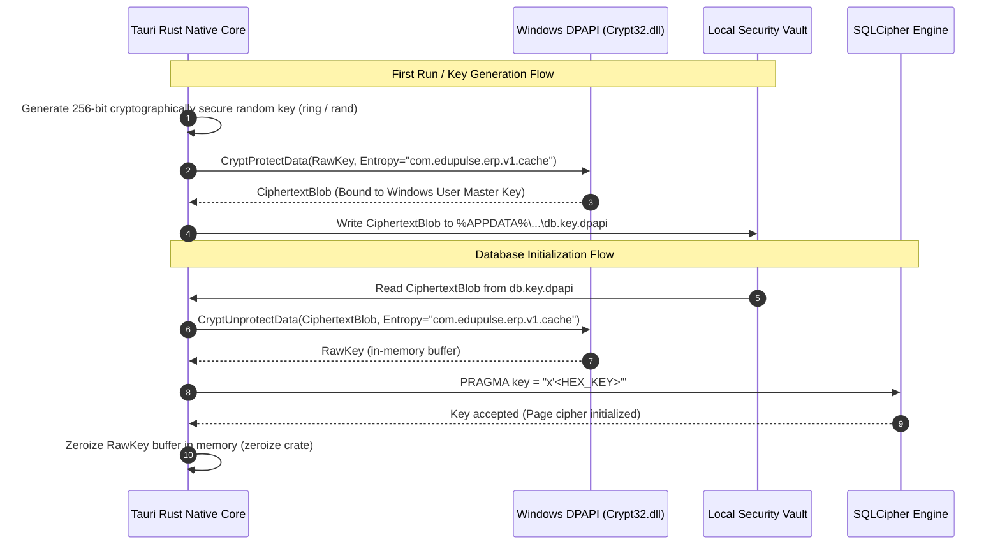

# EduPulse ERP — Day 02, Work Package 06
# Deliverable 06b: Local Offline Storage and Encryption Architecture

## 1. Local Storage Engine Selection

To store synchronized institutional data securely and efficiently on Windows desktop endpoints, EduPulse ERP requires an embedded storage engine that satisfies four mandatory architectural constraints:
1. **Strong Encryption-at-Rest:** Transparent, page-level cryptographic protection for sensitive student Personally Identifiable Information (PII) and institutional records.
2. **IPC and Boundary Isolation:** Storage engine must reside entirely in the native Rust shell, inaccessible to rogue JavaScript or DOM-based XSS attacks.
3. **Structured Querying & Performance:** High-throughput indexing supporting sub-millisecond relational queries across tens of thousands of student records.
4. **ACID Transactional Guarantees:** Atomic commits and rollbacks preventing partial, corrupt state during unexpected power loss or crashes.

### 1.1 Candidate Evaluation Matrix

| Storage Candidate | Encryption-at-Rest | Performance & Indexing | Process Isolation | ACID Compliance | Evaluation Result |
| :--- | :--- | :--- | :--- | :--- | :--- |
| **Plain SQLite (`rusqlite`)** | None (Plaintext on filesystem) | Excellent (B-Tree, Full-Text Search) | High (Native Rust) | Complete ACID | **Rejected:** Storing unencrypted student records violates FERPA, GDPR, and Indian DPDP Act 2023. |
| **SQLCipher via `rusqlite` (Bundled)** | **AES-256-CBC (Page-level, transparent)** | **Excellent (B-Tree, Full-Text Search)** | **High (Native Rust)** | **Complete ACID** | **SELECTED CANDIDATE:** Industry standard, zero plaintext footprint, native Rust binding, tamper-resistant HMAC. |
| **IndexedDB (via WebView2 / Chromium)** | Weak (Plaintext SQLite under user profile) | Moderate (Limited JS query engine) | Low (Directly accessible to any JS script) | Weak (Browser dependent) | **Rejected:** Insecure; unencrypted files in `%LOCALAPPDATA%\...\EBWebView\Default\IndexedDB\`. |
| **Key-Value Store (RocksDB / Sled)** | Requires application-level encryption | High Key-Value (Poor relational querying) | High (Native Rust) | High | **Rejected:** Lacks rich SQL indexing, complex foreign keys, and multi-column filtering. |
| **Flat JSON Files** | None (Plaintext files on disk) | Terrible ($O(N)$ memory scans) | High (Native Rust) | None (File corruption risk on crash) | **Rejected:** Unacceptable for enterprise ERP datasets. |

### 1.2 Selection Decision: SQLCipher via `rusqlite`

EduPulse ERP Desktop Edition adopts **SQLCipher** linked via Rust's `rusqlite` crate with the `bundled-sqlcipher` feature flag.

```
+----------------------------------------------------------------------------------------------------+
|                                    APPLICATION ISOLATION BOUNDARY                                 |
|                                                                                                    |
|   +---------------------------------------+       Tauri IPC        +---------------------------+   |
|   |         React 19 / WebView2           |  (Typed Command Query) |     Tauri Core (Rust)     |   |
|   |   NO Direct Access to Filesystem      | ---------------------> |   Memory Key Management   |   |
|   |   NO Direct Access to Database Engine | <--------------------- |    Decryption In-Memory   |   |
|   +---------------------------------------+      JSON DTO Only     +---------------------------+   |
|                                                                                  |                 |
|                                                                       Page-Level AES-256-CBC       |
|                                                                       HMAC-SHA256 Authenticated    |
|                                                                                  v                 |
|                                                                    +---------------------------+   |
|                                                                    |     Windows Filesystem    |   |
|                                                                    |  %APPDATA%\...\cache.db   |   |
|                                                                    |   100% Ciphertext at Rest |   |
|                                                                    +---------------------------+   |
+----------------------------------------------------------------------------------------------------+
```

---

## 2. Storage Location and Filesystem Permissions

### 2.1 File Paths

Local offline data is isolated within the authenticated Windows user's roaming application data directory:
- **Database File:** `%APPDATA%\com.edupulse.erp\data\cache.db`
- **Write-Ahead Log (WAL):** `%APPDATA%\com.edupulse.erp\data\cache.db-wal`
- **Shared Memory File:** `%APPDATA%\com.edupulse.erp\data\cache.db-shm`
- **DPAPI Key Vault:** `%APPDATA%\com.edupulse.erp\security\db.key.dpapi`

### 2.2 Windows NTFS DACL Enforcement

During application initialization, the Rust native layer verifies and enforces strict Windows NTFS Discretionary Access Control Lists (DACLs) on `%APPDATA%\com.edupulse.erp\`:
- **Current User SID (`Owner / Full Control`):** Read, Write, Execute, Delete.
- **SYSTEM SID (`NT AUTHORITY\SYSTEM`):** Full Control (required for OS-level maintenance).
- **All Other Users / Authenticated Users / Everyone:** **EXPLICITLY INHERITED DENIAL**.

This ensures that even if multiple staff members or students share the same Windows workstation with separate user accounts, User B cannot read or open User A's offline database file.

---

## 3. Encryption Key Generation, DPAPI Protection, and Lifecycle

The SQLCipher database key must never be hardcoded, never derived from a static string, and never stored in plaintext.



### 3.1 Key Lifecycle Rules

1. **Generation:** On initial app launch, Rust generates a 32-byte (256-bit) pseudorandom key using `ring::rand::SystemRandom`.
2. **Encryption with DPAPI:** The key is encrypted via `CryptProtectData` with `CRYPTPROTECT_UI_FORBIDDEN` and an application-specific salt (`com.edupulse.erp.v1.offline.salt`). Windows ties this encryption directly to the user's Windows login credentials via PBKDF2 and the user's DPAPI Master Key.
3. **In-Memory Zeroization:** As soon as the connection executes `PRAGMA key = "x'...'";`, the intermediate byte buffer in Rust memory is immediately cleared using `zeroize::Zeroize`.
4. **No IPC Transmission:** The encryption key is never exposed across the Tauri IPC channel to the React frontend.

---

## 4. Database Schema and Versioning Strategy

The offline database uses a hybrid schema combining indexed relational columns for rapid searching with structured JSON document payloads (`data_json`) for flexible entity storage.

### 4.1 Schema Definitions

```sql
-- Schema Migration Tracking Table
CREATE TABLE IF NOT EXISTS schema_migrations (
    version INTEGER PRIMARY KEY,
    applied_at TIMESTAMP DEFAULT CURRENT_TIMESTAMP,
    description TEXT NOT NULL,
    checksum TEXT NOT NULL
);

-- Synchronization Metadata Table
CREATE TABLE IF NOT EXISTS sync_metadata (
    module_key TEXT PRIMARY KEY,
    last_synced_at TIMESTAMP NOT NULL,
    entity_count INTEGER NOT NULL DEFAULT 0,
    etag TEXT,
    status TEXT NOT NULL, -- 'SYNCHRONIZED', 'STALE', 'PENDING'
    sync_duration_ms INTEGER
);

-- Cached Students Table
CREATE TABLE IF NOT EXISTS cached_students (
    student_id TEXT PRIMARY KEY,
    roll_number TEXT NOT NULL,
    first_name TEXT NOT NULL,
    last_name TEXT NOT NULL,
    grade_level TEXT NOT NULL,
    section TEXT NOT NULL,
    search_tokens TEXT NOT NULL, -- Pre-indexed concatenated search string
    data_json TEXT NOT NULL,     -- Full student profile JSON (sanitized)
    updated_at TIMESTAMP NOT NULL
);

CREATE INDEX IF NOT EXISTS idx_student_search ON cached_students (search_tokens);
CREATE INDEX IF NOT EXISTS idx_student_grade_section ON cached_students (grade_level, section);

-- Cached Timetables Table
CREATE TABLE IF NOT EXISTS cached_timetables (
    entry_id TEXT PRIMARY KEY,
    day_of_week INTEGER NOT NULL, -- 1 = Monday ... 7 = Sunday
    period_number INTEGER NOT NULL,
    start_time TEXT NOT NULL,
    end_time TEXT NOT NULL,
    grade_level TEXT NOT NULL,
    section TEXT NOT NULL,
    teacher_id TEXT NOT NULL,
    teacher_name TEXT NOT NULL,
    subject_name TEXT NOT NULL,
    room_number TEXT NOT NULL,
    data_json TEXT NOT NULL
);

CREATE INDEX IF NOT EXISTS idx_timetable_schedule ON cached_timetables (grade_level, section, day_of_week);
CREATE INDEX IF NOT EXISTS idx_timetable_teacher ON cached_timetables (teacher_id, day_of_week);

-- Cached Academic Notices and Circulars Table
CREATE TABLE IF NOT EXISTS cached_announcements (
    notice_id TEXT PRIMARY KEY,
    title TEXT NOT NULL,
    category TEXT NOT NULL,
    target_audience TEXT NOT NULL,
    publish_date TIMESTAMP NOT NULL,
    expiry_date TIMESTAMP,
    body_text TEXT NOT NULL,
    data_json TEXT NOT NULL
);

CREATE INDEX IF NOT EXISTS idx_announcements_publish ON cached_announcements (publish_date DESC);
```

### 4.2 Migration Strategy: Safe Ephemeral Re-creation

Because the desktop cache is strictly an ephemeral downstream read-only replica:
1. **Forward Migrations:** Normal schema upgrades execute sequential migration scripts registered in `schema_migrations`.
2. **Migration Failure Recovery:** If a local schema migration fails (e.g. database schema mismatch between versions), the application does **not** abort or enter an irrecoverable crash loop. Instead, the application cleanly deletes `cache.db`, recreates an empty database with the latest schema, and marks all modules for immediate initial sync upon online connection.

---

## 5. Data Minimization and Sensitive Field Redaction

To minimize institutional risk in the event of endpoint loss or forensic inspection, strict data sanitization rules are enforced by the Spring Boot backend before payloads are transmitted for desktop caching:

```
+-----------------------------------------------------------------------------------+
|                        DATA SANITIZATION PIPELINE                                 |
|                                                                                   |
|   Server Entity in PostgreSQL:                                                    |
|   {                                                                               |
|     "studentId": "STU-88219",                                                     |
|     "firstName": "Aarav",                                                         |
|     "lastName": "Sharma",                                                         |
|     "nationalIdentityNumber": "Aadhaar: 8492-4910-4491", <--- REDACTED (STRIPPED) |
|     "parentBankAccount": "SBI-009182319283",             <--- REDACTED (STRIPPED) |
|     "psychologicalConsultNotes": "Confidential medical",  <--- REDACTED (STRIPPED) |
|     "emergencyPhone": "+91-98765-43210",                 <--- PRESERVED           |
|     "bloodGroup": "O+",                                  <--- PRESERVED           |
|     "allergies": "Peanuts"                               <--- PRESERVED           |
|   }                                                                               |
+-----------------------------------------------------------------------------------+
```

### 5.1 Redacted Attributes

1. **Authentication Data:** Under no circumstances are user passwords, BCrypt password hashes, salt strings, MFA recovery codes, or biometric templates written to `cache.db`.
2. **Government & Banking Identifiers:** National identity numbers (e.g., Aadhaar, SSN, National Insurance), parent bank account numbers, IFSC codes, and credit card histories are completely omitted from the sync DTOs.
3. **Sensitive Clinical & Disciplinary Notes:** Psychiatric evaluations, sensitive infirmary consultation transcripts, and pending disciplinary tribunal memos are withheld from local caching.

---

## 6. SSD Forensic Deletion Limitations and Cryptographic Erasure

### 6.1 The Physical Reality of Solid-State Drives (SSDs)

Modern enterprise laptops and desktop PCs utilize NAND flash SSDs managed by proprietary controller firmware executing wear-leveling, garbage collection, and bad-block retirement.
- Traditional disk-wiping tools (e.g., writing zeroes or random passes via `shred`) cannot guarantee that physical flash cells containing old data are overwritten.
- When an OS writes to sector $X$, the SSD controller maps $X$ to a completely new physical NAND block and marks the old block for background TRIM garbage collection.
- Consequently, raw flash memory recovery can potentially retrieve previously "deleted" unencrypted data from over-provisioned NAND blocks.

### 6.2 Solution: Cryptographic Erasure (Crypto-Shredding)

Because the entire offline database is encrypted using SQLCipher with AES-256-CBC, EduPulse ERP achieves verifiable, instantaneous forensic erasure via **Crypto-Shredding**:

```
+-----------------------------------------------------------------------------------+
|                           CRYPTO-SHREDDING SEQUENCE                               |
|                                                                                   |
|   Step 1: Terminate active SQLite connection pool and zeroize in-memory keys.      |
|                                                                                   |
|   Step 2: Cryptographically overwrite DPAPI key file:                             |
|           Over-write %APPDATA%\...\db.key.dpapi with 3 passes of CSPRNG bytes.    |
|                                                                                   |
|   Step 3: Delete %APPDATA%\...\db.key.dpapi from filesystem.                      |
|                                                                                   |
|   Step 4: Delete %APPDATA%\...\cache.db.                                          |
|                                                                                   |
|   Result: Even if physical NAND flash blocks of cache.db remain un-garbage-       |
|           collected on the SSD, without the destroyed 256-bit DPAPI key, the      |
|           residual data is mathematically indistinguishable from random noise.    |
+-----------------------------------------------------------------------------------+
```

Crypto-shredding guarantees complete data unrecoverability within 5 milliseconds, providing certified compliance with institutional data destruction requirements upon employee offboarding or device repurposing.
