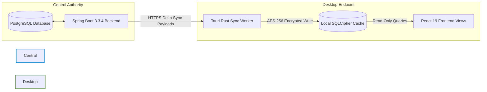

# EduPulse ERP — Day 02, Work Package 06
# Deliverable 06c: Offline Data Synchronization and Freshness Architecture

## 1. Synchronization Topology and Authority Rules

EduPulse ERP Desktop Edition enforces a strict unidirectional synchronization topology. The central Spring Boot 3.3.4 backend backed by PostgreSQL is the sole authoritative system of record. The desktop SQLCipher database is strictly an ephemeral, downstream read-only replica.



### 1.1 Fundamental Authority Principles

1. **Unidirectional Replication:** Data flows strictly from Spring Boot to Tauri SQLCipher. No client-originated writes or mutations occur offline.
2. **Read-Only SQLite Connections for UI:** When React executes queries through Tauri IPC, the Rust native layer utilizes a dedicated read-only SQLite connection pool opened with `SQLITE_OPEN_READONLY`. The write connection is exclusively owned by the background synchronization worker.
3. **Non-Authoritative Cache:** If any conflict, ambiguity, or hash divergence occurs, the desktop cache is discarded and refreshed from the server.

---

## 2. Initial vs. Incremental Synchronization

### 2.1 Initial Synchronization Flow

Initial synchronization occurs when a user authenticates on a newly installed client, following an institution server change, or after cache recovery.

```mermaid
sequenceDiagram
    autonumber
    participant UI as React 19 Frontend
    participant Rust as Tauri Rust Sync Worker
    participant Backend as Spring Boot API
    participant DB as SQLCipher Cache

    UI->>Rust: tauri::invoke("trigger_initial_sync")
    Rust->>Backend: GET /api/v1/sync/bootstrap/manifest
    Backend-->>Rust: { modules: ["students", "timetables", "announcements"], totalRecords: 4500 }

    loop For each module chunk (Page size: 500)
        Rust->>Backend: GET /api/v1/sync/{module}?page={n}&size=500
        Backend-->>Rust: { records: [...], hasNext: true, page: n }
        Rust->>DB: BEGIN TRANSACTION; INSERT OR REPLACE ... COMMIT;
        Rust-->>UI: emit("sync://progress", { module, percent: 45, current: 2250, total: 4500 })
    end

    Rust->>DB: UPDATE sync_metadata SET status = 'SYNCHRONIZED', last_synced_at = NOW();
    Rust-->>UI: emit("sync://completed", { status: "SUCCESS" })
```

### 2.2 Incremental Synchronization Flow (Delta Sync)

Incremental synchronization minimizes network bandwidth and backend database load by transferring only entities modified since the last recorded synchronization timestamp.

```
+-----------------------------------------------------------------------------------+
|                        INCREMENTAL HTTP REQUEST SPECIFICATION                     |
|                                                                                   |
|   GET /api/v1/sync/students/delta?since=2026-11-02T08:30:00Z&page=0&size=500     |
|   Host: erp.institution.edu                                                       |
|   Authorization: Bearer <access_token>                                            |
|   If-None-Match: "W/7a8b9c-20261102"                                             |
|                                                                                   |
|   RESPONSE (If no changes exist):                                                 |
|   HTTP/1.1 304 Not Modified                                                       |
|                                                                                   |
|   RESPONSE (If modifications exist):                                              |
|   HTTP/1.1 200 OK                                                                 |
|   ETag: "W/8b9c0d-20261102"                                                       |
|   {                                                                               |
|     "module": "students",                                                         |
|     "syncTimestamp": "2026-11-02T10:15:00Z",                                      |
|     "upserted": [                                                                 |
|       { "studentId": "STU-88219", "rollNumber": "A-12", "name": "Aarav Sharma" }  |
|     ],                                                                            |
|     "deletedIds": ["STU-88102"],                                                  |
|     "hasNextPage": false                                                          |
|   }                                                                               |
+-----------------------------------------------------------------------------------+
```

---

## 3. Synchronization Triggers and Scheduling

The desktop native synchronization worker is triggered by four distinct operational events:

| Trigger Event | Activation Condition | Action Executed | Rate / Throttling |
| :--- | :--- | :--- | :--- |
| **Startup Trigger** | Application starts and backend health check passes. | Incremental sync across all subscribed modules. | Executed once per session launch. |
| **Periodic Background Worker** | Desktop client is connected (`ONLINE`) and system is idle. | Incremental delta check (`If-None-Match`). | Configurable interval: 15 minutes (default). |
| **Reconnection Trigger** | Network status transitions from `OFFLINE` to `ONLINE`. | Wait 3.0s (network stabilization), then run incremental sync. | Debounced to 1 trigger per 60 seconds. |
| **Manual User Refresh** | User clicks the "Sync Now" action in top status bar. | Full incremental sync check with immediate UI progress modal. | Rate limited: maximum 1 manual sync per 60s. |

---

## 4. Pagination, Batching, and Resource Throttling

To prevent resource starvation on either the Spring Boot server or the desktop client, the synchronization engine enforces strict batching and throttling parameters:

### 4.1 Batching Specifications

- **Default Page Size:** 500 records per HTTP round-trip.
- **Maximum Payload Size:** Hard cap of 2.0 MB uncompressed JSON per request.
- **Streaming Ingestion:** Rust streams and parses JSON chunks directly into SQLite prepared statements without accumulating large array allocations in the JavaScript heap.

### 4.2 Backoff and Rate Limiting

If the Spring Boot backend returns HTTP `429 Too Many Requests` or `503 Service Unavailable`:
1. Parse the `Retry-After` header if present.
2. If omitted, apply exponential backoff with full jitter:
   $$T = \min\left(2^k \times 1000 + \text{rand}(0, 500), 60000\right)\text{ ms}$$
3. The background sync worker temporarily suspends operations and sets sync state to `PAUSED_RATE_LIMITED` without disrupting user queries against existing cache.

---

## 5. Atomic Cache Updates and Transactional Consistency

To guarantee that the user never reads incomplete or half-synced datasets while a synchronization cycle is actively streaming:

```sql
-- Step 1: Open an exclusive write transaction
BEGIN EXCLUSIVE TRANSACTION;

-- Step 2: Ingest upserted records
INSERT INTO cached_students (
    student_id, roll_number, first_name, last_name, grade_level, section, search_tokens, data_json, updated_at
) VALUES (
    ?1, ?2, ?3, ?4, ?5, ?6, ?7, ?8, ?9
) ON CONFLICT(student_id) DO UPDATE SET
    roll_number = excluded.roll_number,
    first_name = excluded.first_name,
    last_name = excluded.last_name,
    grade_level = excluded.grade_level,
    section = excluded.section,
    search_tokens = excluded.search_tokens,
    data_json = excluded.data_json,
    updated_at = excluded.updated_at;

-- Step 3: Remove records deleted on server
DELETE FROM cached_students WHERE student_id = ?10;

-- Step 4: Update synchronization metadata
UPDATE sync_metadata
SET last_synced_at = ?11, etag = ?12, entity_count = (SELECT count(*) FROM cached_students), status = 'SYNCHRONIZED'
WHERE module_key = 'students';

-- Step 5: Commit atomically
COMMIT;
```

If a network failure or process termination occurs prior to `COMMIT`, SQLite's Write-Ahead Log (WAL) automatically rolls back the entire batch, preserving the prior valid state.

---

## 6. Data Freshness, Time-to-Live (TTL), and Stale Cache Indicators

Cached data is subject to explicit Time-to-Live (TTL) expiration rules based on business volatility.

### 6.1 Per-Domain TTL Policies

| Domain | Recommended TTL | Stale Warning Threshold | Hard Expiry Threshold |
| :--- | :--- | :--- | :--- |
| **Timetables & Daily Schedules** | 12 Hours | 24 Hours | 72 Hours |
| **Student Rosters & Contacts** | 24 Hours | 48 Hours | 7 Days |
| **Academic Syllabi & Curriculum** | 7 Days | 14 Days | 30 Days |
| **Announcements & Circulars** | 6 Hours | 12 Hours | 48 Hours |
| **Fee Structures & Rates** | 24 Hours | 48 Hours | 14 Days |
| **Library Book Catalog** | 24 Hours | 48 Hours | 7 Days |

### 6.2 UI Freshness Badges

The React frontend evaluates `last_synced_at` against current time and renders visual indicators:
- **Fresh (Green Dot):** $\Delta t < \text{TTL}$ — "Synchronized [X mins] ago".
- **Stale (Amber Warning):** $\text{TTL} \le \Delta t < \text{Hard Expiry}$ — "Cached data: [X hours] old. May not reflect recent campus changes."
- **Expired (Red Alert):** $\Delta t \ge \text{Hard Expiry}$ — "Cache Expired: This data is older than the allowed institutional threshold. Connect to network to view."

---

## 7. Handling Deleted Records: Tombstones vs. Full Reconciliation

### 7.1 Soft-Deletes and Deletion Tombstones

When an entity (e.g., an enrolled student or timetable slot) is deleted on the server, PostgreSQL marks the record with `deleted_at = NOW()` and `is_deleted = true`. During incremental delta synchronization, Spring Boot includes these records in the `deletedIds` payload, allowing the desktop SQLite database to immediately purge the cached records via `DELETE FROM table WHERE id IN (?)`.

### 7.2 Periodic Cryptographic Reconciliation Sweep

To guarantee that no deleted records remain orphaned due to missed delta batches or restored backups:
1. Every 7 days during an active online session, the client requests a module hash:
   `GET /api/v1/sync/{module}/reconciliation-hash`
2. Spring Boot computes a deterministic SHA-256 hash over all active IDs in PostgreSQL:
   $$\text{Hash} = \text{SHA256}(\text{CONCAT}(\text{id}_1, \text{id}_2, \dots, \text{id}_n))$$
3. The desktop computes the identical hash over its local SQLite IDs.
4. If the hashes match, the cache is guaranteed 100% reconciled.
5. If the hashes differ, the client initiates a background full resynchronization for that module.
