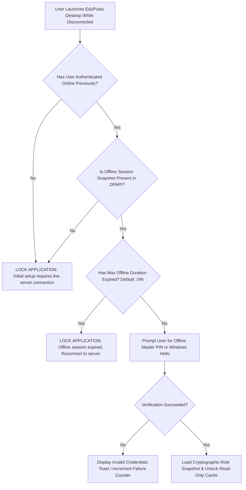
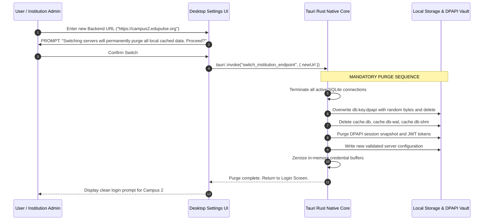

# EduPulse ERP — Day 02, Work Package 06
# Deliverable 06d: Offline Authentication and Multi-Institution Isolation

## 1. Offline Authentication Architecture and Security Boundaries

When a desktop client is disconnected from the institutional campus network, standard backend JWT validation and OAuth2 refresh endpoints (`/api/v1/auth/login`, `/api/v1/auth/refresh`) are completely unreachable.

To permit authorized staff to view previously cached records without introducing security bypasses, EduPulse ERP implements a secure, time-boxed offline authentication architecture.



### 1.1 Strict Prerequisites for Offline Access

1. **Prior Online Authentication:** A user **must** have completed at least one successful online authentication against the Spring Boot backend on the specific Windows machine. First-time offline login is strictly impossible.
2. **Time-Boxed Offline Lifetime:** Offline sessions are strictly limited to a maximum duration of **24 hours** (configurable by institutional Group Policy up to a maximum hard ceiling of 48 hours).
3. **Local Credential Verification:** The user authenticates against an Argon2id-hashed offline PIN or password digest stored within Windows DPAPI-protected storage, or validates via Windows Hello biometric authentication.

---

## 2. Permission and Role Snapshotting

During each successful online session, Spring Boot provides an authoritative snapshot of the user's identity, roles, and granular authorities. The Rust native layer serializes and seals this snapshot using Windows DPAPI.

### 2.1 Cryptographic Session Snapshot Structure

```json
{
  "formatVersion": 1,
  "userId": "USR-99214",
  "username": "prof.sharma",
  "institutionId": "INST-DELHI-01",
  "serverUrl": "https://erp.delhi.edupulse.org",
  "roles": ["ROLE_TEACHER", "ROLE_DEPARTMENT_HEAD"],
  "grantedAuthorities": [
    "academics:read",
    "timetable:read",
    "student:profile:read",
    "noticeboard:read",
    "library:catalog:read"
  ],
  "offlinePinHash": "$argon2id$v=19$m=65536,t=3,p=4$...",
  "snapshotTimestamp": "2026-11-02T08:30:00Z",
  "validUntil": "2026-11-03T08:30:00Z"
}
```

### 2.2 Dual-Layer Enforcement

Authorization is enforced at both the presentation layer and the native query boundary:

1. **Native Query Guard (Rust Shell):** When the React frontend invokes `query_offline_cache`, the Rust command inspects the verified session snapshot:
   ```rust
   // Rust Native IPC Handler
   #[tauri::command]
   pub async fn query_offline_cache(
       session: State<'_, ActiveOfflineSession>,
       module: String,
       query_params: CacheQueryParams,
   ) -> Result<CacheResult, AppError> {
       let required_permission = format!("{}:read", module);
       if !session.has_authority(&required_permission) {
           return Err(AppError::AccessDenied("Unauthorized domain access"));
       }
       // Execute read-only query against SQLCipher...
   }
   ```
2. **Presentation Guard (React / Zustand):** Frontend route guards and component wrappers inspect `useAuthStore((s) => s.authorities)`. UI elements for unpermitted domains are hidden from the navigation tree.

---

## 3. Security Implications of Offline Access: Accepted Risks and Mitigations

Operating in a disconnected state introduces a fundamental computer security challenge: **the impossibility of immediate remote revocation**.

### 3.1 The Remote Deactivation Threat

```
+-----------------------------------------------------------------------------------+
|                        REMOTE REVOCATION RACE CONDITION                           |
|                                                                                   |
|   10:00 AM: Teacher T syncs application while connected to campus LAN.            |
|   11:00 AM: Teacher T leaves campus and disconnects laptop (goes offline).        |
|   11:30 AM: Institutional HR terminates Teacher T and revokes account in DB.      |
|   12:00 PM: Teacher T launches EduPulse Desktop in offline mode.                  |
|                                                                                   |
|   PROBLEM: Client cannot reach Spring Boot to discover account revocation.       |
|   EXPOSURE: Teacher T can inspect cached student records until session expires.   |
+-----------------------------------------------------------------------------------+
```

### 3.2 Mitigation Controls and Accepted Risk Strategy

EduPulse ERP manages this accepted operational risk through defense-in-depth:

| Security Vector | Mitigation Control | Residual Risk Level |
| :--- | :--- | :--- |
| **Exposure Duration** | Strict **24-hour hard ceiling** on offline session validity. After 24 hours, local cache locks unconditionally. | Low (Confined to 24h window). |
| **Data Integrity** | **Strictly Read-Only.** Terminated user cannot submit altered grades, delete attendance records, or modify financial data. | Zero Risk (No mutations allowed). |
| **Data Scope** | **Data Minimization.** Highly sensitive data (bank accounts, national IDs, psychiatric records) is never cached. | Low (Only operational rosters cached). |
| **Non-Repudiation** | **Encrypted Offline Audit Trail.** Every query executed offline is appended to an encrypted local log and transmitted to Spring Boot upon reconnection. | Audit trail preserved for legal action. |

---

## 4. Device Identity and Windows User Account Binding

Educational institutions deploy desktop computers across two primary patterns: personal institution laptops and shared lab/staff-room workstations.

### 4.1 Multi-User Windows Environments

On Windows machines with multiple Windows user accounts (e.g., `Teacher_A` and `Teacher_B` logging into their own Windows profiles):
1. **Windows DPAPI Isolation:** Windows DPAPI derives encryption keys from the logged-in user's Windows Security Identifier (SID) and logon password hash.
2. **NTFS Profile Isolation:** `Teacher_A`'s cache at `C:\Users\Teacher_A\AppData\Roaming\com.edupulse.erp\` is strictly inaccessible to `Teacher_B` via Windows NTFS ACLs.
3. If `Teacher_B` attempts to read `Teacher_A`'s `cache.db` file, Windows kernel file system drivers reject the access with `ERROR_ACCESS_DENIED`. Even if copied via administrative override, DPAPI `CryptUnprotectData` fails with `SEC_E_DECRYPT_FAILURE`.

### 4.2 Shared Windows Generic Accounts

In scenarios where multiple staff members share a generic Windows login (e.g. `staff_room_pc`):
- EduPulse ERP requires individual user logout.
- Upon clicking "Switch User" or "Logout", the Rust shell immediately purges active in-memory session keys.
- To prevent cross-staff data exposure on generic Windows accounts, institutions can configure the Group Policy `PurgeCacheOnLogout = 1`, which automatically wipes `cache.db` upon application exit.

---

## 5. Multi-Institution Isolation and Cache Purging Protocol

EduPulse Desktop Edition supports connecting to different Spring Boot backend URLs (e.g., visiting inspectors, peripatetic teachers working across multiple campuses, or multi-campus university clusters).

Under no circumstances may data from **Institution A** persist or leak when the client switches to **Institution B**.



### 5.1 The Cache Purge Guarantee

The cache purge sequence guarantees:
1. **Cryptographic Erasure:** The SQLCipher key file is overwritten with CSPRNG bytes prior to unlinking, rendering residual disk blocks unrecoverable.
2. **Zero Residual State:** `cache.db` and all associated WAL journals are unlinked from the filesystem.
3. **Credential Annihilation:** All DPAPI blobs containing previous refresh tokens, session snapshots, and user IDs are unlinked.
4. **Mandatory Initial Sync:** The application launches in a clean, pristine state against the new institution endpoint, requiring fresh online authentication.
