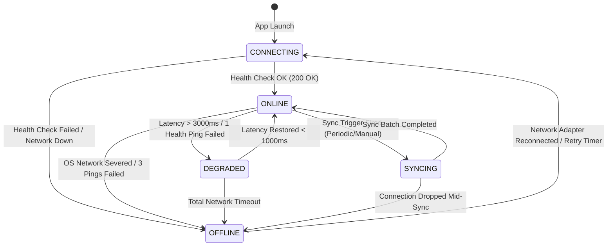
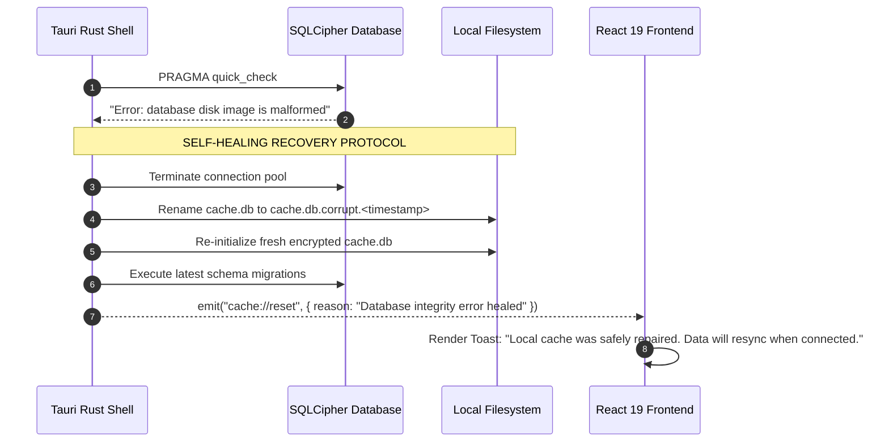

# EduPulse ERP — Day 02, Work Package 06
# Deliverable 06e: Offline Failure Handling, Recovery, and Validation Plan

## 1. Connectivity State Machine

EduPulse ERP Desktop Edition governs network transitions through a formal, deterministic finite state machine (FSM) managed inside the Tauri Rust runtime and mirrored reactively into the React 19 frontend via Zustand.



### 1.1 State Definitions and Operational Rules

| State Name | Diagnostic Condition | Frontend User Experience | Native Layer Behavior |
| :--- | :--- | :--- | :--- |
| `CONNECTING` | App launching or re-probing `/api/v1/health`. | Subtle status spinner in title bar. | Issues non-blocking HTTP probe with 3.0s timeout. |
| `ONLINE` | Spring Boot responding with HTTP 200 within 1000ms. | Green connectivity badge; all 259 modules accessible; write forms active. | Regular periodic heartbeat (30s); background sync active. |
| `DEGRADED` | Network packet loss or response latency between 3000ms and 5000ms. | Yellow badge: "Slow Campus Network"; write submissions prompt confirmation. | Suspends heavy background sync tasks; prioritizes user API requests. |
| `OFFLINE` | Physical adapter down, DNS failure, or 3 consecutive heartbeat timeouts. | Amber banner: "Offline Mode (Read-Only)"; all inputs disabled. | Routes queries to local SQLCipher cache; background health retry active. |
| `SYNCING` | Active downstream ingestion of delta batches. | Blue sync progress indicator with record count. | Ingests records via exclusive SQLite write transaction. |

---

## 2. Health Monitoring and Circuit Breaking

To prevent the React frontend from freezing or hanging on unfulfilled network calls when campus Wi-Fi drops, the desktop shell implements an aggressive circuit breaker pattern.

```
+-----------------------------------------------------------------------------------+
|                        CIRCUIT BREAKER & HEALTH MONITOR                           |
|                                                                                   |
|   ONLINE State:                                                                   |
|   - Send GET /api/v1/health every 30 seconds.                                     |
|   - If request exceeds 3000ms timeout: mark as 1 failure.                         |
|   - If 3 consecutive failures occur: TRIP CIRCUIT TO 'OFFLINE'.                   |
|                                                                                   |
|   OFFLINE State:                                                                  |
|   - Immediately fail all frontend API network calls to avoid UI lag.              |
|   - Immediately divert query requests to local SQLCipher read-only cache.         |
|   - Schedule health probes with exponential backoff and jitter:                   |
|     Probe 1: 2.0s                                                                 |
|     Probe 2: 4.0s                                                                 |
|     Probe 3: 8.0s                                                                 |
|     Probe 4: 16.0s                                                                |
|     Probe 5: 32.0s                                                                |
|     Ceiling: 60.0s max polling interval                                          |
+-----------------------------------------------------------------------------------+
```

---

## 3. Corrupt Cache Detection and Self-Healing Protocol

Local storage corruption can occur if a laptop battery dies during disk write operations or if physical storage sectors fail. EduPulse ERP handles corruption gracefully without application crashes.

### 3.1 Startup Integrity Verification

Upon opening the local SQLCipher database, the Rust native layer executes an immediate fast integrity check:
```sql
PRAGMA quick_check;
```
If `quick_check` returns any string other than `"ok"`, the self-healing recovery protocol is triggered.



Because the desktop cache is strictly a non-authoritative read-only downstream projection, self-healing guarantees zero data loss: authoritative records remain completely safe in PostgreSQL on the server.

---

## 4. Comprehensive Offline Validation Plan (14 Structured Test Cases)

The following 14 test cases provide complete test coverage for all offline scenarios, edge cases, failure states, and security requirements.

---

### Test Case TC-OFF-01: Online-to-Offline Transition Mid-Session
- **Objective:** Verify seamless UI transition and form mutation locking when network disconnects during an active session.
- **Preconditions:** User is logged in as Teacher on campus network; student roster is cached.
- **Execution Steps:**
  1. Navigate to "Student Information Management" and view Section 10-A roster.
  2. Sever network connection (disable network adapter or disconnect Ethernet cable).
  3. Observe top-bar connectivity banner and form action buttons.
- **Expected Results:**
  - Connectivity state switches from `ONLINE` to `OFFLINE` within 3 seconds.
  - Global amber banner appears: *"Offline Mode (Read-Only)"*.
  - "Add Student" and "Edit Profile" buttons switch to disabled with tooltip explaining offline restrictions.
  - Previously loaded roster remains fully visible and searchable.
- **Pass/Fail Criteria:** Pass if UI transitions without page refresh or crash, inputs lock, and cached data remains searchable.

---

### Test Case TC-OFF-02: App Startup in Offline Mode with Valid Cache
- **Objective:** Validate that a previously authenticated user can launch the app while disconnected and browse valid cached records.
- **Preconditions:** User logged in and synced data within past 12 hours; PC is completely disconnected from internet.
- **Execution Steps:**
  1. Disconnect PC network interfaces.
  2. Launch EduPulse Desktop application.
  3. Enter offline PIN / Windows Hello biometric verification.
  4. Navigate to Timetable and School Notices.
- **Expected Results:**
  - App unlocks in offline mode using the DPAPI-protected session snapshot.
  - Timetable for the current week renders correctly from SQLCipher.
  - Green/Gray cache freshness indicator displays: *"Cached 12 hours ago"*.
- **Pass/Fail Criteria:** Pass if application launches smoothly, authenticates locally, and displays cached data with zero network calls.

---

### Test Case TC-OFF-03: App Startup in Offline Mode with Expired Cache (TTL Exceeded)
- **Objective:** Verify proper enforcement of hard TTL limits on expired offline data.
- **Preconditions:** Cache synchronized 8 days ago (exceeding the 7-day hard TTL ceiling for student rosters).
- **Execution Steps:**
  1. Launch application in offline mode with simulated 8-day-old cache.
  2. Navigate to Student Directory.
- **Expected Results:**
  - System detects cache timestamp older than maximum permissible TTL.
  - Screen displays an amber alert: *"Cache Expired: This roster data is older than the institutional threshold (7 days). Connect to the campus network to refresh."*
  - Outdated data is restricted to prevent reliance on invalid information.
- **Pass/Fail Criteria:** Pass if expired data triggers the mandatory warning and does not present as fresh records.

---

### Test Case TC-OFF-04: App Startup in Offline Mode with Zero Cache (First Run Offline)
- **Objective:** Verify security boundary preventing first-time offline launch without prior online initialization.
- **Preconditions:** Pristine installation of EduPulse Desktop; no prior login; no `cache.db` or DPAPI key present.
- **Execution Steps:**
  1. Disconnect PC network interfaces.
  2. Launch EduPulse Desktop.
- **Expected Results:**
  - Application does not crash or present an unhandled exception.
  - Login form displays a prominent lock modal: *"Initial Setup Required: EduPulse ERP must connect to your campus server online for initial user setup and security initialization."*
  - Local database is not initialized.
- **Pass/Fail Criteria:** Pass if first-time offline access is completely blocked with a clear informational message.

---

### Test Case TC-OFF-05: Read-Only Enforcement (Attempted Offline Write Actions)
- **Objective:** Verify that client-side and native IPC layers reject all mutation attempts while offline.
- **Preconditions:** App running in offline mode.
- **Execution Steps:**
  1. Inspect student record.
  2. Attempt to trigger a mutation via UI (e.g. force-enabling submit button via DevTools).
  3. Attempt to invoke native write command via JavaScript console: `window.__TAURI__.core.invoke('submit_attendance', { ... })`.
- **Expected Results:**
  - UI inputs are disabled by default.
  - Native Rust command immediately rejects with `Err(AppError::OfflineMutationProhibited)`.
  - No write transaction is opened on SQLCipher; no local mutation queue is created.
- **Pass/Fail Criteria:** Pass if both UI and native layers unconditionally reject write attempts.

---

### Test Case TC-OFF-06: Background Auto-Sync Upon Reconnection
- **Objective:** Verify automatic incremental synchronization when network connectivity is restored.
- **Preconditions:** App operating in `OFFLINE` mode.
- **Execution Steps:**
  1. Modify a student's contact number on the Spring Boot server (via Web App).
  2. Re-enable network adapter on the desktop PC.
  3. Observe desktop title bar and student record.
- **Expected Results:**
  - Circuit breaker detects network restoration and transitions `OFFLINE` -> `CONNECTING` -> `ONLINE`.
  - After 3-second stabilization delay, background worker executes incremental delta sync.
  - Blue sync badge indicates: *"Syncing changes..."*.
  - Student record in view automatically refreshes with updated contact number.
- **Pass/Fail Criteria:** Pass if reconnection triggers delta sync without manual user intervention and data updates reactively.

---

### Test Case TC-OFF-07: Partial Sync Interrupted by Sudden Disconnection
- **Objective:** Verify database consistency and rollback when network drops in the middle of a multi-page sync.
- **Preconditions:** 5,000 records pending sync; app begins ingesting page 3 of 10.
- **Execution Steps:**
  1. Initiate full synchronization.
  2. Pull network cable while page 3 is downloading.
  3. Relaunch app or inspect SQLite database.
- **Expected Results:**
  - Uncommitted transaction for page 3 is rolled back via SQLite WAL.
  - Previously committed pages (1 and 2) or prior snapshot remain fully intact and consistent.
  - `sync_metadata` table accurately records the interruption; status marked as `PENDING_RESUME`.
  - App transitions smoothly to `OFFLINE` mode without crashing.
- **Pass/Fail Criteria:** Pass if database remains uncorrupted and queries continue to function on committed data.

---

### Test Case TC-OFF-08: Token Expiration While Offline
- **Objective:** Verify behavior when in-memory JWT access token expires during an extended offline session.
- **Preconditions:** User working offline; access token lifetime (15 mins) expires.
- **Execution Steps:**
  1. Keep app open in offline mode for 30 minutes.
  2. Navigate between cached modules (e.g., from Timetable to Announcements).
- **Expected Results:**
  - Expired in-memory JWT does not lock the offline session, because queries are serviced locally by Rust against SQLCipher using the DPAPI offline session snapshot.
  - App continues to allow read-only cache browsing.
  - When network reconnects later, Tauri background token refresh executes before live API requests are resumed.
- **Pass/Fail Criteria:** Pass if local cache navigation remains uninterrupted by backend JWT token expiry while offline.

---

### Test Case TC-OFF-09: Cache Corruption Recovery (Zero-Byte or Corrupt File)
- **Objective:** Verify self-healing recovery protocol when `cache.db` is corrupt.
- **Preconditions:** App closed; `cache.db` deliberately overwritten with random junk bytes.
- **Execution Steps:**
  1. Overwrite `%APPDATA%\com.edupulse.erp\data\cache.db` with 100 KB of random binary data.
  2. Launch EduPulse Desktop.
- **Expected Results:**
  - Rust shell detects `PRAGMA quick_check` failure.
  - Corrupt file is quarantined to `cache.db.corrupt.<timestamp>`.
  - Clean encrypted `cache.db` is initialized with latest migrations.
  - UI informs user: *"Local cache was reset due to a data error. Connect to campus network to re-sync."*
  - App remains stable and does not crash.
- **Pass/Fail Criteria:** Pass if app recovers automatically, quarantines bad file, and restarts cleanly.

---

### Test Case TC-OFF-10: Multi-Institution URL Change Cache Purge Validation
- **Objective:** Verify complete cryptographic erasure of offline cache when switching backend server URL.
- **Preconditions:** User logged in and cached data from Campus A (`https://campus-a.edupulse.org`).
- **Execution Steps:**
  1. Open Settings -> Server Configuration.
  2. Change backend URL to `https://campus-b.edupulse.org`.
  3. Confirm the warning prompt that local cache will be destroyed.
  4. Inspect `%APPDATA%\com.edupulse.erp\data\` and `security\`.
- **Expected Results:**
  - `db.key.dpapi` is overwritten with random bytes and unlinked.
  - `cache.db`, WAL, and SHM files are deleted from disk.
  - In-memory keys are zeroized.
  - App returns to initial login screen for Campus B.
  - No records from Campus A are accessible or recoverable.
- **Pass/Fail Criteria:** Pass if all cached data and encryption keys are completely annihilated.

---

### Test Case TC-OFF-11: Windows Account Switching Isolation
- **Objective:** Verify that User B on the same Windows PC cannot open or decrypt User A's cached database.
- **Preconditions:** Windows workstation configured with two distinct Windows user accounts (`UserA` and `UserB`).
- **Execution Steps:**
  1. `UserA` logs into Windows, launches EduPulse Desktop, and synchronizes data.
  2. `UserA` logs out of Windows.
  3. `UserB` logs into Windows and attempts to access `C:\Users\UserA\AppData\Roaming\com.edupulse.erp\data\cache.db`.
  4. Even if `UserB` possesses Administrator privileges and copies the file to their own directory, `UserB` attempts to launch EduPulse.
- **Expected Results:**
  - Standard NTFS DACL blocks `UserB` from reading `UserA`'s directory.
  - When copied, DPAPI decryption fails because `UserB`'s Windows DPAPI master key does not match `UserA`'s master key.
  - `CryptUnprotectData` returns `SEC_E_DECRYPT_FAILURE`.
  - Database cannot be decrypted.
- **Pass/Fail Criteria:** Pass if DPAPI cryptographic binding prevents cross-account decryption.

---

### Test Case TC-OFF-12: Large Dataset Sync Performance and Memory Footprint
- **Objective:** Verify that synchronizing a large institution dataset (25,000 student records) does not spike memory or freeze the UI.
- **Preconditions:** Test backend populated with 25,000 student records.
- **Execution Steps:**
  1. Initiate bootstrap initial sync.
  2. Monitor Windows Task Manager for EduPulse ERP process (RAM and CPU utilization).
  3. Observe UI responsiveness and progress reporting during streaming ingestion.
- **Expected Results:**
  - Rust streams chunks (500 records/page) directly into SQLCipher prepared statements.
  - Total RAM consumption of the desktop application remains below **180 MB** throughout the entire sync.
  - CPU usage remains below **15%** on modern multi-core processor.
  - UI remains responsive at 60 FPS; progress bar updates smoothly.
- **Pass/Fail Criteria:** Pass if sync completes under 90 seconds (on LAN) without memory leaks or UI frame drops.

---

### Test Case TC-OFF-13: Stale Data Warning Banners Across Multiple UI Modules
- **Objective:** Verify consistent display of stale cache warnings when records exceed recommended TTL.
- **Preconditions:** Cache timestamps manually adjusted to 30 hours old (exceeding 24-hour timetable TTL).
- **Execution Steps:**
  1. Open Timetable module.
  2. Open Student Directory module.
  3. Open Announcements module.
- **Expected Results:**
  - Each module displays a prominent contextual warning badge: *"Cached data (30 hours old) — May not reflect recent schedule changes."*
  - Action buttons retain clear disabled tooltips.
  - No stale data is masked or falsely presented as current live data.
- **Pass/Fail Criteria:** Pass if all affected modules clearly indicate stale status.

---

### Test Case TC-OFF-14: Simultaneous Multiple Window Read Access to Local Cache
- **Objective:** Verify that opening multiple desktop windows (e.g. Timetable in Window 1, Student Directory in Window 2) does not cause SQLite database lock errors.
- **Preconditions:** App configured to support multi-window view in offline mode.
- **Execution Steps:**
  1. Launch primary window in offline mode.
  2. Detach or open a secondary window (Timetable view).
  3. Execute searches concurrently in both windows.
- **Expected Results:**
  - SQLCipher operates in WAL (Write-Ahead Logging) mode with shared cache.
  - Read queries execute concurrently without `SQLITE_BUSY` or `database locked` errors.
  - Both windows display responsive, consistent query results.
- **Pass/Fail Criteria:** Pass if concurrent reads succeed without lock contention.
