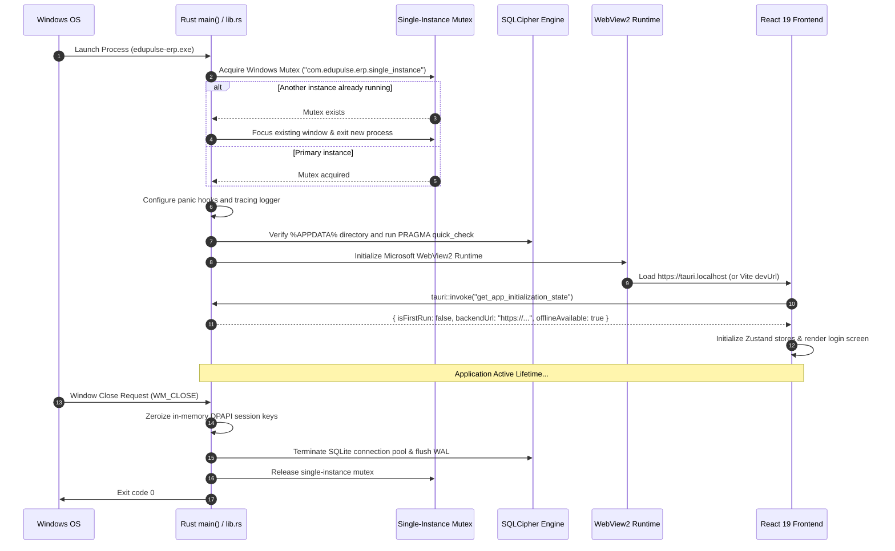

# EduPulse ERP — Day 02, Work Package 07
# Deliverable 07a: Tauri Desktop Project Structure and Shell Architecture

## 1. Executive Overview and Structural Principles

EduPulse ERP Desktop Edition integrates the existing React 19.2 frontend (`frontend-v2/`) with Tauri v2 to deliver a lightweight, secure Windows desktop application.

### Core Repository Boundaries
1. **Zero Structural Disruption:** Existing frontend (`frontend-v2/`), backend (`backend/`), and database files remain in their current directories. No existing folders are moved or renamed.
2. **Standard Tauri v2 Co-Location:** The Rust desktop shell is organized within `frontend-v2/src-tauri/`, aligning with standard Vite–Tauri tooling conventions and enabling seamless developer workflows (`npm run tauri dev`).
3. **Decoupled Architecture:** The desktop shell functions as a native container. The Spring Boot backend remains an independent service running on campus servers or in the cloud.

---

## 2. Proposed Directory Tree

The following tree defines the complete file and directory layout for the desktop shell:

```text
Institutioanl_ERP_v1.0-main/Institutioanl_ERP_v1.0/
├── backend/                               # Unchanged Spring Boot 3.3.4 Backend
├── docs/                                  # Project Documentation
└── frontend-v2/                           # React 19.2 + Vite 8.3 Application
    ├── package.json                       # Scripts for Vite and Tauri CLI
    ├── vite.config.ts                     # Vite build & dev proxy configuration
    ├── tsconfig.json                      # TypeScript compiler configuration
    ├── src/                               # Existing React Application Code
    │   ├── api/                           # Axios clients and interceptors
    │   ├── components/                    # Radix UI and Tailwind components
    │   ├── hooks/                         # React hooks (including useTauriBridge)
    │   ├── stores/                        # Zustand stores (auth, network, settings)
    │   └── desktop/                       # Desktop-specific React adaptations
    │       ├── bridge.ts                  # Typed Tauri invoke wrappers
    │       ├── events.ts                  # Typed event listeners
    │       └── components/                # Titlebar, UpdateModal, NetworkBanner
    └── src-tauri/                         # TAURI v2 RUST DESKTOP SHELL
        ├── Cargo.toml                     # Rust dependencies and build metadata
        ├── Cargo.lock                     # Deterministic dependency lockfile
        ├── tauri.conf.json                # Tauri v2 application configuration
        ├── build.rs                       # Tauri build script (winres, icon embed)
        ├── capabilities/                  # Declarative security capabilities
        │   └── default.json               # Default capability configuration
        ├── icons/                         # Windows application icon assets
        │   ├── 32x32.png
        │   ├── 128x128.png
        │   ├── icon.ico                   # Multi-resolution Windows ICO (16-256px)
        │   └── icon.png
        └── src/                           # Rust Native Source Code
            ├── main.rs                    # Windows entry point and subsystem macro
            ├── lib.rs                     # App builder, plugin registry, lifecycle
            ├── error.rs                   # Unified error types & IPC serialization
            ├── commands/                  # Exposed Tauri IPC Commands
            │   ├── mod.rs                 # Command module declarations
            │   ├── auth.rs                # DPAPI vault & session snapshot commands
            │   ├── cache.rs               # SQLCipher offline query commands
            │   ├── config.rs              # Backend endpoint URL & registry commands
            │   ├── diagnostics.rs         # Health checks, log export & system info
            │   └── window.rs              # Native window controls (minimize, close)
            ├── services/                  # Native Business & System Services
            │   ├── mod.rs
            │   ├── dpapi_vault.rs         # CryptProtectData / CryptUnprotectData
            │   ├── sqlcipher_db.rs        # SQLite connection pool & page encryption
            │   ├── sync_worker.rs         # Background delta synchronization engine
            │   ├── network_monitor.rs     # Real-time network & heartbeat monitor
            │   └── registry_policy.rs     # Windows Registry GPO policy reader
            └── models/                    # Rust Data Transfer Objects (Serde)
                ├── mod.rs
                ├── auth_dto.rs
                ├── sync_dto.rs
                └── config_dto.rs
```

---

## 3. Directory Responsibilities and Component Breakdown

### 3.1 `frontend-v2/src/desktop/` (React Integration Layer)
- **`bridge.ts`:** Encapsulates `@tauri-apps/api/core` `invoke()` calls in strongly-typed TypeScript functions with Zod validation. If running in a standard web browser, functions automatically fall back to web API behaviors or throw descriptive errors.
- **`events.ts`:** Subscribes to native events (`sync://progress`, `network://status-changed`, `updater://progress`) via `@tauri-apps/api/event`.
- **`components/`:** Desktop-optimized UI components including a custom frameless Windows title bar, network connectivity status pills, and update download dialogs.

### 3.2 `frontend-v2/src-tauri/src/` (Rust Native Shell)
- **`main.rs`:** Defines `#![cfg_attr(not(debug_assertions), windows_subsystem = "windows")]` to suppress the Windows terminal console in release builds. Initializes the panic hook and invokes `lib::run()`.
- **`lib.rs`:** Builds the Tauri runtime using `tauri::Builder::default()`. Registers plugins (`tauri-plugin-single-instance`, `tauri-plugin-updater`, `tauri-plugin-log`, `tauri-plugin-dialog`), configures state management (`ManagedState` for database pools and session keys), and registers command handlers.
- **`services/`:** Implements native system functionality. These services do not contain enterprise business logic; they handle low-level OS operations (DPAPI, encrypted local storage, GPO registry inspection).
- **`commands/`:** Pure IPC boundary handlers. They receive deserialized requests from the WebView, validate arguments, delegate work to `services/`, and return serializable `Result<T, AppError>`.

---

## 4. Tauri v2 Configuration (`tauri.conf.json`)

The proposed `tauri.conf.json` establishes explicit security boundaries and configuration parameters:

```json
{
  "$schema": "https://raw.githubusercontent.com/tauri-apps/tauri/dev/crates/tauri-cli/schema.json",
  "productName": "EduPulse ERP",
  "version": "1.0.0",
  "identifier": "com.edupulse.erp",
  "build": {
    "beforeDevCommand": "npm run dev",
    "devUrl": "http://localhost:5173",
    "beforeBuildCommand": "tsc -b && vite build",
    "frontendDist": "../dist"
  },
  "app": {
    "windows": [
      {
        "title": "EduPulse ERP",
        "width": 1280,
        "height": 800,
        "minWidth": 1024,
        "minHeight": 700,
        "resizable": true,
        "fullscreen": false,
        "center": true,
        "decorations": true,
        "useHttpsScheme": true
      }
    ],
    "security": {
      "csp": "default-src 'self'; script-src 'self'; style-src 'self' 'unsafe-inline'; img-src 'self' data: https:; connect-src 'self' https: http://localhost:*; font-src 'self' data:;"
    }
  },
  "bundle": {
    "active": true,
    "targets": ["msi", "nsis"],
    "icon": [
      "icons/32x32.png",
      "icons/128x128.png",
      "icons/icon.ico"
    ],
    "windows": {
      "certificateThumbprint": null,
      "digestAlgorithm": "sha256",
      "timestampUrl": "http://timestamp.digicert.com",
      "webviewInstallMode": {
        "type": "downloadBootstrapper"
      },
      "wix": {
        "language": ["en-US"]
      },
      "nsis": {
        "installerIcon": "icons/icon.ico",
        "headerImage": "icons/header.bmp"
      }
    }
  }
}
```

---

## 5. Declarative Capabilities and Least-Privilege Permissions

In Tauri v2, the legacy v1 allowlist is replaced by a granular, declarative permission system defined in `src-tauri/capabilities/default.json`.

```json
{
  "$schema": "https://raw.githubusercontent.com/tauri-apps/tauri/dev/crates/tauri-utils/schema.json",
  "identifier": "default-capability",
  "description": "Default permission set for EduPulse ERP desktop client",
  "windows": ["main"],
  "permissions": [
    "core:default",
    "core:window:allow-minimize",
    "core:window:allow-maximize",
    "core:window:allow-close",
    "core:window:allow-set-title",
    "log:default",
    "dialog:default",
    "single-instance:default"
  ]
}
```

### Access Control Rules:
1. **No Broad Filesystem Permissions:** Generic `fs:read` or `fs:write` permissions are completely omitted. File operations are handled strictly through custom, audited Rust commands.
2. **No Shell Execution:** `shell:execute` and `shell:open` are restricted to explicitly whitelisted browser links via `dialog` and `opener` protocols.
3. **Restricted Custom Commands:** Custom IPC commands (`vault_*`, `query_offline_cache`) are scoped exclusively to the primary authenticated window context.

---

## 6. Application Startup and Shutdown Lifecycle


