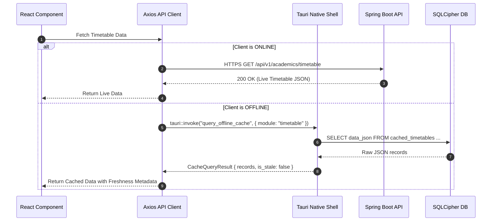

# EduPulse ERP — Day 02, Work Package 07
# Deliverable 07b: React and Rust Integration Architecture

## 1. Architectural Responsibilities and Division of Concerns

The architecture of EduPulse ERP Desktop Edition is partitioned into three distinct layers to ensure security, maintainability, and code reuse:

```mermaid
flowchart TD
    subgraph Presentation Layer
        React[React 19.2 + TypeScript + Vite 8.3]
        Zustand[Zustand State Stores]
        Zod[Zod Schema Validation]
    end

    subgraph Native Desktop Shell
        TauriCore[Tauri v2 Core Runtime]
        DPAPI[Windows DPAPI Vault Service]
        SQLCipher[(Encrypted SQLCipher Cache)]
        SyncWorker[Background Sync Worker]
        NetMon[Network & Health Monitor]
    end

    subgraph Authoritative Central Tier
        SpringBoot[Spring Boot 3.3.4 REST API]
        Postgres[(PostgreSQL System of Record)]
    end

    React <-->|Tauri IPC (Typed JSON Commands)| TauriCore
    TauriCore <--> DPAPI
    TauriCore <--> SQLCipher
    TauriCore <--> SyncWorker
    TauriCore <--> NetMon

    React <-->|HTTPS REST Calls (When Online)| SpringBoot
    SyncWorker <-->|HTTPS Batch Delta Sync| SpringBoot
    SpringBoot <--> Postgres

    style Presentation Layer fill:#e3f2fd,stroke:#1565c0,stroke-width:2px
    style Native Desktop Shell fill:#e8f5e9,stroke:#2e7d32,stroke-width:2px
    style Authoritative Central Tier fill:#fff3e0,stroke:#e65100,stroke-width:2px
```

### 1.1 Strict Architectural Principles

1. **Spring Boot Owns All Business Logic:** No academic GPA computation, fee structure calculation, attendance percentage aggregation, or financial accounting logic is ever executed or duplicated in Rust or React.
2. **React Owns Presentation Logic:** UI state, user interactions, form validation, client-side routing, and component lifecycles remain 100% within React 19.
3. **Rust Owns Privileged Desktop Operations:** Operating system APIs, file system storage, DPAPI hardware-backed encryption, registry queries, and background network heartbeat workers reside strictly in Rust.
4. **Zero Key Exposure to JavaScript:** Encryption keys for SQLCipher and DPAPI are never transferred across the IPC channel or exposed to the WebView DOM.
5. **No Duplication of Authorization Logic:** Complex permission evaluations are executed by Spring Boot. Rust merely stores an authoritative cryptographic snapshot of granted permissions for offline read guards.
6. **Least Privilege IPC Surface:** Expose only the minimum required set of typed Tauri commands. Generic `eval()` or unconstrained shell/filesystem commands are strictly prohibited.

---

## 2. Tauri IPC Architecture

Communication between the React WebView and the Rust native runtime uses asynchronous, strongly-typed JSON message channels.

### 2.1 IPC Communication Types

| Pattern | Mechanism | Use Cases in EduPulse ERP |
| :--- | :--- | :--- |
| **Command Invocation** | `invoke('command_name', { args })` | Retrieving refresh tokens, querying offline cache, setting server URLs, checking diagnostics. |
| **Native Event Emission** | `emit('event_name', { payload })` | Pushing sync progress updates, broadcasting connectivity state changes, signaling auto-updater progress. |
| **Frontend Event Listening** | `listen('event_name', callback)` | React hooks listening to network status shifts or background synchronization milestones. |

---

## 3. Strongly-Typed Command Contracts

All IPC interactions are formalized through paired Rust structs (using `serde`) and TypeScript interfaces.

### 3.1 Credential Vault Integration (`commands/auth.rs`)

```rust
// Rust Command Signature
#[tauri::command]
pub async fn vault_store_refresh_token(
    state: State<'_, DpapiVaultService>,
    token: String,
) -> Result<(), AppError>;

#[tauri::command]
pub async fn vault_get_refresh_token(
    state: State<'_, DpapiVaultService>,
) -> Result<Option<String>, AppError>;

#[tauri::command]
pub async fn vault_clear_credentials(
    state: State<'_, DpapiVaultService>,
) -> Result<(), AppError>;
```

```typescript
// TypeScript Bridge Definition (src/desktop/bridge.ts)
export interface AuthBridge {
  storeRefreshToken(token: string): Promise<void>;
  getRefreshToken(): Promise<string | null>;
  clearCredentials(): Promise<void>;
}

export const authBridge: AuthBridge = {
  storeRefreshToken: (token) => invoke('vault_store_refresh_token', { token }),
  getRefreshToken: () => invoke('vault_get_refresh_token'),
  clearCredentials: () => invoke('vault_clear_credentials'),
};
```

### 3.2 SQLCipher Offline Storage Integration (`commands/cache.rs`)

```rust
#[derive(Debug, Deserialize)]
pub struct CacheQueryArgs {
    pub module: String,
    pub filter_query: Option<String>,
    pub page: u32,
    pub page_size: u32,
}

#[derive(Debug, Serialize)]
pub struct CacheQueryResult {
    pub records: Vec<serde_json::Value>,
    pub total_records: usize,
    pub last_synced_at: String,
    pub is_stale: bool,
}

#[tauri::command]
pub async fn query_offline_cache(
    db: State<'_, SqlCipherService>,
    args: CacheQueryArgs,
) -> Result<CacheQueryResult, AppError>;
```

### 3.3 Endpoint Configuration Integration (`commands/config.rs`)

```rust
#[derive(Debug, Serialize, Deserialize)]
pub struct EndpointConfig {
    pub base_url: String,
    pub is_managed_by_policy: bool,
    pub environment_name: String,
}

#[tauri::command]
pub async fn get_endpoint_config(
    policy: State<'_, RegistryPolicyService>,
) -> Result<EndpointConfig, AppError>;

#[tauri::command]
pub async fn set_endpoint_config(
    policy: State<'_, RegistryPolicyService>,
    new_url: String,
) -> Result<(), AppError>;
```

---

## 4. API Communication Boundaries: Online vs. Offline

To maximize performance and minimize IPC overhead, the desktop application employs a dual-path routing strategy:



### Routing Rules:
1. **Direct HTTPS for Online Requests:** When online, React communicates directly with Spring Boot over standard HTTPS using Axios. This avoids serializing massive JSON payloads through Tauri IPC and leverages browser-level HTTP keep-alive, streaming, and connection pooling.
2. **IPC Exclusively for Native & Offline Access:** Tauri IPC is engaged exclusively when offline queries are necessary, when storing/retrieving credentials, or when invoking native OS capabilities.
3. **Enterprise Forward Proxy Compatibility (NTLM/Kerberos):** In campus networks requiring authenticated forward proxies, Axios within WebView2 automatically leverages Windows Internet Options (WinINet) for transparent NTLM/Kerberos authentication, while the Rust background synchronization engine connects via Windows SSPI to avoid HTTP 407 proxy authentication challenges.

---

## 5. Unified Error Handling and IPC Result Types

To prevent uncaught JavaScript runtime exceptions and vague "IPC failed" messages, all Rust commands return a standardized, structured error contract.

### 5.1 Rust Error Architecture (`error.rs`)

```rust
#[derive(Debug, thiserror::Error)]
pub enum AppError {
    #[error("DPAPI vault error: {0}")]
    VaultError(String),

    #[error("Offline cache error: {0}")]
    DatabaseError(String),

    #[error("Operation prohibited while offline: {0}")]
    OfflineMutationProhibited(String),

    #[error("Configuration policy locked by institutional administrator")]
    PolicyLocked,

    #[error("Unauthorized access to module: {0}")]
    AccessDenied(String),
}

// Serializable error structure returned across IPC
#[derive(Debug, Serialize)]
pub struct IpcErrorPayload {
    pub code: String,
    pub message: String,
}

impl Serialize for AppError {
    fn serialize<S>(&self, serializer: S) -> Result<S::Ok, S::Error>
    where
        S: serde::Serializer,
    {
        let payload = match self {
            AppError::VaultError(msg) => IpcErrorPayload { code: "VAULT_ERROR".into(), message: msg.clone() },
            AppError::DatabaseError(msg) => IpcErrorPayload { code: "DATABASE_ERROR".into(), message: msg.clone() },
            AppError::OfflineMutationProhibited(msg) => IpcErrorPayload { code: "OFFLINE_MUTATION_PROHIBITED".into(), message: msg.clone() },
            AppError::PolicyLocked => IpcErrorPayload { code: "POLICY_LOCKED".into(), message: "Locked by Administrator GPO".into() },
            AppError::AccessDenied(msg) => IpcErrorPayload { code: "ACCESS_DENIED".into(), message: msg.clone() },
        };
        payload.serialize(serializer)
    }
}
```

### 5.2 React Frontend Handling

```typescript
// React safe invocation wrapper
export async function safeInvoke<T>(command: string, args?: Record<string, unknown>): Promise<T> {
  try {
    return await invoke<T>(command, args);
  } catch (error: any) {
    if (error && typeof error === 'object' && error.code) {
      if (error.code === 'POLICY_LOCKED') {
        toast.error('Configuration is locked by institutional Group Policy.');
      } else if (error.code === 'OFFLINE_MUTATION_PROHIBITED') {
        toast.warning('Action unavailable offline. Connect to campus network.');
      }
    }
    throw error;
  }
}
```
