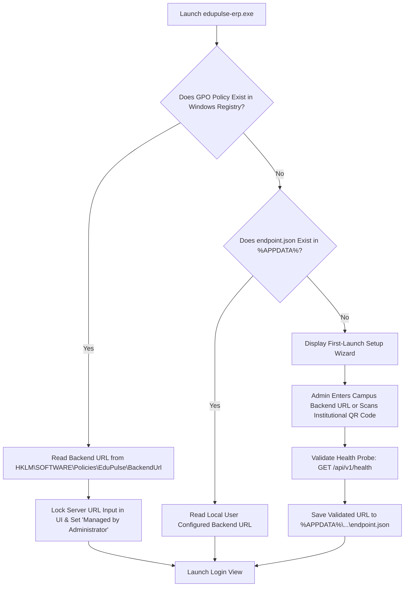
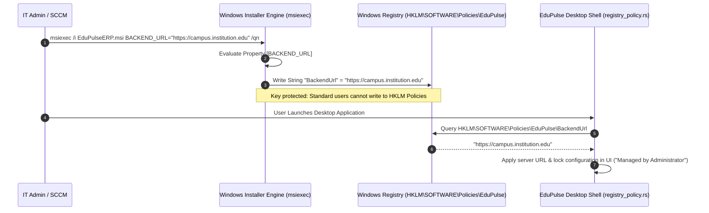

# EduPulse ERP — Day 02, Work Package 07
# Deliverable 07c: Windows Installer and Packaging Architecture

## 1. Installer Technology Selection: MSI vs. NSIS

Windows desktop deployment across higher education institutions requires accommodating two distinct operational environments:
1. **Centralized IT Management:** Large computer laboratories, administrative staff workstations, and campus-wide deployments managed via Active Directory Group Policy (GPO), Microsoft Intune, or Microsoft Endpoint Configuration Manager (MECM/SCCM).
2. **Self-Service BYOD (Bring Your Own Device):** Students, lecturers, and visiting faculty installing the application on personal laptops without administrative rights.

To satisfy both operational models, EduPulse ERP adopts a **Dual-Artifact Packaging Strategy**.

```
+----------------------------------------------------------------------------------------------------+
|                                    PACKAGING ARTIFACT STRATEGY                                     |
|                                                                                                    |
|   +---------------------------------------------------+  +-------------------------------------+   |
|   |         ENTERPRISE WINDOWS INSTALLER (.MSI)       |  |      STANDARD USER SETUP (.EXE)     |   |
|   |                 (WiX Toolset v4/v5)               |  |                (NSIS)               |   |
|   +---------------------------------------------------+  +-------------------------------------+   |
|   | * Target: IT Admins, Intune, SCCM, Active Directory|  | * Target: Faculty & Student Laptops |   |
|   | * Per-Machine installation (%ProgramFiles%)       |  | * Per-User installation (%LocalAppData%)|   |
|   | * Silent rollout: msiexec /i EduPulse.msi /qn     |  | * Friendly GUI Setup Wizard         |   |
|   | * Parameterized: BACKEND_URL="https://..."        |  | * No Local Admin rights required    |   |
|   | * Persists to HKLM\SOFTWARE\Policies\EduPulse     |  | * Automatic Desktop & Start shortcut|   |
|   +---------------------------------------------------+  +-------------------------------------+   |
+----------------------------------------------------------------------------------------------------+
```

### 1.1 Detailed Evaluation: MSI vs. NSIS

| Evaluation Criterion | Windows Installer (MSI via WiX) | NSIS Executable (`.exe`) | EduPulse Strategic Selection |
| :--- | :--- | :--- | :--- |
| **GPO / Intune Deployment** | Native support; standard property tables; flawless silent distribution. | Requires custom packaging or wrapped commands. | **MSI** for all managed institutional hardware. |
| **Silent Install Syntax** | Standard: `msiexec /i package.msi /qn` | Proprietary: `Setup.exe /S` | **MSI** preferred by Windows system administrators. |
| **Privilege Requirements** | Typically requires UAC elevation for `ALLUSERS=1`. | Can run in user mode (`ALLUSERS=0`) without elevation. | **NSIS** for BYOD student/faculty devices. |
| **Installation Speed** | Moderate (Windows Installer transaction engine). | Very Fast (Direct binary extraction). | **NSIS** provides faster personal install experience. |
| **Transactional Rollback** | Complete OS-level rollback if installation fails midway. | Script-dependent custom rollback handling. | **MSI** guarantees clean enterprise state. |
| **Custom Property Injection** | Native via public properties explicitly persisted to Registry. | Requires command-line parsing scripts. | **MSI** enables zero-touch campus provisioning. |

---

## 2. Application Installation Directories and Permissions

EduPulse ERP strictly isolates executable binaries from mutable application data in compliance with Windows security standards.

### 2.1 Filesystem Path Architecture

```text
Per-Machine Installation (MSI with ALLUSERS=1):
├── Executables & Shell:   C:\Program Files\EduPulse ERP\
│   ├── edupulse-erp.exe  (Read-Only for Users; Full Control for Administrators)
│   └── *.dll             (WebView2Loader.dll, etc.)
│
Per-User Installation (NSIS with ALLUSERS=0):
└── Executables & Shell:   C:\Users\<User>\AppData\Local\Programs\EduPulse ERP\
    ├── edupulse-erp.exe  (User Full Control)
    └── *.dll

Shared Data Storage (All Installations):
├── Roaming User Profile: C:\Users\<User>\AppData\Roaming\com.edupulse.erp\
│   ├── data\
│   │   ├── cache.db      (SQLCipher Encrypted Offline Database)
│   │   ├── cache.db-wal  (SQLite Write-Ahead Log)
│   │   └── cache.db-shm
│   ├── security\
│   │   └── db.key.dpapi  (DPAPI-Encrypted 256-bit Key)
│   └── config\
│       └── endpoint.json (Local Server Configuration)
│
└── Local User Profile:   C:\Users\<User>\AppData\Local\com.edupulse.erp\
    ├── logs\             (Daily Rolling Diagnostic Logs)
    └── crashdumps\       (Crash reports and panic logs)
```

---

## 3. Microsoft WebView2 Runtime Prerequisites and Restricted Network Handling

Tauri v2 renders application views using Microsoft Edge WebView2.

### 3.1 Evergreen Runtime vs. Fixed Version Runtime

1. **Evergreen Runtime (Recommended Baseline):**
   - Pre-installed across Windows 11 and modern Windows 10 (Version 2004+).
   - Automatically updated and patched against security vulnerabilities by Microsoft Edge Update services.
   - Installer size remains lightweight (~12 MB total package).
2. **Fixed Version Runtime (Evaluated for Air-Gapped Networks):**
   - Packages a specific, immutable Chromium runtime (~180 MB package size penalty).
   - Carries security maintenance liabilities; unpatched versions remain vulnerable unless manually updated with new application builds.
   - Reserved strictly for fully air-gapped institutions with no external connectivity.

### 3.2 Bootstrapper Verification Strategy (`downloadBootstrapper`)

In `tauri.conf.json`, EduPulse configures:
```json
"webviewInstallMode": {
  "type": "downloadBootstrapper"
}
```

During installation:
1. The installer inspects the Windows Registry to determine if WebView2 Evergreen is present:
   `HKLM\SOFTWARE\WOW6432Node\Microsoft\EdgeUpdate\Clients\{F3017226-FE2A-4295-8BDF-6D3A4A7E007E}`
2. **If detected:** The installer proceeds immediately without network download.
3. **If missing:** The installer initiates Microsoft's official Evergreen Bootstrapper (`MicrosoftEdgeWebview2Setup.exe /silent /install`), which contacts Microsoft CDN servers to fetch and install the latest Evergreen Runtime.

### 3.3 Restricted Campus Networks and Failure Handling

In enterprise education networks, the online bootstrapper may fail due to:
- Strict egress firewalls blocking Microsoft CDN endpoints (`*.delivery.mp.microsoft.com`).
- Authenticated forward proxies (NTLM/Kerberos) requiring corporate credentials.
- Isolated intranet or air-gapped laboratory networks without public internet routing.

#### Failure Handling & Enterprise Remediation:
- **Installer Failure Dialog:** If the bootstrapper cannot reach Microsoft servers (timeout or non-zero exit code), the installer terminates gracefully with an actionable error modal:
  *"Microsoft Edge WebView2 Runtime is required to run EduPulse ERP. The automated download failed due to network restrictions. Please contact your IT administrator to install the WebView2 Evergreen Standalone Installer."*
- **Enterprise Pre-Deployment Best Practice:** IT administrators deploying via Intune or MECM/SCCM must pre-deploy the **Microsoft Edge WebView2 Evergreen Standalone Installer** (a self-contained ~150 MB offline installer available from Microsoft) across all target machines before rolling out the EduPulse MSI.

---

## 4. First-Launch Setup and Configuration Persistence

When launched for the first time, EduPulse ERP initializes the runtime environment through a deterministic sequence:



---

## 5. Application Upgrades and Uninstallation Behavior

### 5.1 Upgrade Protocol
- Executable binaries, DLLs, and shortcuts are updated cleanly in-place.
- User data in `%APPDATA%\com.edupulse.erp\` is strictly preserved across version upgrades.
- SQLCipher schema migrations are executed automatically by the new binary upon launch.

### 5.2 Uninstallation Protocol
- **Binary Removal:** All files in `C:\Program Files\EduPulse ERP\` or `%LocalAppData%\Programs\` are deleted.
- **Shortcuts & Registry:** Start Menu shortcuts, desktop shortcuts, and uninstall keys under `HKLM\SOFTWARE\Microsoft\Windows\CurrentVersion\Uninstall` are unlinked.
- **Data Retention Prompt (NSIS GUI):** The uninstaller prompts:
  *"Do you wish to remove your locally cached student records and saved login credentials?"*
  - **No (Default):** Retains `%APPDATA%` so future reinstalls preserve offline state.
  - **Yes:** Invokes cryptographic wipe (zeroizes DPAPI key, unlinks `cache.db`).
- **Silent Enterprise Uninstallation (MSI):** Retains `%APPDATA%` by default. If `PURGE_USER_DATA=1` is passed via command-line, an enterprise custom action purges all user data profiles.

---

## 6. Windows Shortcuts, Icons, and PE Metadata

### 6.1 Application Metadata (Embedded via `build.rs` and `winres`)
The compiled `edupulse-erp.exe` binary embeds full Windows PE version information:
- **File Description:** EduPulse ERP Windows Desktop Client
- **Product Name:** EduPulse ERP
- **Company Name:** EduPulse Global Technologies Inc.
- **Legal Copyright:** © 2026 EduPulse Global Technologies Inc. All rights reserved.
- **Internal Name:** edupulse-erp
- **Original Filename:** edupulse-erp.exe
- **Product Version:** 1.0.0.0

### 6.2 High-DPI Windows Icon Asset (`icon.ico`)
The Windows installer and executable bundle a multi-layer ICO file containing uncompressed BMP/PNG layers at:
`16x16`, `24x24`, `32x32`, `48x48`, `64x64`, `128x128`, and `256x256` pixels.

---

## 7. Silent Enterprise Deployment, MSI Properties, and Persistence

Passing public parameters to `msiexec` does **not** automatically configure an application binary on its own. Windows Installer requires explicit mapping within the WiX manifest to write parameters to persistent storage.

### 7.1 How `BACKEND_URL` is Captured and Persisted

In the WiX configuration fragment (`src-tauri/wix/main.wxs`), EduPulse defines:

```xml
<!-- 1. Declare public property as secure to pass across UAC elevation boundary -->
<Property Id="BACKEND_URL" Secure="yes" />

<!-- 2. Persist property to HKLM Policies so application can read it at runtime -->
<Component Id="RegistryPolicyBackendUrl" Guid="{4B8D3A12-88E1-42C1-B75F-2F590A92E1B4}" Directory="TARGETDIR">
  <Condition>BACKEND_URL</Condition>
  <RegistryKey Root="HKLM" Key="SOFTWARE\Policies\EduPulse">
    <RegistryValue Type="string" Name="BackendUrl" Value="[BACKEND_URL]" KeyPath="yes" />
  </RegistryKey>
</Component>
```

### 7.2 Persistence and Consumption Flow



### Supported MSI Public Properties:
- `ALLUSERS=1`: Enforces system-wide installation to `%ProgramFiles%`.
- `BACKEND_URL="https://..."`: Written to `HKLM\SOFTWARE\Policies\EduPulse\BackendUrl` via the WiX `RegistryValue` component. If omitted, the registry value is not written, permitting local configuration via `%APPDATA%`.
- `DISABLE_AUTO_UPDATE=1`: Writes `DisableAutoUpdate=1` to `HKLM\SOFTWARE\Policies\EduPulse` to let institutional SCCM/Intune manage updates.
- `INSTALLDESKTOPSHORTCUT=1`: Creates a desktop shortcut for all users.

---

## 8. Code Signing and SmartScreen Reputation Architecture

Digital signatures verify application authenticity, prevent tampering, and determine Windows Defender SmartScreen trust.

### 8.1 Evaluation of Code Signing Options

| Signing Mechanism | Hardware Requirement | SmartScreen Trust | CI/CD Automation | Evaluation & Recommendation |
| :--- | :--- | :--- | :--- | :--- |
| **Standard Authenticode (OV)** | Software certificate or cloud token | Builds reputation gradually over time via download volume | High (Can sign in runner) | **Viable:** Cost-effective (~$200/yr), but initial users encounter SmartScreen warnings until volume builds. |
| **Extended Validation (EV)** | Physical USB token or Cloud HSM | Fast reputation accumulation, but **NOT** mandatory | Difficult without dedicated Cloud HSM | **Evaluated:** EV is not strictly required by Windows. High maintenance overhead for physical tokens. |
| **Azure Trusted Signing (Recommended)** | Fully managed Microsoft Cloud HSM | Fast SmartScreen reputation; direct Microsoft identity tie | **Native GitHub Actions Integration** | **STRONGLY RECOMMENDED:** Microsoft's modern cloud signing service; no hardware tokens; seamless CI/CD integration. |

### 8.2 SmartScreen Reputation Considerations
- **EV is Not Mandatory:** Windows accepts binaries signed with any valid Authenticode certificate (OV, EV, or Azure Trusted Signing).
- **Reputation Dynamics:** Microsoft SmartScreen uses algorithmic, cloud-based telemetry. New certificates start with low reputation, temporarily showing an "Unrecognized app" notice.
- **Enterprise Bypass via Group Policy / Intune:** In managed college environments, IT administrators eliminate SmartScreen prompts entirely by deploying EduPulse's signing certificate to the **Trusted Publishers** store via Active Directory GPO or whitelisting it in Windows Defender Application Control (WDAC).
