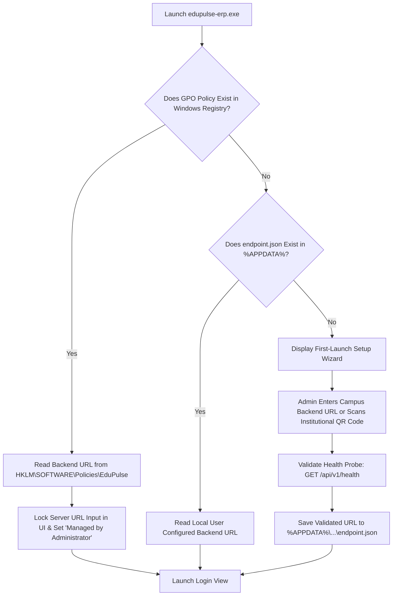

# EduPulse ERP — Day 02, Work Package 07
# Deliverable 07c: Windows Installer and Packaging Architecture

## 1. Installer Technology Selection: MSI vs. NSIS

Windows desktop deployment across higher education institutions requires accommodating two distinct operational environments:
1. **Centralized IT Management:** Large computer laboratories, administrative staff workstations, and campus-wide deployments managed via Active Directory Group Policy (GPO), Microsoft Intune, or Microsoft Endpoint Configuration Manager (MECM/SCCM).
2. **Self-Service BYOD (Bring Your Own Device):** Students, lecturers, and visiting faculty installing the application on personal laptops without administrative rights.

To satisfy both operational models, EduPulse ERP adopts a **Dual-Artifact Packaging Strategy**.

```
+----------------------------------------------------------------------------------------------------+
|                                    PACKAGING ARTIFACT STRATEGY                                     |
|                                                                                                    |
|   +---------------------------------------------------+  +-------------------------------------+   |
|   |         ENTERPRISE WINDOWS INSTALLER (.MSI)       |  |      STANDARD USER SETUP (.EXE)     |   |
|   |                 (WiX Toolset v4/v5)               |  |                (NSIS)               |   |
|   +---------------------------------------------------+  +-------------------------------------+   |
|   | * Target: IT Admins, Intune, SCCM, Active Directory|  | * Target: Faculty & Student Laptops |   |
|   | * Per-Machine installation (%ProgramFiles%)       |  | * Per-User installation (%LocalAppData%)|   |
|   | * Silent rollout: msiexec /i EduPulse.msi /qn     |  | * Friendly GUI Setup Wizard         |   |
|   | * Parameterized: BACKEND_URL="https://..."        |  | * No Local Admin rights required    |   |
|   | * Strict Windows Installer database standard      |  | * Automatic Desktop & Start shortcut|   |
|   +---------------------------------------------------+  +-------------------------------------+   |
+----------------------------------------------------------------------------------------------------+
```

### 1.1 Detailed Evaluation: MSI vs. NSIS

| Evaluation Criterion | Windows Installer (MSI via WiX) | NSIS Executable (`.exe`) | EduPulse Strategic Selection |
| :--- | :--- | :--- | :--- |
| **GPO / Intune Deployment** | Native support; standard property tables; flawless silent distribution. | Requires custom packaging or wrapped commands. | **MSI** for all managed institutional hardware. |
| **Silent Install Syntax** | Standard: `msiexec /i package.msi /qn` | Proprietary: `Setup.exe /S` | **MSI** preferred by Windows system administrators. |
| **Privilege Requirements** | Typically requires UAC elevation for `ALLUSERS=1`. | Can run in user mode (`ALLUSERS=0`) without elevation. | **NSIS** for BYOD student/faculty devices. |
| **Installation Speed** | Moderate (Windows Installer transaction engine). | Very Fast (Direct binary extraction). | **NSIS** provides faster personal install experience. |
| **Transactional Rollback** | Complete OS-level rollback if installation fails midway. | Script-dependent custom rollback handling. | **MSI** guarantees clean enterprise state. |
| **Custom Property Injection** | Native via command-line arguments (e.g. `BACKEND_URL`). | Requires command-line parsing scripts. | **MSI** enables zero-touch campus provisioning. |

---

## 2. Application Installation Directories and Permissions

EduPulse ERP strictly isolates executable binaries from mutable application data in compliance with Windows security standards.

### 2.1 Filesystem Path Architecture

```text
Per-Machine Installation (MSI with ALLUSERS=1):
├── Executables & Shell:   C:\Program Files\EduPulse ERP\
│   ├── edupulse-erp.exe  (Read-Only for Users; Full Control for Administrators)
│   └── *.dll             (WebView2Loader.dll, etc.)
│
Per-User Installation (NSIS with ALLUSERS=0):
└── Executables & Shell:   C:\Users\<User>\AppData\Local\Programs\EduPulse ERP\
    ├── edupulse-erp.exe  (User Full Control)
    └── *.dll

Shared Data Storage (All Installations):
├── Roaming User Profile: C:\Users\<User>\AppData\Roaming\com.edupulse.erp\
│   ├── data\
│   │   ├── cache.db      (SQLCipher Encrypted Offline Database)
│   │   ├── cache.db-wal  (SQLite Write-Ahead Log)
│   │   └── cache.db-shm
│   ├── security\
│   │   └── db.key.dpapi  (DPAPI-Encrypted 256-bit Key)
│   └── config\
│       └── endpoint.json (Local Server Configuration)
│
└── Local User Profile:   C:\Users\<User>\AppData\Local\com.edupulse.erp\
    ├── logs\             (Daily Rolling Diagnostic Logs)
    └── crashdumps\       (Crash reports and panic logs)
```

---

## 3. Microsoft WebView2 Runtime Prerequisites

Tauri v2 renders UI components using Microsoft Edge WebView2.

### 3.1 Evergreen Runtime vs. Fixed Version Runtime

1. **Evergreen Runtime (Recommended):**
   - Pre-installed on Windows 11 and Windows 10 (Version 2004+).
   - Maintained, secured, and updated automatically by Microsoft.
   - Installer size remains compact (~12 MB total installer size).
2. **Fixed Version Runtime (Evaluated & Rejected for Standard Builds):**
   - Bundles a specific Chromium binary package (~180 MB installer size penalty).
   - Poses security maintenance liability; leaves endpoints vulnerable to unpatched WebKit/Blink vulnerabilities unless patched manually.
   - Reserved strictly for special-order air-gapped military/government university networks.

### 3.2 Bootstrapper Verification Strategy

In `tauri.conf.json`, EduPulse configures:
```json
"webviewInstallMode": {
  "type": "downloadBootstrapper"
}
```
During installation:
1. The installer checks the registry for WebView2:
   `HKLM\SOFTWARE\WOW6432Node\Microsoft\EdgeUpdate\Clients\{F3017226-FE2A-4295-8BDF-6D3A4A7E007E}`
2. If detected, the installer proceeds immediately.
3. If absent (e.g. unpatched legacy Windows 10 LTSC), the installer launches Microsoft's official silent Evergreen Bootstrapper (`MicrosoftEdgeWebview2Setup.exe /silent /install`), ensuring 100% runtime availability.

---

## 4. First-Launch Setup and Configuration Persistence

When launched for the first time, EduPulse ERP initializes the runtime environment through a deterministic sequence:



---

## 5. Application Upgrades and Uninstallation Behavior

### 5.1 Upgrade Protocol
- Executable binaries, DLLs, and shortcuts are updated cleanly in-place.
- User data in `%APPDATA%\com.edupulse.erp\` is strictly preserved across version upgrades.
- SQLCipher schema migrations are executed automatically by the new binary upon launch.

### 5.2 Uninstallation Protocol
- **Binary Removal:** All files in `C:\Program Files\EduPulse ERP\` or `%LocalAppData%\Programs\` are deleted.
- **Shortcuts & Registry:** Start Menu shortcuts, desktop shortcuts, and uninstall keys under `HKLM\SOFTWARE\Microsoft\Windows\CurrentVersion\Uninstall` are unlinked.
- **Data Retention Prompt (NSIS GUI):** The uninstaller prompts:
  *"Do you wish to remove your locally cached student records and saved login credentials?"*
  - **No (Default):** Retains `%APPDATA%` so future reinstalls preserve offline state.
  - **Yes:** Invokes cryptographic wipe (zeroizes DPAPI key, unlinks `cache.db`).
- **Silent Enterprise Uninstallation (MSI):** Retains `%APPDATA%` by default. If `PURGE_USER_DATA=1` is passed via command-line, an enterprise custom action purges all user data profiles.

---

## 6. Windows Shortcuts, Icons, and PE Metadata

### 6.1 Application Metadata (Embedded via `build.rs` and `winres`)
The compiled `edupulse-erp.exe` binary embeds full Windows PE version information:
- **File Description:** EduPulse ERP Windows Desktop Client
- **Product Name:** EduPulse ERP
- **Company Name:** EduPulse Global Technologies Inc.
- **Legal Copyright:** © 2026 EduPulse Global Technologies Inc. All rights reserved.
- **Internal Name:** edupulse-erp
- **Original Filename:** edupulse-erp.exe
- **Product Version:** 1.0.0.0

### 6.2 High-DPI Windows Icon Asset (`icon.ico`)
The Windows installer and executable bundle a multi-layer ICO file containing uncompressed BMP/PNG layers at:
`16x16`, `24x24`, `32x32`, `48x48`, `64x64`, `128x128`, and `256x256` pixels.

---

## 7. Silent Enterprise Deployment and GPO Parameters

College IT administrators can deploy EduPulse ERP silently across thousands of campus endpoints using Microsoft Intune or Active Directory GPO:

```cmd
:: Silent Enterprise Installation with Pre-Configured Backend URL
msiexec /i EduPulseERP-1.0.0.msi /qn /norestart ALLUSERS=1 BACKEND_URL="https://erp.delhi.edupulse.org" /l*v "C:\Temp\edupulse_install.log"

:: Silent Uninstallation
msiexec /x EduPulseERP-1.0.0.msi /qn /norestart /l*v "C:\Temp\edupulse_uninstall.log"
```

### Supported MSI Public Properties:
- `ALLUSERS=1`: Enforces system-wide installation to `%ProgramFiles%`.
- `BACKEND_URL="https://..."`: Automatically writes the institutional backend URL to `HKLM\SOFTWARE\Policies\EduPulse\BackendUrl`.
- `DISABLE_AUTO_UPDATE=1`: Disables internal auto-updater checks to let institutional MECM/SCCM manage patching.
- `INSTALLDESKTOPSHORTCUT=1`: Creates a desktop shortcut for all users.
