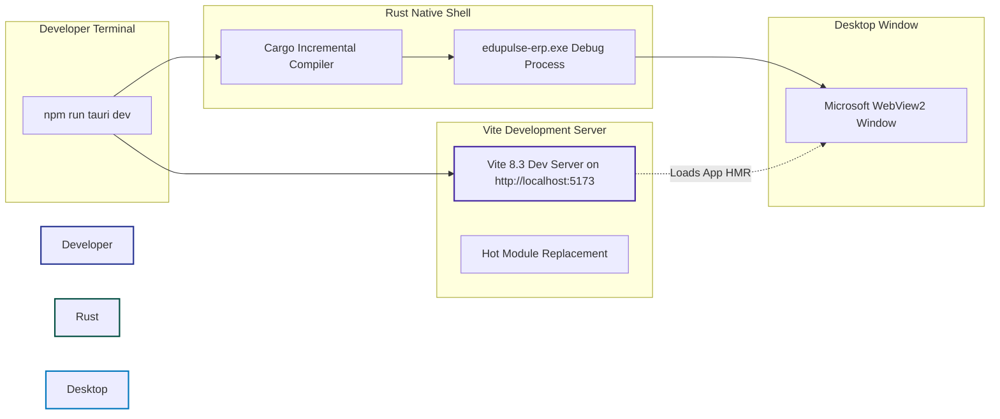
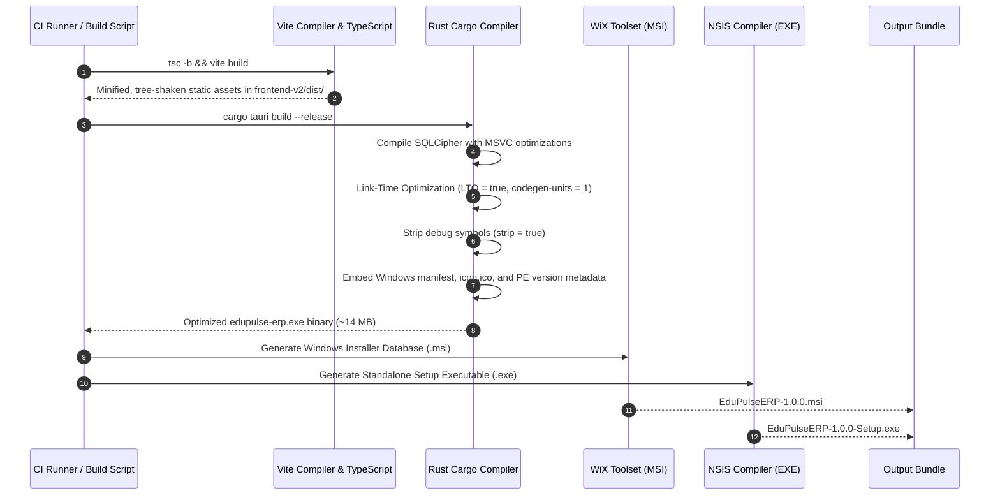

# EduPulse ERP — Day 02, Work Package 07
# Deliverable 07d: Desktop Build, CI/CD, and Release Pipeline

## 1. Development and Local Build Workflow

EduPulse ERP Desktop Edition uses a unified developer workflow that pairs Vite's Hot Module Replacement (HMR) with Tauri's native Rust compilation.



### 1.1 Local Developer Workflow Steps

1. **Prerequisites Verification:**
   - Node.js 22 LTS
   - Rust toolchain: `stable-x86_64-pc-windows-msvc`
   - Visual Studio 2022 C++ Build Tools (MSVC compiler and Windows 10/11 SDK)
   - Microsoft Edge WebView2 (installed on Windows 10/11)
2. **Launching Desktop in Development Mode:**
   ```powershell
   cd Institutioanl_ERP_v1.0-main/Institutioanl_ERP_v1.0/frontend-v2
   npm run tauri dev
   ```
3. **Internal Mechanics of `npm run tauri dev`:**
   - Spawns Vite on `http://localhost:5173`.
   - Runs `cargo check` and compiles Rust native crates incrementally into `src-tauri/target/debug/`.
   - Launches `edupulse-erp.exe` in debug mode with console logging enabled.
   - Spawns the WebView2 window pointing to `http://localhost:5173`.
   - Code edits in React/TypeScript trigger instantaneous HMR without recompiling Rust. Edits to `src-tauri/` automatically trigger incremental Cargo recompilation and window reload.

---

## 2. Decoupling the Desktop Shell from the Java Backend

A fundamental requirement of the EduPulse architecture is the complete decoupling of the desktop shell from the Spring Boot backend.

```
+-----------------------------------------------------------------------------------+
|                        INDEPENDENCE & DECOUPLING RULES                            |
|                                                                                   |
|   1. No Bundled JRE / Spring Boot:                                                |
|      The desktop installer NEVER bundles Java 21, the Spring Boot JAR, or local   |
|      PostgreSQL. Bundling the backend would bloat installer size by > 200 MB,     |
|      create severe port collision issues, and violate the central authority.     |
|                                                                                   |
|   2. Decoupled CI/CD Workflows:                                                   |
|      Desktop GitHub Actions workflows are strictly separated from web/backend CI. |
|      Building or releasing desktop installers NEVER triggers backend deployments  |
|      or affects production cloud databases.                                       |
|                                                                                   |
|   3. API Protocol Compatibility:                                                  |
|      The desktop shell communicates with Spring Boot exclusively via standard     |
|      versioned HTTPS REST endpoints (/api/v1/*), ensuring forward and backward    |
|      compatibility across releases.                                               |
+-----------------------------------------------------------------------------------+
```

---

## 3. Production Build Process (`npm run tauri build`)

When producing release packages, the build system enforces strict optimizations and security protections:



---

## 4. GitHub Actions CI/CD Pipeline Architecture

The desktop build and release pipeline is structured into four independent workflows, preserving all existing web and backend workflows (`ci.yml`).

### 4.1 Four Pipeline Tiers

| Pipeline Tier | Workflow Name | Trigger Event | Primary Responsibility |
| :--- | :--- | :--- | :--- |
| **Tier 1: Local Dev** | Developer Machine | `npm run tauri dev` | Rapid local coding with Vite HMR and debug Rust shell. |
| **Tier 2: CI Validation** | `.github/workflows/desktop-ci.yml` | Pull requests to `main` and `develop` | Fast feedback: linting, TypeScript type-checks, Rust clippy, unit tests. |
| **Tier 3: Release Candidate** | `.github/workflows/desktop-rc.yml` | Push to `release/*` branches | Generates unsigned test installers; executes automated installation tests. |
| **Tier 4: Production Release** | `.github/workflows/desktop-release.yml` | Tag creation (`v*.*.*`) | Builds release installers, signs with Authenticode, generates updater manifest. |

---

## 5. Production Release Workflow Specification (`desktop-release.yml`)

The following specification details the proposed production release workflow:

```yaml
name: Desktop Production Release

on:
  push:
    tags:
      - 'v*.*.*'

concurrency:
  group: desktop-release-${{ github.ref }}
  cancel-in-progress: false

jobs:
  build-windows:
    name: Build & Package Windows Desktop (MSI & NSIS)
    runs-on: windows-2022
    permissions:
      contents: write

    steps:
      - name: Checkout Code
        uses: actions/checkout@v4
        with:
          submodules: recursive

      - name: Setup Node.js 22 LTS
        uses: actions/setup-node@v4
        with:
          node-version: 22
          cache: npm
          cache-dependency-path: Institutioanl_ERP_v1.0-main/Institutioanl_ERP_v1.0/frontend-v2/package-lock.json

      - name: Setup Rust Stable Toolchain
        uses: dtolnay/rust-toolchain@stable
        with:
          targets: x86_64-pc-windows-msvc

      - name: Rust Cache
        uses: swatinem/rust-cache@v2
        with:
          workspaces: Institutioanl_ERP_v1.0-main/Institutioanl_ERP_v1.0/frontend-v2/src-tauri

      - name: Install Frontend Dependencies
        working-directory: Institutioanl_ERP_v1.0-main/Institutioanl_ERP_v1.0/frontend-v2
        run: npm ci

      - name: Build Tauri Desktop Package
        working-directory: Institutioanl_ERP_v1.0-main/Institutioanl_ERP_v1.0/frontend-v2
        env:
          TAURI_SIGNING_PRIVATE_KEY: ${{ secrets.TAURI_UPDATER_PRIVATE_KEY }}
          TAURI_SIGNING_PRIVATE_KEY_PASSWORD: ${{ secrets.TAURI_UPDATER_KEY_PASSWORD }}
        run: npx tauri build

      - name: Sign Windows Installers (Authenticode)
        if: env.WINDOWS_CERTIFICATE_BASE64 != ''
        working-directory: Institutioanl_ERP_v1.0-main/Institutioanl_ERP_v1.0/frontend-v2/src-tauri/target/release/bundle
        env:
          WINDOWS_CERTIFICATE_BASE64: ${{ secrets.WINDOWS_CERTIFICATE_BASE64 }}
          WINDOWS_CERTIFICATE_PASSWORD: ${{ secrets.WINDOWS_CERTIFICATE_PASSWORD }}
        run: |
          # Decoding certificate and executing signtool sign /fd SHA256 ...
          Write-Host "Executing production Authenticode signing..."

      - name: Publish GitHub Release
        uses: softprops/action-gh-release@v2
        with:
          files: |
            Institutioanl_ERP_v1.0-main/Institutioanl_ERP_v1.0/frontend-v2/src-tauri/target/release/bundle/msi/*.msi
            Institutioanl_ERP_v1.0-main/Institutioanl_ERP_v1.0/frontend-v2/src-tauri/target/release/bundle/nsis/*.exe
            Institutioanl_ERP_v1.0-main/Institutioanl_ERP_v1.0/frontend-v2/src-tauri/target/release/bundle/updater/latest.json
          generate_release_notes: true
          draft: false
          prerelease: false
```

---

## 6. Build Reproducibility and Caching Strategy

To ensure deterministic builds and avoid "works on my machine" inconsistencies:
1. **Pinned Dependency Lockfiles:**
   - Node: `frontend-v2/package-lock.json`
   - Rust: `frontend-v2/src-tauri/Cargo.lock`
2. **CI Dependency Caching:**
   - GitHub Actions caches Cargo registry indices, compiled dependency artifacts, and `node_modules`.
   - Cold build duration: ~9–12 minutes (compiling SQLCipher and Rust dependencies).
   - Cached warm build duration: ~2–3 minutes.
3. **Isolated Workspaces:** The build scripts execute strictly within `frontend-v2/`, eliminating any cross-contamination with the root or backend build caches.
