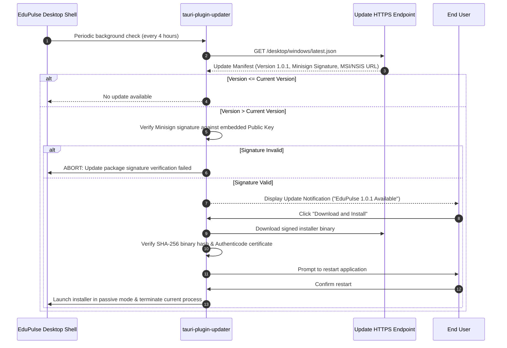

# EduPulse ERP — Day 02, Work Package 07
# Deliverable 07e: Desktop Logging, Diagnostics, Crash Handling, and Auto-Updates

## 1. Desktop Logging Architecture and Sensitive Data Redaction

EduPulse ERP Desktop Edition implements a unified, privacy-first diagnostic logging pipeline combining native Rust telemetry with frontend error reporting.

```mermaid
flowchart TD
    subgraph Frontend Diagnostics
        ReactErr[React Error Boundary] -->|tauri::invoke('log_frontend_event')| NativeLogger
        AxiosErr[Axios Network Interceptor] -->|tauri::invoke('log_frontend_event')| NativeLogger
    end

    subgraph Native Diagnostic Engine
        RustCore[Rust Core & Services] --> NativeLogger[Rust Tracing / tauri-plugin-log]
        NativeLogger --> Redactor[Regex Sanitizer & PII Redaction Filter]
        Redactor --> RollingFile[Daily Rolling Appender: edupulse-YYYY-MM-DD.log]
    end

    subgraph Storage & Export
        RollingFile --> LocalDisk[%LOCALAPPDATA%\com.edupulse.erp\logs\]
        LocalDisk --> ZipExport[Sanitized ZIP Diagnostic Package]
    end

    style Frontend Diagnostics fill:#e3f2fd,stroke:#1565c0,stroke-width:2px
    style Native Diagnostic Engine fill:#e8f5e9,stroke:#2e7d32,stroke-width:2px
    style Storage & Export fill:#fff3e0,stroke:#e65100,stroke-width:2px
```

### 1.1 Log Levels, Paths, and Retention

- **Storage Location:** `%LOCALAPPDATA%\com.edupulse.erp\logs\`
- **Naming Pattern:** `edupulse-YYYY-MM-DD.log`
- **Default Production Level:** `INFO` (Can be temporarily set to `DEBUG` via Settings for troubleshooting).
- **Rotation Policy:** Daily rotation at midnight UTC, with a file size threshold of **10 MB per file**.
- **Retention Policy:** Maximum **14 days** of log history or **50 MB** total log directory size. Older log files are pruned automatically during application startup.

### 1.2 Mandatory Sensitive Data Redaction Pipeline

To protect student privacy and comply with data protection regulations (FERPA, GDPR, Indian DPDP Act 2023), the logging pipeline enforces mandatory in-memory redaction before writing any record to disk:

```
+-----------------------------------------------------------------------------------+
|                        MANDATORY LOG REDACTION RULES                              |
|                                                                                   |
|   1. Authentication Credentials:                                                  |
|      - HTTP Bearer Tokens: Bearer [A-Za-z0-9\-._~+/]+=*  -> Bearer [REDACTED]     |
|      - JSON Passwords: "password":\s*".*?"              -> "password": "[REDACTED]"|
|      - Refresh Tokens: "refreshToken":\s*".*?"          -> "refreshToken": "[REDACTED]"|
|                                                                                   |
|   2. Cryptographic Material:                                                      |
|      - SQLCipher Database Key Hex: PRAGMA key = "x'.*?'" -> PRAGMA key = "[REDACTED]"|
|      - DPAPI Ciphertext Blobs:                           -> [REDACTED_DPAPI_BLOB] |
|                                                                                   |
|   3. Student & Parent PII:                                                        |
|      - National ID Numbers (Aadhaar/SSN): \d{4}-\d{4}-\d{4} -> [REDACTED_NATIONAL_ID]|
|      - Bank Account Numbers: \b\d{9,18}\b               -> [REDACTED_BANK_ACCOUNT]|
+-----------------------------------------------------------------------------------+
```

---

## 2. System Diagnostics and Safe Package Export

When institutional users encounter connectivity or synchronization anomalies, they can generate a sanitized diagnostic report without exposing private records.

### 2.1 Diagnostic Payload Structure

```json
{
  "timestamp": "2026-11-02T12:45:00Z",
  "application": {
    "name": "EduPulse ERP",
    "version": "1.0.0",
    "buildProfile": "release",
    "tauriVersion": "2.0.0"
  },
  "environment": {
    "os": "Windows 11 Enterprise",
    "osBuild": "22631.3880",
    "architecture": "x86_64",
    "webview2Version": "128.0.2739.42 Evergreen"
  },
  "network": {
    "status": "ONLINE",
    "backendUrl": "https://erp.delhi.edupulse.org",
    "isManagedByPolicy": true,
    "lastHealthProbeLatencyMs": 34
  },
  "storage": {
    "databaseSizeBytes": 14680064,
    "quickCheckStatus": "ok",
    "lastSyncTimestamp": "2026-11-02T12:30:00Z",
    "syncedModules": ["students", "timetables", "announcements"]
  }
}
```

### 2.2 Diagnostic Package Export Flow
1. User navigates to **Settings -> System Diagnostics** and clicks **"Export Support Package"**.
2. Rust creates an in-memory ZIP archive containing `diagnostics.json` and the sanitized log files from the past 48 hours.
3. Windows native save file dialog prompts the user to save `edupulse-support-<date>.zip` to their local machine.
4. **Zero Unconsented Telemetry:** EduPulse ERP collects zero remote telemetry or tracking beacons without explicit administrative consent.

---

## 3. Crash Handling and Panic Recovery

The desktop client handles unexpected failures at three distinct boundaries to prevent data loss or silent application termination:

### 3.1 Rust Native Panics
A custom panic hook registered in `main.rs` intercepts unhandled Rust panics:
1. Formats the panic stack trace and writes it to `%LOCALAPPDATA%\com.edupulse.erp\crashdumps\panic-<timestamp>.log`.
2. Flushes pending SQLite WAL transactions to prevent database corruption.
3. Displays a native Windows Win32 message box:
   *"An unexpected internal error occurred. EduPulse ERP will now restart. Your local data remains safe."*
4. Restarts the application cleanly in safe mode.

### 3.2 React Frontend Crashes
A global React Error Boundary (`<DesktopErrorBoundary>`) wraps the application root:
- Catches component render failures, unhandled promise rejections, and DOM exceptions.
- Dispatches a structured error report to Rust via `tauri::invoke("log_frontend_event", { ... })`.
- Renders an inline recovery screen: *"A view error occurred"*, providing immediate "Reload View" and "Return to Dashboard" action buttons.

---

## 4. Tauri v2 Secure Auto-Updates Architecture

EduPulse ERP uses the official `tauri-plugin-updater` with end-to-end cryptographic verification to deliver seamless software updates.



### 4.1 Update Manifest Structure (`latest.json`)

```json
{
  "version": "1.0.1",
  "notes": "EduPulse ERP Desktop 1.0.1 includes performance optimizations for offline timetable queries and updated institutional certificate bundles.",
  "pub_date": "2026-11-02T16:00:00Z",
  "platforms": {
    "windows-x86_64": {
      "signature": "dW50cnVzdGVkIGNvbW1lbnQ6IHNpZ25hdHVyZSBmcm9tIHRhdXJpIHNlY3JldCBrZXkKUldSYzhj...",
      "url": "https://updates.edupulse.org/desktop/windows/EduPulseERP-1.0.1-Setup.exe"
    }
  }
}
```

### 4.2 Cryptographic Security Rules for Updates

1. **Minisign Cryptographic Verification:** The public key is hardcoded directly into the compiled Rust binary via `tauri.conf.json`. Releases are signed using the corresponding private key during the production CI pipeline.
2. **Rejection of Unsigned Updates:** If an update artifact fails signature verification or hash validation, the updater aborts immediately and logs a high-severity security alert.
3. **No Silent Upgrades Without Consent:** End users are always notified before an update restarts their workstation.

---

## 5. Enterprise-Managed Update Policy (GPO Control)

In institutional computer labs and centrally managed enterprise networks, automatic software updates can disrupt scheduled examinations or IT change-management protocols.

### 5.1 Disabling Auto-Updates via Group Policy
Administrators can suppress all client-side updater checks by setting the following Windows Registry key:
```ini
[HKEY_LOCAL_MACHINE\SOFTWARE\Policies\EduPulse]
"DisableAutoUpdate"=dword:00000001
```

When `DisableAutoUpdate == 1`:
- Background update checks are completely suppressed.
- The "Check for Updates" button in Settings displays: *"Updates are managed by your institution administrator."*
- Software patching is managed exclusively by campus IT via Microsoft Intune or SCCM pushing signed MSI packages.

---

## 6. Rollback and Recovery Strategy

If an updated version encounters a critical flaw (e.g., crashing on startup across campus devices):
1. **Crash Loop Detection:** If the application crashes within 30 seconds of launch three consecutive times, the startup manager automatically enters **Safe Mode**.
2. **Safe Mode Prompt:** Safe Mode presents a recovery dialog offering two options:
   - *"Reset Local Cache & Launch with Clean State"*
   - *"Roll Back to Previous Version / Run Installer Repair"*
3. **Server-Side Revocation:** The central operations team can revoke a faulty version by updating `latest.json` or flagging the version as blocked on the backend, prompting clients to revert to the previous stable release.
