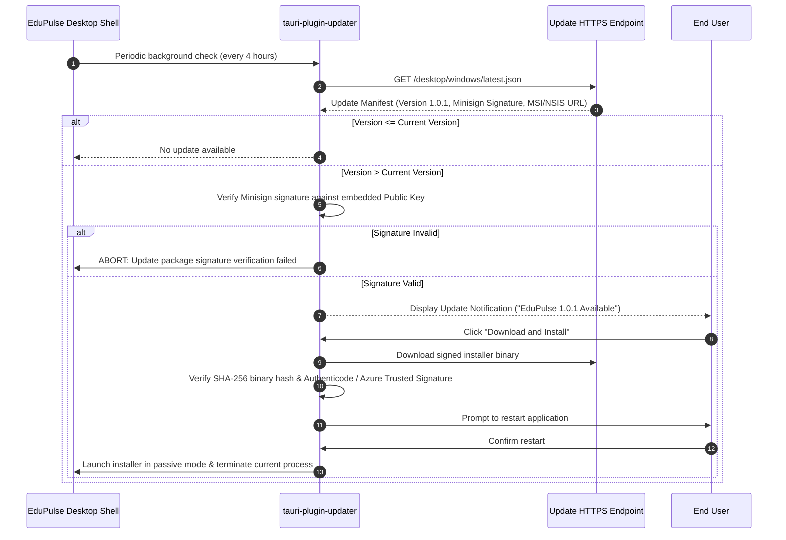

# EduPulse ERP — Day 02, Work Package 07
# Deliverable 07e: Desktop Logging, Diagnostics, Crash Handling, and Auto-Updates

## 1. Desktop Logging Architecture: Structured Allowlist and Redaction

EduPulse ERP Desktop Edition implements a privacy-first diagnostic logging pipeline combining native Rust telemetry with frontend error reporting.

```mermaid
flowchart TD
    subgraph Frontend Diagnostics
        ReactErr[React Error Boundary] -->|tauri::invoke('log_frontend_event')| NativeLogger
        AxiosErr[Axios Network Interceptor] -->|tauri::invoke('log_frontend_event')| NativeLogger
    end

    subgraph Native Diagnostic Pipeline
        RustCore[Rust Core & Services] --> NativeLogger[Rust Tracing Subscriber]
        NativeLogger --> AllowlistFilter[Primary Defense: Structured Field Allowlist]
        AllowlistFilter --> RegexSanitizer[Secondary Defense: Regex Redaction Filter]
        RegexSanitizer --> RollingFile[Daily Rolling Appender: edupulse-YYYY-MM-DD.log]
    end

    subgraph Storage & Export
        RollingFile --> LocalDisk[%LOCALAPPDATA%\com.edupulse.erp\logs\]
        LocalDisk --> ZipExport[Sanitized ZIP Diagnostic Package]
    end

    style Frontend Diagnostics fill:#e3f2fd,stroke:#1565c0,stroke-width:2px
    style Native Diagnostic Pipeline fill:#e8f5e9,stroke:#2e7d32,stroke-width:2px
    style Storage & Export fill:#fff3e0,stroke:#e65100,stroke-width:2px
```

### 1.1 Primary Control: Structured Field Allowlist

Relying exclusively on regex pattern matching to sanitize logs is fragile; new API payloads, custom headers, or unexpected JSON schemas can leak sensitive tokens if regex rules do not anticipate them.

EduPulse enforces **Structured Logging with an Explicit Allowlist of Safe Fields** as the primary architectural defense:

1. **Permitted Operational Fields Only:** Logging events must use typed key-value attributes containing only safe operational metadata:
   ```rust
   // Compliant structured logging pattern in Rust
   tracing::info!(
       module = "academics",
       operation = "fetch_timetable",
       student_id = %sanitized_id,
       status_code = 200,
       duration_ms = 42,
       "Timetable batch synchronized successfully"
   );
   ```
2. **Strict Prohibition of Raw Payloads:**
   - Raw HTTP request headers and request bodies are **strictly forbidden** from being logged.
   - Raw JSON response bodies and database row dumps are **strictly forbidden** from being logged.
   - Arbitrary error objects containing full network contexts cannot be printed via `{:?}` without filtering.

### 1.2 Secondary Defense: Automated Regex Redaction Filter

As a defense-in-depth safety net (e.g. for unexpected third-party library error messages or panic strings), an in-memory regex sanitizer inspects all formatted log lines before writing to disk:

```
+-----------------------------------------------------------------------------------+
|                        REGEX CATCH-ALL REDACTION RULES                            |
|                                                                                   |
|   1. Authentication Credentials:                                                  |
|      - HTTP Bearer Tokens: Bearer\s+[A-Za-z0-9\-._~+/]+=* -> Bearer [REDACTED]    |
|      - Passwords: "(?:password|pwd|secret)":\s*".*?"    -> "[REDACTED_CREDENTIAL]"|
|      - Refresh Tokens: "refreshToken":\s*".*?"          -> "refreshToken": "[REDACTED]"|
|                                                                                   |
|   2. Cryptographic Material:                                                      |
|      - SQLCipher Key Hex: PRAGMA key = "x'.*?'"         -> PRAGMA key = "[REDACTED]"|
|      - DPAPI Ciphertext Blobs:                          -> [REDACTED_DPAPI_BLOB]  |
|                                                                                   |
|   3. Student & Parent PII:                                                        |
|      - National ID Numbers (Aadhaar/SSN): \d{4}-\d{4}-\d{4} -> [REDACTED_NATIONAL_ID]|
|      - Bank Account Numbers: \b\d{9,18}\b               -> [REDACTED_BANK_ACCOUNT]|
+-----------------------------------------------------------------------------------+
```

### 1.3 Log Levels, Paths, and Retention

- **Storage Location:** `%LOCALAPPDATA%\com.edupulse.erp\logs\`
- **Naming Pattern:** `edupulse-YYYY-MM-DD.log`
- **Default Production Level:** `INFO` (Can be toggled to `DEBUG` temporarily via Settings for support sessions).
- **Rotation Policy:** Daily rotation at midnight UTC, with a threshold of **10 MB per file**.
- **Retention Policy:** Maximum **14 days** of log history or **50 MB** total directory size. Older files are automatically pruned on startup.

---

## 2. System Diagnostics, Safe Package Export, and Enterprise Proxy Support

### 2.1 Diagnostic Payload Structure

```json
{
  "timestamp": "2026-11-02T12:45:00Z",
  "application": {
    "name": "EduPulse ERP",
    "version": "1.0.0",
    "buildProfile": "release",
    "tauriVersion": "2.0.0"
  },
  "environment": {
    "os": "Windows 11 Enterprise",
    "osBuild": "22631.3880",
    "architecture": "x86_64",
    "webview2Version": "128.0.2739.42 Evergreen"
  },
  "network": {
    "status": "ONLINE",
    "backendUrl": "https://erp.delhi.edupulse.org",
    "isManagedByPolicy": true,
    "lastHealthProbeLatencyMs": 34,
    "proxyConfigured": true
  },
  "storage": {
    "databaseSizeBytes": 14680064,
    "quickCheckStatus": "ok",
    "lastSyncTimestamp": "2026-11-02T12:30:00Z",
    "syncedModules": ["students", "timetables", "announcements"]
  }
}
```

### 2.2 Diagnostic Package Export Flow
1. User navigates to **Settings -> System Diagnostics** and clicks **"Export Support Package"**.
2. Rust creates an in-memory ZIP archive containing `diagnostics.json` and sanitized rolling logs from the past 48 hours.
3. Windows native save file dialog prompts the user to save `edupulse-support-<date>.zip` locally.
4. **Zero Unconsented Telemetry:** EduPulse ERP collects zero remote telemetry or tracking beacons without explicit administrative consent.

### 2.3 Windows Enterprise Proxy Support (NTLM and Kerberos / SPNEGO)

Higher education campuses frequently route all outbound workstation traffic through enterprise forward proxies (e.g., BlueCoat, Squid, Zscaler) requiring NTLM or Kerberos authentication using active Windows domain credentials.

```
+-----------------------------------------------------------------------------------+
|                     WINDOWS PROXY COMPATIBILITY ARCHITECTURE                      |
|                                                                                   |
|   1. System Proxy Discovery:                                                      |
|      The native Rust reqwest client must discover system proxy settings from the  |
|      Windows WinINet / Internet Options registry configuration.                   |
|                                                                                   |
|   2. NTLM / Kerberos (SPNEGO) Authentication:                                     |
|      Standard reqwest lacks built-in Windows SSPI authentication. To prevent      |
|      HTTP 407 (Proxy Authentication Required) errors:                             |
|      - The background sync engine links with Windows SSPI (Security Support       |
|        Provider Interface) to negotiate transparent Single Sign-On (SSO).         |
|      - Alternatively, native HTTP calls utilize Windows WinHTTP / WinINet APIs     |
|        which handle NTLM/Kerberos handshakes automatically without prompting      |
|        faculty or students for proxy credentials.                                 |
+-----------------------------------------------------------------------------------+
```

---

## 3. Crash Handling and Panic Recovery

The desktop client handles unexpected failures at three distinct boundaries to prevent data corruption or silent crashes:

### 3.1 Rust Native Panics: Diagnostic Capture and SQLite Safety

A custom panic hook registered in `main.rs` intercepts unhandled Rust panics:

```rust
// Panic hook implementation in main.rs
std::panic::set_hook(Box::new(|panic_info| {
    // 1. Capture diagnostic backtrace
    let backtrace = std::backtrace::Backtrace::capture();
    let location = panic_info.location().map(|l| format!("{}:{}:{}", l.file(), l.line(), l.column()))
        .unwrap_or_else(|| "unknown".into());
    let message = if let Some(s) = panic_info.payload().downcast_ref::<&str>() {
        *s
    } else if let Some(s) = panic_info.payload().downcast_ref::<String>() {
        s.as_str()
    } else {
        "Unknown panic payload"
    };

    // 2. Write minimal crash dump to disk
    let crash_dir = get_crashdump_directory();
    let timestamp = chrono::Utc::now().format("%Y%m%d_%H%M%S");
    let dump_file = crash_dir.join(format!("panic_{}.log", timestamp));
    let _ = std::fs::write(&dump_file, format!("Location: {}\nMessage: {}\nBacktrace:\n{:?}", location, message, backtrace));

    // 3. DO NOT execute complex SQLite operations here!
    // Performing database calls or WAL flushes during a panic risks secondary panics,
    // lock deadlocks, or corrupting storage due to poisoned memory state.
}));
```

#### Why SQLite Operations are Omitted During Panics:
- In Rust, panics can occur due to memory inconsistency, stack unwinding, or lock poisoning.
- Attempting to acquire database mutexes or execute `PRAGMA wal_checkpoint` inside a panic hook can cause secondary panics, thread deadlocks, or partial disk writes.
- **SQLite Crash Resilience Guarantee:** SQLite is fundamentally ACID and crash-safe. If the process terminates abruptly, SQLite's Write-Ahead Log (WAL) automatically rolls back uncommitted transactions and recovers committed data during the next startup connection.

### 3.2 Startup Recovery and Integrity Verification

Upon launching the application following a crash:
1. SQLite automatically replays the WAL log to restore the database to the last committed atomic transaction.
2. The Rust shell runs `PRAGMA quick_check;` to verify B-Tree integrity before accepting any queries.
3. If corruption is detected, the self-healing recovery protocol (quarantining corrupt file and re-initializing from server) is triggered.

### 3.3 React Frontend Crashes
A global React Error Boundary (`<DesktopErrorBoundary>`) wraps the application root:
- Catches component render failures, unhandled promise rejections, and DOM exceptions.
- Dispatches a structured error report to Rust via `tauri::invoke("log_frontend_event", { ... })`.
- Renders an inline recovery screen: *"A view error occurred"*, providing immediate "Reload View" and "Return to Dashboard" action buttons.

---

## 4. Tauri v2 Secure Auto-Updates Architecture

EduPulse ERP uses the official `tauri-plugin-updater` with end-to-end cryptographic verification to deliver software updates.



### 4.1 Update Manifest Structure (`latest.json`)

```json
{
  "version": "1.0.1",
  "notes": "EduPulse ERP Desktop 1.0.1 includes performance optimizations for offline timetable queries and updated institutional certificate bundles.",
  "pub_date": "2026-11-02T16:00:00Z",
  "platforms": {
    "windows-x86_64": {
      "signature": "dW50cnVzdGVkIGNvbW1lbnQ6IHNpZ25hdHVyZSBmcm9tIHRhdXJpIHNlY3JldCBrZXkKUldSYzhj...",
      "url": "https://updates.edupulse.org/desktop/windows/EduPulseERP-1.0.1-Setup.exe"
    }
  }
}
```

### 4.2 Cryptographic Security Rules for Updates

1. **Minisign Cryptographic Verification:** The public key is hardcoded directly into the compiled Rust binary via `tauri.conf.json`. Releases are signed using the corresponding private key during the production CI pipeline.
2. **Rejection of Unsigned Updates:** If an update artifact fails signature verification or hash validation, the updater aborts immediately and logs a high-severity security alert.
3. **No Silent Upgrades Without Consent:** End users are always notified before an update restarts their workstation.

---

## 5. Enterprise-Managed Update Policy (GPO Control)

In institutional computer labs and centrally managed enterprise networks, automatic software updates can disrupt scheduled examinations or IT change-management protocols.

### 5.1 Disabling Auto-Updates via Group Policy
Administrators can suppress all client-side updater checks by setting the following Windows Registry key:
```ini
[HKEY_LOCAL_MACHINE\SOFTWARE\Policies\EduPulse]
"DisableAutoUpdate"=dword:00000001
```

When `DisableAutoUpdate == 1`:
- Background update checks are completely suppressed.
- The "Check for Updates" button in Settings displays: *"Updates are managed by your institution administrator."*
- Software patching is managed exclusively by campus IT via Microsoft Intune or SCCM pushing signed MSI packages.

---

## 6. Rollback and Recovery Strategy

If an updated version encounters a critical flaw (e.g., crashing on startup across campus devices):
1. **Crash Loop Detection:** If the application crashes within 30 seconds of launch three consecutive times, the startup manager automatically enters **Safe Mode**.
2. **Safe Mode Prompt:** Safe Mode presents a recovery dialog offering two options:
   - *"Reset Local Cache & Launch with Clean State"*
   - *"Roll Back to Previous Version / Run Installer Repair"*
3. **Server-Side Revocation:** The central operations team can revoke a faulty version by updating `latest.json` or flagging the version as blocked on the backend, prompting clients to revert to the previous stable release.
