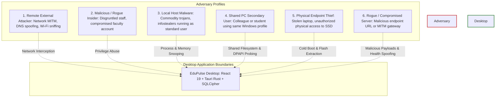

# EduPulse ERP — Day 02, Work Package 08
# Deliverable 08a: Desktop Threat Model and Trust Boundaries

## 1. Executive Summary and Scope

This document defines the comprehensive threat model, architectural trust boundaries, and attack surface analysis for **EduPulse ERP Windows Desktop Edition**.

The transition from a pure browser-based web application to a hybrid desktop application (Tauri v2 + React 19.2 + Rust native core + Spring Boot 3.3.4 + PostgreSQL) alters the security landscape:
- **Separation of Web vs. Desktop Token Storage:** The existing web application stores JWT tokens in browser `localStorage`, leaving them vulnerable to web-tier script access. The proposed desktop architecture eliminates `localStorage` entirely, retaining short-lived access tokens exclusively in JavaScript memory and vaulting persistent refresh tokens via Windows DPAPI.
- **New Attack Surfaces:** The desktop environment introduces new boundaries: the Tauri Inter-Process Communication (IPC) bridge, local file system storage, offline encrypted databases (SQLCipher), native installer binaries, and shared institutional Windows desktop endpoints.

---

## 2. Institutional Assets Requiring Protection

The desktop application handles highly regulated educational, administrative, and financial data:

| Asset Category | Specific Data Elements | Sensitivity & Regulatory Classification |
| :--- | :--- | :--- |
| **Student & Staff PII** | Full names, national identity numbers (Aadhaar/SSN), home addresses, phone numbers, dates of birth, biometric proofs, blood group, medical/allergy emergency records. | **High / Critical** (FERPA, GDPR, Indian DPDP Act 2023). Unauthorized disclosure triggers institutional liability. |
| **Academic Records** | Examination marks, GPA/CGPA scores, official report cards, promotion decisions, degree transcripts, disciplinary history. | **High** (Academic Integrity). Unauthorized tampering destroys institutional credibility. |
| **Financial & Billing Data** | Tuition fee structures, concessions/scholarships, historical cash/card receipts, fee arrears, general ledger accounts. | **Critical** (Financial Accounting Compliance). Fraudulent modification or receipt deletion violates tax and audit laws. |
| **Authentication Secrets** | User login passwords, BCrypt hashes, JWT access tokens, DPAPI-protected refresh tokens, offline master PINs, session snapshots. | **Critical**. Compromise leads to full identity spoofing and unauthorized system access. |
| **Cryptographic Keys** | SQLCipher AES-256 database encryption keys, DPAPI entropy salts, Minisign updater public/private keys, Authenticode signing certificates. | **Critical**. Compromise destroys confidentiality-at-rest and supply chain integrity. |
| **Application Integrity** | Native Windows binaries (`edupulse-erp.exe`), dynamic link libraries (`*.dll`), installer packages (`.msi`, `.exe`), updater manifests. | **Critical**. Tampering enables remote code execution (RCE) on campus endpoints. |

---

## 3. Threat Actors and Adversary Profiles

EduPulse ERP operates across diverse institutional environments ranging from modern university campuses to shared computer labs. The threat model accounts for six primary threat actor profiles:



---

## 4. Architectural Trust Boundaries

The system is partitioned by five distinct trust boundaries:

```mermaid
flowchart LR
    subgraph Client Endpoint [Trust Zone 1: Windows Client Endpoint]
        subgraph Untrusted UI [Untrusted Presentation Tier]
            WebView[React 19.2 in WebView2 DOM]
        end

        subgraph Native Core [Privileged Native Tier]
            TauriCore[Tauri Rust Native Core]
            Vault[(Windows DPAPI Vault)]
            LocalDB[(Encrypted SQLCipher DB)]
        end
    end

    subgraph Network Boundary [Trust Zone 2: Untrusted Network]
        WAN((Campus LAN / Internet / Reverse Proxy))
    end

    subgraph Central Infrastructure [Trust Zone 3: Authoritative Enterprise Tier]
        Backend[Spring Boot 3.3.4 REST API]
        Database[(PostgreSQL Database)]
    end

    WebView <-->|Boundary 1: Tauri IPC Bridge| TauriCore
    TauriCore <-->|Boundary 2: Windows Kernel / DPAPI API| Vault
    TauriCore <-->|Boundary 2: Native C-ABI / AES Page Cipher| LocalDB

    WebView <-->|Boundary 3: Direct HTTPS REST (Bearer Token)| WAN
    TauriCore <-->|Boundary 3: Native HTTPS Sync & Updates| WAN
    WAN <-->|Boundary 4: Spring Security Filter Chain| Backend
    Backend <-->|Boundary 5: JPA / HikariCP Pool| Database

    style Untrusted UI fill:#fffde7,stroke:#fbc02d,stroke-width:2px
    style Native Core fill:#e8f5e9,stroke:#388e3c,stroke-width:2px
    style Network Boundary fill:#f5f5f5,stroke:#9e9e9e,stroke-width:2px
    style Central Infrastructure fill:#e1f5fe,stroke:#0288d1,stroke-width:2px
```

### Trust Boundary Definitions:
1. **Boundary 1 (WebView to Rust IPC):** The React frontend is treated as **untrusted** for security decision-making. JavaScript execution can be hijacked by third-party npm vulnerabilities or DOM XSS. **Crucially: Injected JavaScript can execute `window.__TAURI__.core.invoke()`.** Therefore, the native layer must implement command-level authorization, strict argument validation, and data minimization rather than assuming IPC invocations are inherently benign.
2. **Boundary 2 (Rust Shell to Windows OS):** The boundary between native application code and Windows OS security primitives (`Crypt32.dll`, NTFS DACLs, Windows Registry).
3. **Boundary 3 (Client Endpoint to Campus WAN):** The network transport boundary. All communication must traverse TLS 1.3/1.2; campus networks are assumed to be hostile and subject to packet inspection or DNS manipulation.
4. **Boundary 4 (Network to Spring Boot Backend):** The authoritative perimeter. Spring Security filters, JWT authentication, role-based authorization, and CORS policies are enforced here.
5. **Boundary 5 (Spring Boot to PostgreSQL):** The transactional persistence boundary, isolated within the campus datacenter or private VPC.

---

## 5. STRIDE Threat Scenarios and Analysis

### 5.1 Spoofing (Identity & Origin)
- **Scenario S-01: Rogue Backend Endpoint Spoofing:** An attacker on the local network uses DNS poisoning or DHCP spoofing to redirect `erp.institution.edu` to a rogue server.
  - *Mitigation:* Strict TLS certificate chain validation via the Windows System Trust Store. HTTP cleartext is prohibited; invalid or self-signed certificates without an installed institutional root CA are rejected.
- **Scenario S-02: Shared Generic Windows Account Impersonation:** On shared institutional workstations (e.g. staff rooms or laboratories), multiple users frequently share a single generic Windows user account (`staff_user`).
  - *Vulnerability Analysis:* Windows DPAPI user scope binds encryption keys to the active Windows user SID and logon password. **Because all users share the identical Windows login session, DPAPI `CryptUnprotectData` provides ZERO isolation between different EduPulse users.** Any user logging into Windows can decrypt previously saved DPAPI credentials belonging to another teacher.
  - *Required Mitigations:*
    1. Require an application-level PIN or password challenge before loading offline credentials.
    2. Mandate application logout on shared workstations, which explicitly deletes vaulted tokens.
    3. Support an enterprise GPO policy `PurgeCacheOnLogout = 1` that wipes local cache and DPAPI keys upon process exit.

### 5.2 Tampering (Data & Binary Integrity)
- **Scenario T-01: Local SQLCipher Database Tampering:** An attacker with local user access attempts to hex-edit `cache.db` to alter student grades.
  - *Mitigation:* SQLCipher employs HMAC-SHA256 page-level authentication. Any modification of ciphertext pages invalidates the HMAC, causing SQLCipher to reject the page and trip the self-healing quarantine protocol.
- **Scenario T-02: Malicious Application Update Injection:** An attacker compromises the update distribution server and attempts to push a trojanized `edupulse-erp.exe`.
  - *Mitigation:* The Tauri updater cryptographically validates the Minisign signature against a hardcoded public key embedded in the compiled binary before staging or executing any update installer.

### 5.3 Repudiation (Auditability)
- **Scenario R-01: Repudiation of Offline Data Inspection:** A user inspects confidential student records while offline and later denies having viewed them.
  - *Mitigation:* The Rust native shell records all offline query events into an encrypted local audit queue (`local_audit_events`), cryptographically hashed and transmitted to Spring Boot immediately upon network reconnection (`POST /api/v1/audit/offline-events`).

### 5.4 Information Disclosure (Confidentiality)
- **Scenario I-01: Memory Scraping of Access Tokens:** Infostealer malware running under the same Windows account scans process memory for JWTs.
  - *Mitigation:* Access tokens are strictly short-lived (15 minutes maximum), reducing exposure duration. Refresh tokens are never held in plaintext in long-term memory; they are vaulted in DPAPI and loaded into memory solely during token refresh, with buffers zeroized immediately after use.
- **Scenario I-02: Diagnostic Log Data Leakage:** Diagnostic logs exported for IT support contain sensitive student records or Bearer tokens.
  - *Mitigation:* Primary defense: structured logging allowlist prohibiting raw payload capture. Secondary defense: regex redaction scrubbing all tokens, passwords, and government IDs before writing logs to disk.
- **Scenario I-03: Forensic Data Recovery on Discarded SSDs:** An attacker acquires a decommissioned institution laptop and attempts to recover student data from SSD NAND flash cells.
  - *Realistic Cryptographic Erasure Analysis:* Wear-leveling and bad-block remapping prevent traditional multi-pass file shredding from reliably overwriting physical flash cells. Instead, EduPulse relies on **Cryptographic Erasure (Crypto-Shredding)**: deleting the DPAPI-encrypted 256-bit AES master key (`db.key.dpapi`) renders the residual `cache.db` ciphertext blocks across the SSD flash media mathematically unrecoverable.

### 5.5 Denial of Service (Availability)
- **Scenario D-01: Intentional Cache Corruption to Crash Endpoint:** A malicious user corrupts `cache.db` to cause startup crash loops during examination periods.
  - *Mitigation:* Fast startup integrity check (`PRAGMA quick_check;`) detects corruption, renames the damaged database to `.corrupt.<timestamp>`, initializes a clean schema, and alerts the user without crashing the process.

### 5.6 Elevation of Privilege (Authorization Bypass)
- **Scenario E-01: IPC Abuse via Frontend XSS:** A compromised dependency or DOM XSS executes within the WebView and invokes exposed Tauri IPC commands.
  - *Realistic Threat Assessment:* Injected script can execute `tauri.invoke('vault_get_refresh_token')` or `tauri.invoke('query_offline_cache')` because it runs in the origin context of the window.
  - *Mitigations & Native Guardrails:*
    1. **Command-Level Authorization:** Rust native commands verify active caller state and permissions snapshot before returning sensitive data.
    2. **Data Minimization Across IPC:** Never return database encryption keys or master credentials across IPC.
    3. **Backend Refresh Token Rotation:** Note that while token rotation revokes the individual old token, the existing backend does **NOT** currently invalidate descendant token families on reuse. Implementing complete refresh token family invalidation remains a required backend security enhancement.

---

## 6. Consolidated Threat Register

| Threat ID | STRIDE Category | Threat Description | Severity | Likelihood | Impact | Mitigation Strategy | Residual Risk |
| :--- | :--- | :--- | :--- | :--- | :--- | :--- | :--- |
| **TR-01** | Spoofing | Rogue backend server redirects client | Critical | Medium | High | Strict TLS verification; HSTS; disable cleartext HTTP | Low |
| **TR-02** | Spoofing | Multi-user impersonation on shared Windows generic profile | Critical | High | Critical | DPAPI user scope cannot isolate shared accounts; requires app PIN challenge & `PurgeCacheOnLogout` | Medium (Requires IT Policy) |
| **TR-03** | Tampering | Hex-editing local SQLite cache to alter records | High | Low | High | SQLCipher AES-256-CBC + HMAC-SHA256 page checks | Very Low |
| **TR-04** | Tampering | Malicious binary pushed via auto-updater | Critical | Low | Critical | Dual verification: Minisign signature + Authenticode | Very Low |
| **TR-05** | Tampering | Modifying backend URL in registry without rights | High | Low | High | Stored in `HKLM\SOFTWARE\Policies` (Admin-only DACL) | Very Low |
| **TR-06** | Repudiation | Unlogged offline student record access | Medium | Medium | Medium | Encrypted local audit queue synced on reconnect | Low |
| **TR-07** | Info Disclosure| Web app token theft via browser `localStorage` | Critical | High | Critical | **Web vs Desktop:** Existing web app uses `localStorage`; proposed desktop architecture eliminates it via DPAPI | Low (Desktop) / High (Web) |
| **TR-08** | Info Disclosure| Forensic extraction of student PII from SSD | High | Low | High | SQLCipher page encryption + Cryptographic Erasure (deleting DPAPI key file) | Low |
| **TR-09** | Info Disclosure| PII / Credential leakage in diagnostic logs | High | Medium | High | Structured allowlist logging + regex redaction | Very Low |
| **TR-10** | DoS | Corrupt database causes permanent startup crash | High | Medium | High | Startup quick check + quarantine self-healing | Very Low |
| **TR-11** | DoS | Unbounded WebView cache exhausts disk space | Medium | High | Low | Local storage pruning + quota monitoring | Low |
| **TR-12** | Elevation | XSS invoking exposed Tauri IPC commands | High | Medium | High | Command-level native guards, least-privilege capabilities, data minimization | Medium |
| **TR-13** | Elevation | Offline mutation of attendance or grade data | Critical | Medium | Critical | Strictly read-only offline architecture | Zero |
| **TR-14** | Elevation | Token reuse does not revoke token family on backend | High | Medium | High | **Existing Backend Defect:** Backend only revokes individual token; family invalidation required | High (Pending Backend Fix) |
