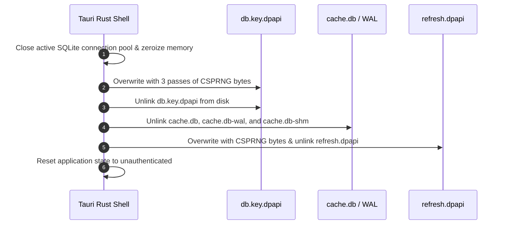

# EduPulse ERP — Day 02, Work Package 08
# Deliverable 08c: Credential, Database, and Offline Data Security Review

## 1. Executive Summary and Scope Consolidation

This document consolidates and reconciles the security architectures defined in **WP03 (Secure Credential Storage Architecture)** and **WP06 (Offline Architecture Design)**.

It evaluates the confidentiality, integrity, and lifecycle of sensitive data stored on Windows endpoints across three cryptographic tiers:
1. **Tier 1 (In-Memory Ephemeral State):** Short-lived JWT access tokens and decrypted session state.
2. **Tier 2 (Windows DPAPI Secret Vault):** Long-lived refresh tokens, offline session snapshots, and database encryption keys.
3. **Tier 3 (SQLCipher Encrypted Local Storage):** Cached institutional records, student directories, timetables, and academic circulars.

---

## 2. Cryptographic Engine Evaluation: Windows DPAPI and SQLCipher

| Cryptographic System | Implementation Mechanism | Cryptographic Primitive | Operating Scope | Threat Mitigation |
| :--- | :--- | :--- | :--- | :--- |
| **Windows DPAPI** (`Crypt32.dll`) | Kernel-level Data Protection API tied to Windows User SID and logon password. | Triple-DES / AES-256 with PBKDF2 Master Key derivation. | Per-User Scope (`CRYPTPROTECT_UI_FORBIDDEN`) + Application Entropy Salt. | Prevents credential theft across separate Windows user accounts and offline disk imaging without user password. |
| **SQLCipher Engine** (`rusqlite` bundled) | Transparent page-level database encryption extension for SQLite. | AES-256-CBC page encryption + HMAC-SHA256 page authentication (4096-byte pages). | Isolated in Rust native process; 100% ciphertext footprint on filesystem. | Protects student PII and academic records at rest; defeats raw disk recovery and hex-editing tampering. |

---

## 3. Key Architecture Evaluation: Single Key vs. Dual Independent Keys

A fundamental architectural question is whether the application should use a single master key to protect both user credentials and offline cached data, or maintain separate, independent cryptographic keys.

```
+----------------------------------------------------------------------------------------------------+
|                                    KEY ARCHITECTURE EVALUATION                                     |
|                                                                                                    |
|   OPTION A: Single Unified Master Key (EVALUATED & REJECTED)                                       |
|   - One DPAPI key encrypts both the refresh token and opens the SQLCipher database.                |
|   - Flaw 1: Coupling. Wiping corrupted cache accidentally logs the user out.                       |
|   - Flaw 2: Security. Inability to re-key or rotate offline database without rotating credentials.  |
|                                                                                                    |
|   OPTION B: Dual Independent Cryptographic Keys (RECOMMENDED ARCHITECTURE)                         |
|   +------------------------------------------------+  +----------------------------------------+   |
|   |         KEY 1: CREDENTIAL VAULT KEY            |  |      KEY 2: SQLCIPHER DATABASE KEY     |   |
|   |             (%APPDATA%\...\refresh.dpapi)      |  |           (%APPDATA%\...\db.key.dpapi) |   |
|   +------------------------------------------------+  +----------------------------------------+   |
|   | * Protects: Refresh token & session snapshot   |  | * Protects: cache.db page ciphertext   |   |
|   | * Derivation: Windows DPAPI User Scope         |  | * Derivation: 256-bit CSPRNG (ring)    |   |
|   | * Salt: "com.edupulse.erp.v1.auth.salt"        |  | * Vaulted: DPAPI ("...offline.salt")   |   |
|   | * Lifecycle: Rotated on login / wiped on logout|  | * Lifecycle: Bound to local cache file |   |
|   +------------------------------------------------+  +----------------------------------------+   |
+----------------------------------------------------------------------------------------------------+
```

### Architectural Decision: Dual Independent Cryptographic Keys
EduPulse ERP adopts **Option B (Dual Independent Keys)**:
1. **Separation of Lifecycles:** Logging out or revoking credentials destroys Key 1 (`refresh.dpapi`), terminating the user's online session. However, institutional policy may permit read-only viewing of cached timetables for a remaining 12-hour offline window using Key 2.
2. **Resilience & Self-Healing:** If `cache.db` becomes corrupt, the self-healing engine can destroy Key 2 and re-create the local database without logging the user out of their active session.
3. **Institution Switching:** When changing the campus server URL, both Key 1 and Key 2 are crypto-shredded simultaneously.

---

## 4. WAL Journals, Temporary Files, and In-Memory Protection

Local database security extends beyond the primary `.db` file:

### 4.1 Write-Ahead Logging (WAL) Security
- SQLite Write-Ahead Logs (`cache.db-wal`) and Shared Memory files (`cache.db-shm`) contain recent transactions.
- **SQLCipher Guarantee:** SQLCipher encrypts pages *before* writing them to the WAL file using the identical AES-256-CBC cipher and HMAC-SHA256 authentication. The WAL file contains zero plaintext.

### 4.2 Temporary Spillover Prevention
- During complex queries, sorting operations, or large index builds, SQLite can spill temporary tables to disk.
- **Protection Control:** EduPulse configures:
  ```sql
  PRAGMA temp_store = MEMORY;
  ```
  This guarantees that all temporary tables and indices are held strictly in process RAM and never written as unencrypted files in Windows `%TEMP%`.

### 4.3 In-Memory Zeroization
When raw keys or tokens are in memory:
- Rust native services employ `zeroize::Zeroize` on byte buffers immediately after passing keys to `CryptProtectData` or `PRAGMA key`.
- On application shutdown, all session structs and connection pools are dropped and their memory regions cleared.

---

## 5. Multi-User Windows Isolation and Institution Switching

### 5.1 Multi-User Windows Workstations
On computers with multiple distinct Windows user profiles:
- Windows NTFS Access Control Lists (DACLs) restrict `C:\Users\<User>\AppData\Roaming\com.edupulse.erp\` to that specific user's SID and `NT AUTHORITY\SYSTEM`.
- Windows DPAPI binds the master key to the user's Windows login credentials. Even if User B possesses Administrator privileges and copies User A's `cache.db` and `db.key.dpapi`, `CryptUnprotectData` fails with `SEC_E_DECRYPT_FAILURE`.

### 5.2 Multi-Institution Switching Protocol
If a user switches backend URLs (e.g. transferring between campus branches), the application executes a mandatory **Crypto-Shredding Sequence**:



This guarantees zero cross-institutional data leakage, even against forensic flash recovery tools.

---

## 6. Offline Session Expiration and Account Deactivation

### 6.1 The 24-Hour Offline Time Ceiling
Offline access relies on a DPAPI-sealed session snapshot containing the user's role permissions. To limit the blast radius of lost or stolen endpoints:
- The offline session enforces a hard ceiling of **24 hours** from the timestamp of the last online backend validation.
- After 24 hours, the Rust shell locks the application and refuses to execute queries against `cache.db` until the client reconnects to Spring Boot.

### 6.2 Accepted Operational Risk: Remote Revocation Latency
Operating in a disconnected state introduces an unavoidable physical limitation:
- **Threat:** If an employee is terminated on the central server while their laptop is offline, the client cannot receive the revocation event.
- **Accepted Risk & Mitigation:** The terminated user retains read-only access to cached operational data for at most 24 hours. They **cannot** perform any write operations (no grade alteration, attendance tampering, or financial transactions). All offline access is logged locally and synchronized upon future reconnection.

---

## 7. Unresolved Cryptographic Design Decisions

The security review identifies two unresolved cryptographic decisions that require institutional policy sign-off:

1. **Hardware-Backed TPM 2.0 Key Sealing:**
   - *Current Design:* Standard Windows DPAPI tied to user Windows login password.
   - *Alternative:* Binding DPAPI keys to Windows Virtualization-Based Security (VBS) and TPM 2.0 hardware PCR registers (`CRYPTPROTECT_SYSTEM`).
   - *Trade-off:* TPM sealing prevents key decryption if the SSD is moved to another identical motherboard, but fails on older campus laptops lacking TPM 2.0 or running legacy Windows installations.
   - *Recommendation:* Maintain user-scoped DPAPI as the default; allow enterprise Group Policy to mandate TPM sealing on managed institutional hardware.
2. **Single-PC Generic Login Partitioning:**
   - *Current Design:* One local offline database per Windows user profile.
   - *Limitation:* If multiple teachers share a single generic Windows account (`staff_room_pc`), they share the same offline database file.
   - *Recommendation:* Require individual application-level user logout, which purges the in-memory key, and mandate `PurgeCacheOnLogout = 1` via GPO on shared generic workstations.
