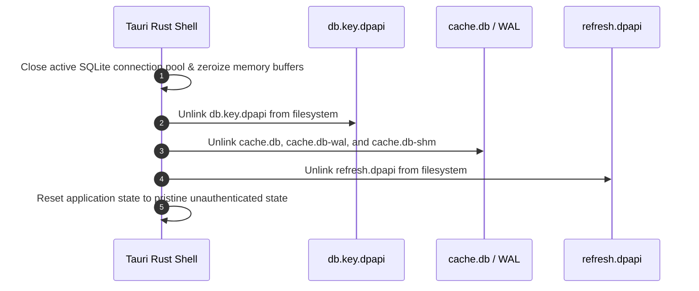

# EduPulse ERP — Day 02, Work Package 08
# Deliverable 08c: Credential, Database, and Offline Data Security Review

## 1. Executive Summary and Scope Consolidation

This document consolidates and reconciles the security architectures defined in **WP03 (Secure Credential Storage Architecture)** and **WP06 (Offline Architecture Design)**.

It evaluates the confidentiality, integrity, and lifecycle of sensitive data stored on Windows endpoints across three cryptographic tiers:
1. **Tier 1 (In-Memory Ephemeral State):** Short-lived JWT access tokens and decrypted session state held in RAM.
2. **Tier 2 (Windows DPAPI Secret Vault):** Long-lived refresh tokens, offline session snapshots, and database encryption keys.
3. **Tier 3 (SQLCipher Encrypted Local Storage):** Cached institutional records, student directories, timetables, and academic circulars.

---

## 2. Cryptographic Engine Evaluation: Windows DPAPI and SQLCipher

| Cryptographic System | Implementation Mechanism | Cryptographic Primitive | Operating Scope | Threat Mitigation |
| :--- | :--- | :--- | :--- | :--- |
| **Windows DPAPI** (`Crypt32.dll`) | Kernel-level Data Protection API tied to Windows User SID and logon credentials. | Triple-DES / AES-256 with PBKDF2 Master Key derivation. | Per-User Scope (`CRYPTPROTECT_UI_FORBIDDEN`) + Application Entropy Salt. | Prevents credential theft across separate Windows user accounts and offline disk imaging without user password. |
| **SQLCipher Engine** (`rusqlite` bundled) | Transparent page-level database encryption extension for SQLite. | AES-256-CBC page encryption + HMAC-SHA256 page authentication (4096-byte pages). | Isolated in Rust native process; 100% ciphertext footprint on filesystem. | Protects student PII and academic records at rest; defeats raw disk recovery and hex-editing tampering. |

---

## 3. Key Architecture Evaluation: Single Key vs. Dual Independent Keys

A fundamental architectural question is whether the application should use a single master key to protect both user credentials and offline cached data, or maintain separate, independent cryptographic keys.

```
+----------------------------------------------------------------------------------------------------+
|                                    KEY ARCHITECTURE EVALUATION                                     |
|                                                                                                    |
|   OPTION A: Single Unified Master Key (EVALUATED & REJECTED)                                       |
|   - One DPAPI key encrypts both the refresh token and opens the SQLCipher database.                |
|   - Flaw 1: Coupling. Wiping corrupted cache accidentally logs the user out.                       |
|   - Flaw 2: Security. Inability to re-key or rotate offline database without rotating credentials.  |
|                                                                                                    |
|   OPTION B: Dual Independent Cryptographic Keys (RECOMMENDED ARCHITECTURE)                         |
|   +------------------------------------------------+  +----------------------------------------+   |
|   |         KEY 1: CREDENTIAL VAULT KEY            |  |      KEY 2: SQLCIPHER DATABASE KEY     |   |
|   |             (%APPDATA%\...\refresh.dpapi)      |  |           (%APPDATA%\...\db.key.dpapi) |   |
|   +------------------------------------------------+  +----------------------------------------+   |
|   | * Protects: Refresh token & session snapshot   |  | * Protects: cache.db page ciphertext   |   |
|   | * Derivation: Windows DPAPI User Scope         |  | * Derivation: 256-bit CSPRNG (ring)    |   |
|   | * Salt: "com.edupulse.erp.v1.auth.salt"        |  | * Vaulted: DPAPI ("...offline.salt")   |   |
|   | * Lifecycle: Rotated on login / wiped on logout|  | * Lifecycle: Bound to local cache file |   |
|   +------------------------------------------------+  +----------------------------------------+   |
+----------------------------------------------------------------------------------------------------+
```

### Architectural Decision: Dual Independent Cryptographic Keys
EduPulse ERP adopts **Option B (Dual Independent Keys)**:
1. **Separation of Lifecycles:** Logging out or revoking credentials destroys Key 1 (`refresh.dpapi`), terminating the user's online session. However, institutional policy may permit read-only viewing of cached timetables for a remaining 12-hour offline window using Key 2.
2. **Resilience & Self-Healing:** If `cache.db` becomes corrupt, the self-healing engine can destroy Key 2 and re-create the local database without logging the user out of their active session.
3. **Institution Switching:** When changing the campus server URL, both Key 1 and Key 2 are crypto-shredded simultaneously.

---

## 4. WAL Journals, Temporary Files, and In-Memory Protection

Local database security extends beyond the primary `.db` file:

### 4.1 Write-Ahead Logging (WAL) Security
- SQLite Write-Ahead Logs (`cache.db-wal`) and Shared Memory files (`cache.db-shm`) contain recent transactions.
- **SQLCipher Guarantee:** SQLCipher encrypts pages *before* writing them to the WAL file using the identical AES-256-CBC cipher and HMAC-SHA256 authentication. The WAL file contains zero plaintext.

### 4.2 Temporary Spillover Prevention
- During complex queries, sorting operations, or large index builds, SQLite can spill temporary tables to disk.
- **Protection Control:** EduPulse configures:
  ```sql
  PRAGMA temp_store = MEMORY;
  ```
  This guarantees that all temporary tables and indices are held strictly in process RAM and never written as unencrypted files in Windows `%TEMP%`.

### 4.3 In-Memory Zeroization
When raw keys or tokens are in memory:
- Rust native services employ `zeroize::Zeroize` on byte buffers immediately after passing keys to `CryptProtectData` or `PRAGMA key`.
- On application shutdown, all session structs and connection pools are dropped and their memory regions cleared.

---

## 5. Multi-User Windows Environments, Shared Profiles, and Institution Switching

### 5.1 Multi-User Windows Workstations (Separate Windows Accounts)
On computers configured with separate Windows user accounts (e.g. `UserA` and `UserB` each having their own Windows login):
- Windows NTFS Access Control Lists (DACLs) restrict `C:\Users\<User>\AppData\Roaming\com.edupulse.erp\` to that specific user's SID and `NT AUTHORITY\SYSTEM`.
- Windows DPAPI binds the master key to the user's Windows login credentials. Even if `UserB` possesses Administrator privileges and copies `UserA`'s `cache.db` and `db.key.dpapi`, `CryptUnprotectData` fails with `SEC_E_DECRYPT_FAILURE`.

### 5.2 Shared Generic Windows Accounts: DPAPI Isolation Failure
In many educational institutions, multiple teachers or lab students share a single generic Windows account (e.g. `staff_room_pc` or `lab_student`).
- **Critical Failure Mode:** Windows DPAPI user scope derives master keys from the logged-in Windows user's SID and Windows account credentials. **Because all teachers share the same Windows profile, DPAPI `CryptUnprotectData` will successfully decrypt any data encrypted under that Windows profile!**
- **DPAPI provides ZERO isolation between different EduPulse users sharing a single Windows login.**
- **Required Architectural Mitigations:**
  1. **Application-Level Master PIN / Password:** EduPulse Desktop must require an application-specific offline master PIN to decrypt and unlock local session state.
  2. **Mandatory Explicit Logout:** Users on shared generic PCs must click "Logout" in EduPulse, which explicitly unlinks `refresh.dpapi` and zeroizes memory keys.
  3. **Enterprise Group Policy Control:** Campus IT can deploy the policy `PurgeCacheOnLogout = 1`, which unconditionally deletes `cache.db` and `db.key.dpapi` whenever the application exits.

### 5.3 Multi-Institution Switching Protocol: Realistic Cryptographic Erasure
If a user switches backend URLs (e.g. transferring between campus branches), the application executes a mandatory **Cryptographic Erasure (Crypto-Shredding)** sequence:



#### Realistic SSD Wear-Leveling Realities:
- On modern NAND flash Solid State Drives (SSDs), software-level multi-pass overwrites (e.g. DoD 3-pass wiping) are **ineffective** because the SSD controller firmware redirects writes to new physical flash cells via wear-leveling algorithms.
- **Why Cryptographic Erasure Works:** The data in `cache.db` is stored as AES-256-CBC ciphertext. By deleting the 256-bit DPAPI encryption key (`db.key.dpapi`) and zeroizing RAM buffers, all residual physical NAND blocks containing `cache.db` ciphertext are rendered mathematically unrecoverable, providing instantaneous and forensically sound data destruction.

---

## 6. Offline Session Expiration and Account Deactivation

### 6.1 The 24-Hour Offline Time Ceiling
Offline access relies on a DPAPI-sealed session snapshot containing the user's role permissions. To limit the blast radius of lost or stolen endpoints:
- The offline session enforces a hard ceiling of **24 hours** from the timestamp of the last online backend validation.
- After 24 hours, the Rust shell locks the application and refuses to execute queries against `cache.db` until the client reconnects to Spring Boot.

### 6.2 Accepted Operational Risk: Remote Revocation Latency
Operating in a disconnected state introduces an unavoidable physical limitation:
- **Threat:** If an employee is terminated on the central server while their laptop is offline, the client cannot receive the revocation event.
- **Accepted Risk & Mitigation:** The terminated user retains read-only access to cached operational data for at most 24 hours. They **cannot** perform any write operations (no grade alteration, attendance tampering, or financial transactions). All offline access is logged locally and synchronized upon future reconnection.

---

## 7. Hardware-Backed Key Protection: CNG Platform Crypto Provider vs. Ordinary DPAPI

A critical technical distinction must be maintained between ordinary DPAPI and true hardware-backed key protection:

### 7.1 Ordinary DPAPI (Software-Based)
- Standard Windows DPAPI (`CryptProtectData`) is a **software-based cryptographic mechanism**.
- It derives master keys from the user's Windows logon password hash and stores encrypted master keys in `%APPDATA%\Microsoft\Protect\<SID>\`.
- While highly effective against other local users and offline disk imaging, it is **not** tied to the machine's hardware security module (TPM) by default.

### 7.2 Hardware-Backed Windows Cryptography Options
When enterprise institutions require hardware-bound key security:
1. **Windows CNG with Microsoft Platform Crypto Provider (PCP):**
   - Cryptography Next Generation (CNG) integrates with the physical **TPM 2.0 (Trusted Platform Module)** silicon.
   - Keys generated via the Microsoft Platform Crypto Provider are sealed inside the TPM hardware chip and can be bound to Platform Configuration Registers (PCRs).
   - Keys cannot be extracted or exported even by administrative kernel drivers.
2. **Virtualization-Based Security (VBS) & Credential Guard:**
   - Isolates cryptographic operations within an isolated virtualized container (Isolated User Mode / VSM), preventing memory-scraping attacks even from local Administrator processes.
3. **Windows Hello for Business:**
   - Employs asymmetric key pairs generated inside the TPM, released only upon successful user biometric (fingerprint/facial recognition) or PIN verification.

### 7.3 Architectural Recommendation
- Maintain **user-scoped DPAPI with application entropy** as the universal baseline for EduPulse Desktop, ensuring full compatibility across all Windows 10/11 editions without requiring specialized TPM configurations.
- Provide an enterprise configuration flag allowing managed institutional devices with TPM 2.0 to utilize CNG Platform Crypto Provider key sealing via institutional Group Policy.
