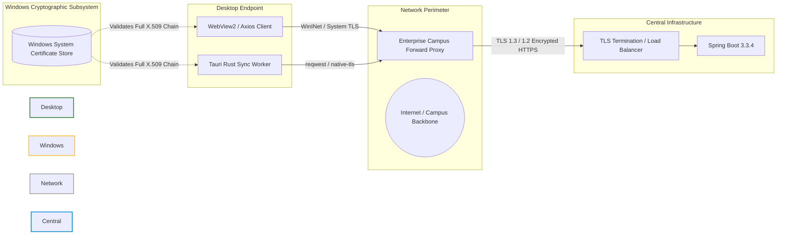

# EduPulse ERP — Day 02, Work Package 08
# Deliverable 08d: Network, API, and Software Supply Chain Security

## 1. Executive Summary and Scope

This document reviews the network communication security, API compatibility policies, and software supply chain integrity for **EduPulse ERP Windows Desktop Edition**.

It examines:
1. Network transport encryption and Windows X.509 certificate validation.
2. Tauri WebView2 origin schemes and Spring Boot CORS compatibility.
3. API authentication transport and token rotation mechanics.
4. Software supply chain controls across Node.js/npm, Rust/Cargo, and GitHub Actions CI/CD.
5. Cryptographic release signing and auto-update verification.

---

## 2. Network and Transport Layer Security

All client-to-server communication between the desktop application and the Spring Boot backend must traverse untrusted campus LANs and wide-area networks (WAN).



### 2.1 Transport Encryption and Certificate Validation

1. **Strict HTTPS Enforcement:** In production builds, cleartext `http://` connections are unconditionally rejected by both the React Axios client and the Rust `reqwest` native sync worker.
2. **TLS Cipher Requirements:** Minimum TLS 1.2; TLS 1.3 strongly preferred. Weak ciphers (RC4, 3DES, CBC-mode ciphers) are disabled at the load balancer / reverse proxy.
3. **X.509 Certificate Chain Validation:**
   - Both WebView2 and Rust `reqwest` validate full X.509 certificate chains against the **Windows System Certificate Store** (`CryptoAPI`).
   - The flag `danger_accept_invalid_certs = true` is **strictly prohibited** in production releases.
   - For on-premises institution servers using private certificate authorities (CAs), institutional IT must deploy the campus root CA to endpoint machines via Active Directory Group Policy.

---

## 3. Tauri WebView Origin and Spring Boot CORS Security

### 3.1 Local WebView Scheme vs. Remote API Connection
An essential architectural distinction exists between the local rendering origin and remote API connections:
- **Local WebView Origin:** The React application is bundled into local assets and served inside WebView2 under the origin:
  `https://tauri.localhost` (configured via `app.windows[].useHttpsScheme = true`).
- **Remote API Connection:** Axios and Tauri sync workers make HTTPS network requests to the remote institutional backend (e.g. `https://erp.institution.edu`).

### 3.2 Spring Boot CORS Policy (`CorsConfig.java`)

To permit legitimate desktop requests without exposing the backend to unauthorized web origins:

```java
// Production Spring Boot CORS Configuration (CorsConfig.java)
@Configuration
public class CorsConfig {
    @Bean
    public CorsFilter corsFilter() {
        UrlBasedCorsConfigurationSource source = new UrlBasedCorsConfigurationSource();
        CorsConfiguration config = new CorsConfiguration();

        config.setAllowCredentials(true);
        // Explicitly whitelisted origins: Web portal + Tauri Windows desktop
        config.setAllowedOrigins(List.of(
            "https://tauri.localhost",          // Tauri v2 Windows Desktop Client
            "https://erp.institution.edu"       // Production Institutional Web Portal
        ));
        config.setAllowedHeaders(List.of(
            "Authorization", "Content-Type", "Accept", "X-Requested-With", "If-None-Match"
        ));
        config.setAllowedMethods(List.of("GET", "POST", "PUT", "PATCH", "DELETE", "OPTIONS"));
        config.setMaxAge(3600L);

        source.registerCorsConfiguration("/api/**", config);
        source.registerCorsConfiguration("/auth/**", config);
        return new CorsFilter(source);
    }
}
```

#### CORS Security Rules:
1. **No Wildcard with Credentials:** Setting `allowedOrigins("*")` combined with `setAllowCredentials(true)` is strictly prohibited and rejected by modern browsers.
2. **Explicit HTTPS Origin Selection:** Only `https://tauri.localhost` is whitelisted. Insecure `http://tauri.localhost` is never permitted in production CORS configurations.

---

## 4. Software Supply Chain Security

Hybrid desktop applications bundle code from multiple software ecosystems. A compromised dependency in either ecosystem can jeopardize endpoint security.

### 4.1 Frontend Ecosystem (npm / Node.js)
The React application (`frontend-v2/`) relies on 30+ direct npm packages and hundreds of transitive dependencies.
- **Controls & Mitigations:**
  - Pinned lockfile (`package-lock.json`) committed to Git.
  - Automated dependency vulnerability scanning via `npm audit` and GitHub Dependabot.
  - Static analysis and code health enforcement using Oxlint.

### 4.2 Native Shell Ecosystem (Rust / Cargo)
The native desktop shell (`src-tauri/`) relies on the Rust crates ecosystem (`tauri`, `rusqlite`, `ring`, `reqwest`, `serde`, `zeroize`).
- **Controls & Mitigations:**
  - Deterministic builds via committed `Cargo.lock`.
  - Automated vulnerability audits in CI using `cargo-audit` (checking against the RustSec Advisory Database).
  - License and dependency policy enforcement via `cargo-deny`.

### 4.3 GitHub Actions CI/CD Pipeline Hardening
The automated release pipeline (`.github/workflows/desktop-release.yml`) operates under strict least-privilege principles:
- **Pinned Action Versions:** Third-party GitHub actions are referenced by verified release tags (e.g. `actions/checkout@v4`).
- **OIDC Token Authentication:** Azure Trusted Signing utilizes OpenID Connect (OIDC) identity federation (`id-token: write`). No long-lived cloud signing credentials or private keys are stored in GitHub repository secrets.
- **Minimal Permissions:** The workflow requests only `contents: write` (for publishing GitHub Releases) and `id-token: write`.

---

## 5. Cryptographic Release Integrity and Update Security

### 5.1 Why SHA-256 Hashes Alone Are Insufficient
A common operational fallacy is assuming that providing a SHA-256 hash file (`SHA256SUMS.txt`) establishes publisher authenticity:
- **The Hash Integrity Fallacy:** A cryptographic hash guarantees that a downloaded binary has not suffered bit-level corruption during transport. However, it provides **zero proof of publisher identity**.
- If an adversary compromises the distribution server or performs a man-in-the-middle attack on an unauthenticated channel, the attacker can simply replace the installer binary *and* provide the corresponding SHA-256 hash of their malicious payload.

### 5.2 Two-Tier Cryptographic Verification

EduPulse ERP enforces two independent, cryptographic layers of authenticity:

```
+----------------------------------------------------------------------------------------------------+
|                               TWO-TIER CRYPTOGRAPHIC VERIFICATION                                   |
|                                                                                                    |
|   Tier 1: OS-Level Authenticode / Azure Trusted Signing                                            |
|   - Authenticode signature embedded in PE header of edupulse-erp.exe and WiX MSI database.         |
|   - Verified by Windows Kernel and Windows Defender SmartScreen prior to execution.                 |
|   - Binds binary mathematically to verified legal identity: "EduPulse Global Technologies Inc."    |
|                                                                                                    |
|   Tier 2: Application-Level Asymmetric Minisign Verification                                       |
|   - Enforced by tauri-plugin-updater during background update checks.                              |
|   - The release manifest (latest.json) contains a Minisign signature created with an offline key.  |
|   - The desktop client verifies the signature against a hardcoded public key embedded in Rust.     |
|   - If the signature fails or does not match the public key, the update is rejected immediately.   |
+----------------------------------------------------------------------------------------------------+
```

This defense-in-depth architecture ensures that even in the catastrophic event of a compromised update web server, no desktop client will ever execute an unauthorized update package.
