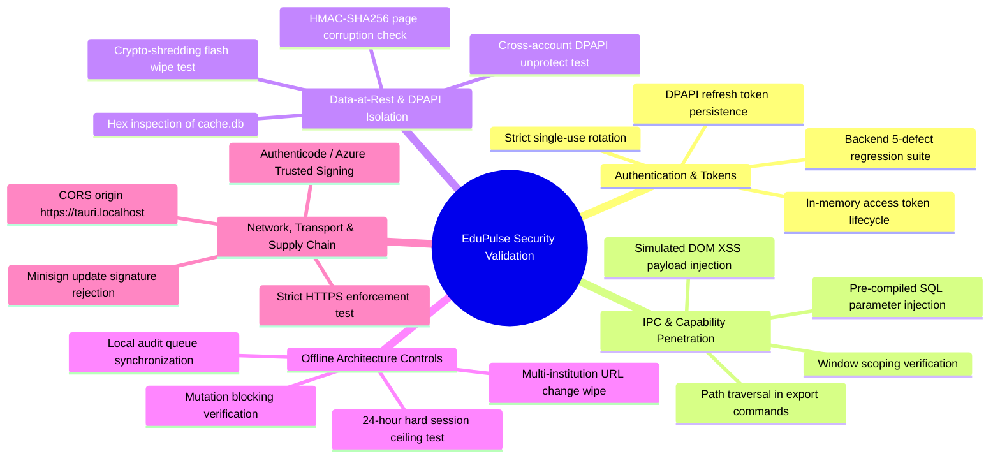

# EduPulse ERP — Day 02, Work Package 08
# Deliverable 08e: Consolidated Security Validation and Remediation Roadmap

## 1. Executive Summary and Validation Framework

This document consolidates the security testing disciplines, empirical validation procedures, and prioritized remediation roadmap for **EduPulse ERP Windows Desktop Edition**.

It synthesizes findings from WP03 (Credential Security), WP04 (Configurable Endpoints), WP05 (CORS & API Compatibility), WP06 (Offline Storage), and WP07 (Desktop Shell & Build Pipeline) into an actionable engineering plan.

---

## 2. Consolidated Security Test Suite

The security validation suite comprises 10 testing disciplines designed to verify architectural controls before enterprise deployment:



### 2.1 Key Validation Procedures

1. **Authentication & Token Isolation Test:** Inspect process memory using WinDbg / Process Hacker. Verify that the refresh token is zeroized from heap immediately after vaulting, and that no tokens are written to `localStorage` or plaintext disk files.
2. **IPC Penetration Test:** Attempt to execute `window.__TAURI__.core.invoke('vault_get_refresh_token')` from an unwhitelisted iframe or secondary popup window; verify native rejection with `AccessDenied`.
3. **Cross-User Windows Isolation Test:** Log into Windows as `UserB`. Attempt to read and decrypt `UserA`'s `cache.db` and `db.key.dpapi`. Verify that Windows NTFS DACL denies read access, and that DPAPI `CryptUnprotectData` fails with `SEC_E_DECRYPT_FAILURE`.
4. **SQLCipher Forensic Verification:** Open `cache.db` in a raw hex editor. Verify that zero plaintext strings (student names, roll numbers, schema names) appear in the file. Alter a single byte in page 1; verify that `PRAGMA quick_check;` detects HMAC failure and triggers self-healing quarantine.
5. **Update Authenticity Test:** Host a modified `latest.json` with an invalid Minisign signature. Verify that `tauri-plugin-updater` rejects the binary, logs a security error, and refuses to prompt the user.

---

## 3. Prioritized Security Remediation Register

The remediation register classifies all identified architectural gaps, existing backend defects, and implementation requirements into four priority tiers:

| Priority Level | Definition | Release Blocking Gate |
| :--- | :--- | :--- |
| **P0** | **Critical Security Blocker** | Must be resolved before any internal alpha or pilot testing. |
| **P1** | **Must Fix Before Production** | Must be resolved before general production release. |
| **P2** | **Required for Broad Institutional Rollout** | Required before deploying across multi-campus enterprise networks. |
| **P3** | **Hardening & Defense-in-Depth** | Continuous security improvements post-release. |

```
+---------------------------------------------------------------------------------------------------------------------------------------+
|                                              PRIORITIZED REMEDIATION REGISTER                                                         |
+----+--------+------------------------------------+-----------------------------------------------------+------------------------------+
| Pri| Defect | Component / Architecture Area      | Vulnerability / Architecture Defect                 | Required Technical Action    |
+----+--------+------------------------------------+-----------------------------------------------------+------------------------------+
| P0 | DEF-01 | Backend: SessionService.java:19    | Revocation Storage Volatility: In-memory token       | Back revoked token blacklist |
|    |        |                                    | blacklist lost on Spring Boot server restart.       | with Redis or PostgreSQL.    |
+----+--------+------------------------------------+-----------------------------------------------------+------------------------------+
| P0 | DEF-02 | Backend: AuthService.java:206      | Password Change Session Survival: Password update   | Call invalidateSession()     |
|    |        |                                    | never invalidates active JWT refresh tokens.        | upon password modification.  |
+----+--------+------------------------------------+-----------------------------------------------------+------------------------------+
| P0 | DEF-03 | Frontend: Existing Web Client      | Plaintext Token Storage: Existing React app stores  | Migrate desktop to DPAPI;    |
|    |        | (frontend-v2)                      | JWT access and refresh tokens in browser localStorage| keep access token in memory. |
+----+--------+------------------------------------+-----------------------------------------------------+------------------------------+
| P1 | DEF-04 | Backend: AuthController.java:54    | Incomplete Logout Revocation: /auth/logout only     | Accept refresh token JTI and |
|    |        |                                    | revokes access token JTI, leaving refresh token alive| blacklist both tokens.       |
+----+--------+------------------------------------+-----------------------------------------------------+------------------------------+
| P1 | DEF-05 | Backend: JwtAuthFilter.java:86     | Account Deactivation Bypass: Filter validates token | Add userDetails.isEnabled()  |
|    |        |                                    | cryptographic signature, but never checks isEnabled()| check in filter chain.       |
+----+--------+------------------------------------+-----------------------------------------------------+------------------------------+
| P1 | SEC-06 | Backend: CorsConfig.java           | CORS Origin Compatibility: Current CORS rejects     | Whitelist explicit origin    |
|    |        |                                    | desktop origin https://tauri.localhost.             | https://tauri.localhost.     |
+----+--------+------------------------------------+-----------------------------------------------------+------------------------------+
| P1 | SEC-07 | Desktop Shell: Build Pipeline      | Unsigned Windows Binaries: Windows Defender         | Integrate Azure Trusted      |
|    |        |                                    | SmartScreen blocks unauthenticated installers.      | Signing into GitHub Actions. |
+----+--------+------------------------------------+-----------------------------------------------------+------------------------------+
| P1 | SEC-08 | Desktop Shell: Update Subsystem    | Untrusted Updates Risk: Releases must be verified   | Embed Minisign public key in |
|    |        |                                    | with cryptographic public key before execution.     | tauri.conf.json.             |
+----+--------+------------------------------------+-----------------------------------------------------+------------------------------+
| P2 | DEF-09 | Backend: SessionService.java:39    | Single-Device Session Overwrite: activeSessions map | Key sessions by composite    |
|    |        |                                    | keyed solely by username; desktop logins collide.   | (userId + deviceId).         |
+----+--------+------------------------------------+-----------------------------------------------------+------------------------------+
| P2 | SEC-10 | Desktop Shell: Network Monitor     | Campus Forward Proxy Incompatibility: Rust reqwest   | Implement Windows SSPI NTLM/ |
|    |        |                                    | fails on authenticated NTLM/Kerberos proxies.       | Kerberos proxy support.      |
+----+--------+------------------------------------+-----------------------------------------------------+------------------------------+
| P2 | SEC-11 | Desktop Shell: Config Manager      | Multi-Campus Cache Leakage: Switching server URL    | Implement mandatory crypto-  |
|    |        |                                    | must wipe prior institution cache and DPAPI keys.   | shredding on endpoint change.|
+----+--------+------------------------------------+-----------------------------------------------------+------------------------------+
| P2 | SEC-12 | Desktop Shell: Native Logging      | PII / Credential Leakage in Logs: Logs must not     | Enforce structured allowlist |
|    |        |                                    | contain raw request payloads or Bearer tokens.      | logging + regex catch-all.   |
+----+--------+------------------------------------+-----------------------------------------------------+------------------------------+
| P3 | SEC-13 | Desktop Shell: Panic Hook          | Crash Loop Stability: Repeated panics require clean | Implement Safe Mode recovery |
|    |        |                                    | recovery without secondary SQLite deadlocks.        | dialog after 3 startup crashes|
+----+--------+------------------------------------+-----------------------------------------------------+------------------------------+
| P3 | SEC-14 | Desktop Shell: Sync Engine         | Soft-Deleted Record Accumulation: Incomplete delta  | Implement weekly module SHA  |
|    |        |                                    | synchronization leaves orphaned deleted records.    | reconciliation sweep.        |
+----+--------+------------------------------------+-----------------------------------------------------+------------------------------+
| P3 | SEC-15 | CI/CD Pipeline: Automated Scanners | Supply Chain Blind Spots: Unaudited npm / Cargo     | Add cargo-audit & npm audit  |
|    |        |                                    | dependencies introduce transitive CVEs.             | checks to pull request CI.   |
+----+--------+------------------------------------+-----------------------------------------------------+------------------------------+
```

---

## 4. Production Security Acceptance Criteria

Before signing off on the production release of EduPulse ERP Desktop Edition, the security team and lead architect must verify that the following criteria are met:

1. **Backend Defect Remediation:** Defects DEF-01, DEF-02, DEF-04, and DEF-05 are fixed in the Spring Boot backend and verified via automated integration tests.
2. **Credential Vault Verification:** Refresh tokens are encrypted exclusively via Windows DPAPI. Zero authentication tokens appear in browser `localStorage` or unencrypted files.
3. **SQLCipher Verification:** The local offline database file (`cache.db`) and WAL journal are 100% encrypted using AES-256-CBC. Raw forensic analysis reveals zero student PII.
4. **Least-Privilege IPC:** The Tauri capability configuration permits only explicit application commands. No generic filesystem, shell execution, or remote origins have access to IPC.
5. **Signed Binaries:** The production `.msi` and `.exe` installers are signed using an Authenticode certificate via Azure Trusted Signing. The update manifest is signed via Minisign.
6. **Strict Transport Security:** All network requests enforce TLS 1.2+ and validate the full certificate chain against the Windows System Trust Store. Insecure HTTP is completely disabled.
7. **Offline Timebox Enforcement:** Offline access locks automatically after 24 hours without connection to the central server.
