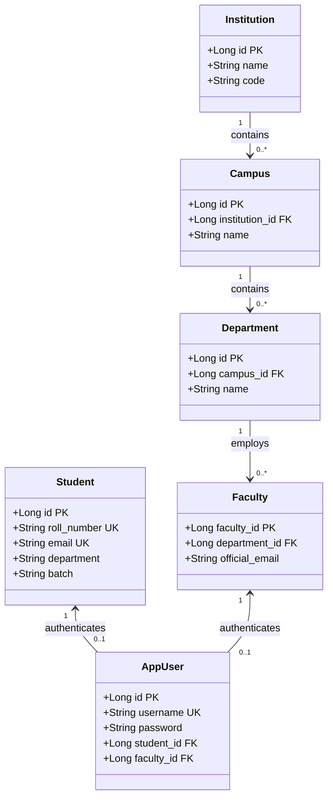

# EduPulse ERP — Day 02, Work Package 09
# Deliverable 09a: Existing PostgreSQL Database Architecture Audit

## 1. Executive Summary and Empirical Baseline Verification

This audit provides an evidence-based technical assessment of the authoritative PostgreSQL database architecture powering **EduPulse ERP**.

An empirical inspection of the backend source code (`backend/src/main/java/com/erp/`) and database migration scripts (`backend/src/main/resources/db/migration/`) establishes the verified system baseline:

```
+-----------------------------------------------------------------------------------+
|                        EMPIRICAL SYSTEM BASELINE VERIFICATION                     |
|                                                                                   |
|   1. Authoritative Database Engine:  PostgreSQL 17 (CI & Target Deployment)       |
|   2. Verified Flyway Migrations:    9 Scripts (V1__baseline through V9__photos)   |
|   3. Total Relational Tables:        54 Tables Created in PostgreSQL Schema       |
|   4. Verified JPA Entity Classes:    54 Classes Annotated with @Entity            |
|   5. In-Memory Dev Fallback:         H2 In-Memory Database (dev/dev-json profile) |
|   6. Connection Pool:                HikariCP (10 max connections, SSL required)  |
|   7. Schema Evolution Ownership:     Spring Boot Flyway (Strictly Server-Side)    |
+-----------------------------------------------------------------------------------+
```

> **Correction of Prior Documentation Baseline:** Prior Day 01 preliminary notes cited a rough count of "58 JPA entities". An exhaustive file-by-file AST verification confirms there are **exactly 54 `@Entity` classes**, matching the **54 relational tables** created by Flyway migrations V1 through V9.

---

## 2. PostgreSQL Schema and Migration History

Authoritative schema migrations are managed exclusively by Flyway in `backend/src/main/resources/db/migration/`:

| Version | Migration Script Name | Date / Commit | Tables Created / Altered | Core Architectural Scope |
| :--- | :--- | :--- | :--- | :--- |
| **V1** | `V1__baseline_erp_schema.sql` | 2026-10-09 | 51 Tables Created | Complete baseline ERP schema: academics, timetable, admission, attendance, finance, guardians, institution, campus, department, students, and faculty. |
| **V2** | `V2__persistent_user_management.sql` | 2026-10-12 | 1 Table Created (`users`) | Persistent Spring Security user authentication table with username, password hash, role, email, and enabled flag. |
| **V3** | `V3__enforce_faculty_fk.sql` | 2026-10-12 | Alter Table (`faculty`) | Enforces referential integrity constraint linking `faculty.department_id` to `department.id`. |
| **V4** | `V4__link_users_to_domain_entities.sql` | 2026-10-12 | Alter Table (`users`) | Adds `student_id` and `faculty_id` foreign keys to `users` table with unique constraints. |
| **V5** | `V5__payment_idempotency.sql` | 2026-10-12 | Alter Table (`finance_payment`) | Adds idempotency key column and unique constraint to prevent duplicate fee transaction processing. |
| **V6** | `V6__link_guardians_to_users.sql` | 2026-10-14 | Alter Table (`guardians`) | Adds `user_id` foreign key linking parent/guardian profiles to persistent login credentials. |
| **V7** | `V7__add_missing_schema_columns.sql` | 2026-10-16 | Multiple Alters | Adds missing audit timestamps and status columns across academic modules. |
| **V8** | `V8__create_notifications_table.sql` | 2026-10-19 | 1 Table Created (`notifications`) | Creates table for institutional broadcasts, target roles, delivery channels, and read receipts. |
| **V9** | `V9__create_student_photos_table.sql` | 2026-10-19 | 1 Table Created (`student_photos`) | Stores student identity photograph metadata, storage URLs, and biometric verification flags. |

---

## 3. Comprehensive Entity and Table Inventory (54 Tables Across 9 Domains)

The 54 tables and their corresponding JPA entity models are organized into 9 cohesive functional clusters:



### Table Inventory by Domain:

1. **Core & Administration (4 Tables):**
   - `institution` (Root institutional entity)
   - `campus` (Physical campus branches referencing `institution_id`)
   - `department` (Academic departments referencing `campus_id`)
   - `users` (Spring Security authentication accounts)
2. **Student Lifecycle Management (9 Tables):**
   - `students` (Core student demographic & status profile)
   - `guardians` (Parent and guardian records referencing `student_id` and `user_id`)
   - `student_academic_records` (Prior qualifications, GPA, graduation credits)
   - `student_categories` (Fee and quota categories: General, OBC, SC, ST)
   - `student_documents` (Uploaded student verification files and identity proofs)
   - `student_enrollments` (Term-based enrollment records)
   - `student_photos` (Student identity photographs)
   - `student_status_history` (Audit log of status changes: ACTIVE, SUSPENDED, GRADUATED)
   - `student_history` (Historical demographic modification logs)
3. **Academics & Curriculum (17 Tables):**
   - `academic_year`, `semester`, `program`, `batch`, `course`, `course_prerequisite`, `course_offering`, `course_registration`, `add_drop_request`, `credit_rule`, `curriculum`, `curriculum_course`, `subject`, `room`, `section`, `section_faculty`, `section_student`.
4. **Timetable & Scheduling (3 Tables):**
   - `class_schedule` (Master schedule definitions)
   - `time_slot` (Weekly time windows with unique `(day_of_week, start_time, end_time)`)
   - `timetable_slot` (Assigned allocations linking `faculty_id`, `room_id`, and `section_id`)
5. **Admissions & Enrollment (4 Tables):**
   - `applicant`, `admission_application`, `applicant_document`, `admission_inquiry`.
6. **Attendance Management (4 Tables):**
   - `student_attendance_record` (Daily period-level attendance tracking)
   - `attendance_correction` (Formal teacher/admin correction requests)
   - `leave_request` (Student absence applications and approvals)
   - `attendance_alert` (System-generated low-attendance warnings)
7. **Faculty & Staff (1 Table):**
   - `faculty` (Academic faculty profiles linked to `department_id`)
8. **Finance & Fee Management (11 Tables):**
   - `fee_head`, `fee_structure`, `fee_structure_component`, `student_fee`, `student_fee_component`, `finance_payment`, `finance_payment_allocation`, `finance_receipt`, `finance_concession`, `finance_scholarship`, `finance_student_scholarship`.
9. **Notifications & Broadcasts (1 Table):**
   - `notifications` (Campus broadcasts, target audience criteria, and delivery status).

---

## 4. Keys, Constraints, and Indexing Strategy

### 4.1 Primary Keys
- Standardized across all 54 tables using auto-incrementing 64-bit surrogate keys: `bigint generated by default as identity primary key`.
- Eliminates natural key churn and minimizes foreign key index footprints.

### 4.2 Natural Keys and Unique Constraints
- `students.roll_number` (VARCHAR 50, UNIQUE)
- `students.email` (VARCHAR 150, UNIQUE)
- `faculty.official_email` (VARCHAR 150, UNIQUE)
- `users.username` (VARCHAR 50, UNIQUE)
- `users.email` (VARCHAR 100, UNIQUE)
- `subject.code` (VARCHAR 255, UNIQUE)
- `time_slot(day_of_week, start_time, end_time)` (COMPOSITE UNIQUE)
- `finance_payment.idempotency_key` (VARCHAR 100, UNIQUE)

### 4.3 Referential Integrity and Indexing
- Foreign keys are defined explicitly with relational constraints (`ON DELETE RESTRICT` by default to prevent accidental orphaned financial and academic records).
- B-Tree indexes are generated automatically on all primary keys and unique constraints. Foreign keys participating in frequent JOIN operations (`section_id`, `student_id`, `faculty_id`) have explicit B-tree indexes defined in Flyway V1.

---

## 5. Audit Logging and Soft-Deletion Reality Check

An exhaustive code inspection of all 54 JPA entity classes reveals crucial insights into existing database behaviors:

### 5.1 Audit Columns
- **Timestamps Present:** Core entities utilize Spring Data JPA's `@EntityListeners(AuditingEntityListener.class)` with `@CreatedDate` (`created_at`) and `@LastModifiedDate` (`updated_at`).
- **Missing Audit Actors:** None of the 54 entities implement `@CreatedBy` or `@LastModifiedBy`. User IDs responsible for database modifications are not captured at the entity row level; changes must be inferred from separate application-level audit logs.

### 5.2 The Soft-Deletion Reality: Zero Soft-Delete Infrastructure
- **Critical Finding:** There is **NO automated soft-delete infrastructure** in the existing PostgreSQL database.
- None of the entities implement `@SQLDelete`, `@Where(clause = "is_deleted = false")`, or contain a `deleted_at` timestamp.
- Executing `repository.deleteById(id)` generates a raw SQL statement:
  ```sql
  DELETE FROM students WHERE id = ?;
  ```
- While status fields exist (e.g. `students.status = 'INACTIVE'`, `faculty.is_active = false`), true row deletions physically remove the record from PostgreSQL.
- **Impact on Desktop Offline Synchronization:** Because hard deletes leave no trace in `updated_at`, naive delta synchronization (`SELECT ... WHERE updated_at > :since`) **cannot discover deleted records**. Reconciling deleted records requires cryptographic hash comparisons or a newly introduced tombstones table.

---

## 6. Connection Pooling and Transaction Management

### 6.1 HikariCP Production Configuration
Production connection pooling is configured in `backend/src/main/resources/application.yml`:
- **Pool Size:** `maximum-pool-size: 10`, `minimum-idle: 2` (sized for institutional app servers).
- **Timeouts:** `connection-timeout: 30000ms`, `idle-timeout: 600000ms`, `max-lifetime: 1800000ms`.
- **SSL Enforcement:** `sslmode: require` enforces mandatory transport encryption between Spring Boot and PostgreSQL.
- **Open-Session-In-View:** `spring.jpa.open-in-view: false` is strictly enforced, preventing database connection leaks during long-running HTTP serialization phases.

### 6.2 Transactional Boundaries
- Service methods are annotated with `@Transactional(readOnly = true)` for query workloads and `@Transactional` for state modifications.
- Read-only transactions reduce PostgreSQL lock overhead and allow the driver to optimize read queries.

---

## 7. Existing Database Technical Debt and Architectural Risks

| Risk Identifier | Component / Area | Description of Technical Debt | Architectural Risk Level |
| :--- | :--- | :--- | :--- |
| **DB-DEBT-01** | Multi-Tenancy | `students`, `finance_*`, and `attendance` lack `institution_id` columns. Global unique constraints (`roll_number`, `email`) prevent shared-database multi-tenancy. | **High** (Enforces single-tenant deployment per database) |
| **DB-DEBT-02** | Synchronization | Absence of soft-deletion (`deleted_at` / tombstones) prevents delta sync from detecting deleted records. | **High** (Requires hash reconciliation for offline cache) |
| **DB-DEBT-03** | Denormalization | `students.department` and `students.program` are stored as plain VARCHAR strings rather than foreign key references to `department.id` and `program.id`. | **Medium** (Risk of string mismatch during department renaming) |
| **DB-DEBT-04** | Audit Actors | Lack of `created_by` / `last_modified_by` prevents row-level attribution of unauthorized modifications. | **Medium** (Compliance & non-repudiation gap) |
