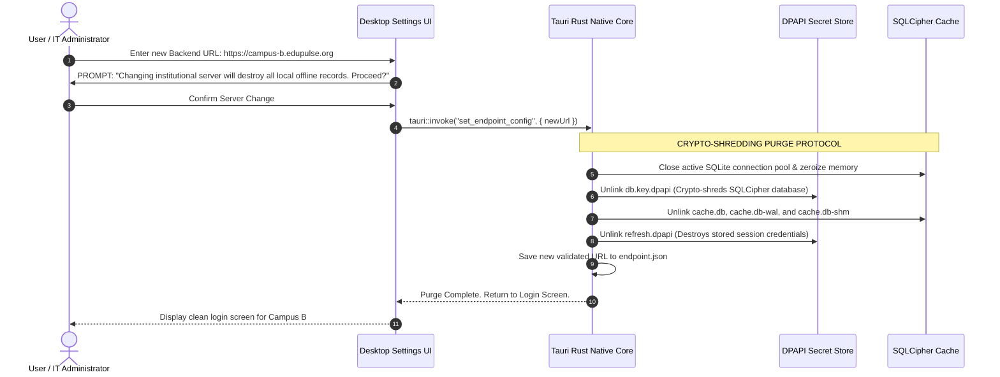

# EduPulse ERP — Day 02, Work Package 09
# Deliverable 09b: Institutional and Campus Data Isolation Architecture

## 1. Executive Summary and Existing Reality Check

A critical responsibility of database architecture is ensuring strict isolation between different institutions, campuses, and operational departments.

### 1.1 The Existing Reality: Institution-Specific Single-Tenant Database

An empirical audit of the 54 PostgreSQL tables across Flyway migrations V1–V9 establishes a fundamental architectural reality:

```
+-----------------------------------------------------------------------------------+
|                        EMPIRICAL TENANCY FINDINGS                                 |
|                                                                                   |
|   1. NO Multi-Tenant Discriminator:                                               |
|      Tables such as 'students', 'users', 'finance_payment', and                   |
|      'student_attendance_record' DO NOT possess a 'tenant_id' column.              |
|                                                                                   |
|   2. Table-Wide Global Unique Constraints:                                        |
|      'students.roll_number', 'students.email', and 'users.username' enforce       |
|      uniqueness globally across the entire table.                                 |
|      * Two institutions cannot share the same database without colliding!         |
|                                                                                   |
|   3. Existing Model: Single-Tenant Instance per Institution:                      |
|      EduPulse is implemented as an institution-specific application where each    |
|      college or school operates its own dedicated PostgreSQL database instance.   |
+-----------------------------------------------------------------------------------+
```

> **Crucial Architecture Distinction:** EduPulse ERP does **not** currently implement a shared-database multi-tenant SaaS architecture. Any claim that the existing database isolates multiple tenants within a single PostgreSQL database is factually incorrect.

---

## 2. Existing Institutional and Campus Hierarchy

Within an individual institution's database, the application establishes a hierarchical organization model:

```mermaid
flowchart TD
    subgraph Institutional Scope
        Inst[Institution Table: Root Entity - ID, Name, Code]
    end

    subgraph Campus Scope
        Campus1[Campus: Main Campus - institution_id]
        Campus2[Campus: Satellite Branch - institution_id]
    end

    subgraph Department Scope
        Dept1[Department: Computer Science - campus_id]
        Dept2[Department: Mechanical Eng - campus_id]
        Dept3[Department: Business Admin - campus_id]
    end

    subgraph Staff & Academic Scope
        Fac1[Faculty Members - department_id]
        Sub1[Subjects & Syllabi - department_id]
    end

    subgraph Student Scope
        Stud[Students: Plaintext 'department' & 'program' strings]
    end

    Inst --> Campus1
    Inst --> Campus2
    Campus1 --> Dept1
    Campus1 --> Dept2
    Campus2 --> Dept3
    Dept1 --> Fac1
    Dept1 --> Sub1
    Dept1 -.->|Denormalized String Match| Stud

    style Institutional Scope fill:#e1f5fe,stroke:#0288d1,stroke-width:2px
    style Campus Scope fill:#e8f5e9,stroke:#2e7d32,stroke-width:2px
    style Department Scope fill:#fff9c4,stroke:#fbc02d,stroke-width:2px
    style Staff & Academic Scope fill:#f3e5f5,stroke:#7b1fa2,stroke-width:2px
    style Student Scope fill:#ffebee,stroke:#c62828,stroke-width:2px
```

### 2.1 Existing Relationship Audit
- **`institution`:** Contains root organizational attributes (`name`, `code`, `address`). In production, this table contains exactly **1 row** representing the deploying institution.
- **`campus`:** Links directly to `institution.id` via `institution_id bigint`. Supports multi-campus colleges (e.g. City Campus vs. Rural Campus).
- **`department`:** Links to `campus.id` via `campus_id bigint`.
- **`faculty`:** Links to `department.id` via `department_id bigint` (enforced via Flyway `V3__enforce_faculty_fk.sql`).
- **`students` (Isolation Weakness):** Unlike faculty, the `students` table does **not** maintain a foreign key to `department.id` or `campus.id`. Instead, `department` and `program` are stored as denormalized plain-text `varchar(100)` strings.

---

## 3. Existing Access Control Weaknesses and IDOR Risks

Because tenancy is enforced by hosting boundaries rather than database query constraints, internal data isolation across campuses exhibits notable technical vulnerabilities:

### 3.1 Insecure Direct Object References (IDOR) Across Campuses
- **Vulnerability Mechanism:** Spring Data JPA repositories rely on standard query methods:
  ```java
  // Inherent IDOR exposure if invoked without campus ownership check
  Optional<Student> findById(Long id);
  ```
- If an institution operates multiple campuses (e.g. Campus A and Campus B) within the same database, an administrative clerk at Campus A can access student records belonging to Campus B simply by supplying the student's numeric database ID (`/api/v1/students/1042`).
- **Absence of Row-Level Filtering:** Repositories lack automated tenant or campus filters (such as Hibernate `@Filter` or Spring Data JPA entity graphs scoped by `campus_id`).

### 3.2 Service-Level Role Authorization Limitations
- Spring Security checks enforce role existence (e.g., `@PreAuthorize("hasRole('ADMIN')")`), but do **not** check whether the administrator's assigned campus matches the target entity's campus.
- **Residual Risk:** Staff with administrative roles possess full vertical visibility across all campuses within that institution's database.

---

## 4. Target Architecture for Three Institutional Deployment Topologies

To accommodate diverse educational institutions without compromising data integrity, EduPulse defines three formal deployment models:

```
+----------------------------------------------------------------------------------------------------+
|                                  DEPLOYMENT TOPOLOGY MATRIX                                        |
|                                                                                                    |
|   TOPOLOGY 1: Dedicated Private Instance (Current Production Standard)                             |
|   - Architecture: Dedicated Spring Boot container + Dedicated PostgreSQL database per institution.|
|   - Tenancy Model: Physical Database-per-Institution Isolation.                                    |
|   - Strengths: Flawless physical isolation; regulatory compliance; zero risk of data leakage.     |
|                                                                                                    |
|   TOPOLOGY 2: Multi-Campus Single Institution (Central University Cluster)                         |
|   - Architecture: Shared backend database cluster; data partitioned hierarchically by campus_id.   |
|   - Tenancy Model: Campus-Scoped RBAC with Repository-Level WHERE campus_id = :id Filtering.       |
|   - Strengths: Centralized academic management with localized campus operational boundaries.      |
|                                                                                                    |
|   TOPOLOGY 3: Cloud-Hosted Multi-Tenant SaaS (Target Future Evolution)                             |
|   - Architecture: Multi-tenant routing proxy with Database-per-Tenant provisioning.               |
|   - Tenancy Model: Dynamic Routing DataSource (AbstractRoutingDataSource).                        |
|   - Strengths: Preserves existing 54-table schema, avoids rewriting global unique constraints.     |
+----------------------------------------------------------------------------------------------------+
```

---

## 5. Desktop Client Multi-Institution Isolation Protocol

The desktop application must interact with both single-campus colleges and multi-campus university clusters without risking cross-institution cache contamination.

### 5.1 Endpoint Isolation Principle
The desktop client is explicitly bound to **one authoritative backend server URL at any given moment**.
- The client endpoint configuration is stored in `HKLM\SOFTWARE\Policies\EduPulse\BackendUrl` (enterprise managed) or `%APPDATA%\com.edupulse.erp\config\endpoint.json` (user configured).

### 5.2 Mandatory Cache Purging on Institution Switch
Under no circumstances may data from **Institution A** persist when a user reconfigures the desktop application to point to **Institution B**:



### 5.3 Multi-Campus User Navigation
For faculty members who teach across multiple campuses within the *same* institution:
- The institution's Spring Boot backend returns the list of authorized campus IDs within the user's JWT token claims:
  ```json
  "campuses": [
    { "campusId": 1, "name": "North Campus", "role": "TEACHER" },
    { "campusId": 2, "name": "South Campus", "role": "HOD" }
  ]
  ```
- The React frontend provides an active campus switcher in the title bar.
- Switching active campuses changes the context header (`X-Campus-Id: 2`) on outbound API calls and filters the local view, without requiring database wiping because both campuses share the same authoritative institutional boundary.
