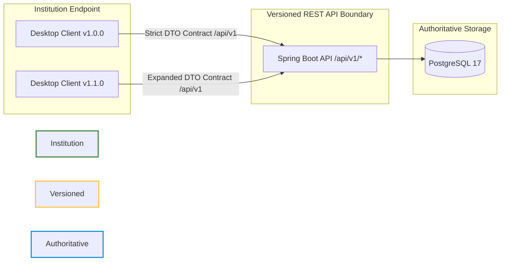
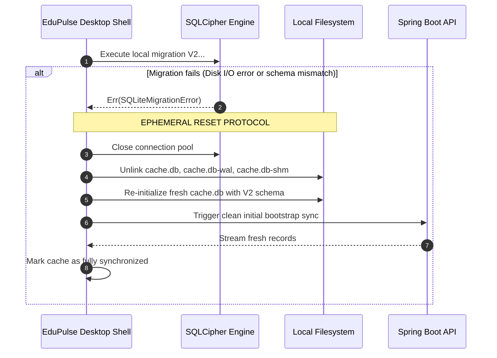

# EduPulse ERP — Day 02, Work Package 09
# Deliverable 09c: Database Migration and Version Management Architecture

## 1. Executive Summary and Architectural Ownership Boundaries

EduPulse ERP enforces a strict separation of concerns between authoritative server-side database migrations and client-side local cache lifecycle management.

```
+----------------------------------------------------------------------------------------------------+
|                               MIGRATION OWNERSHIP BOUNDARIES                                        |
|                                                                                                    |
|   +---------------------------------------------------+  +-------------------------------------+   |
|   |         AUTHORITATIVE SERVER DATABASE             |  |        LOCAL DESKTOP CACHE          |   |
|   |             (PostgreSQL 17)                       |  |        (SQLCipher / SQLite)         |   |
|   +---------------------------------------------------+  +-------------------------------------+   |
|   | * Migration Engine: Flyway (Spring Boot)          |  | * Migration Engine: Native Rust     |   |
|   | * Scripts: backend/.../db/migration/V1__...       |  | * Table: schema_migrations          |   |
|   | * History Table: flyway_schema_history            |  | * Ownership: Tauri Native Shell     |   |
|   | * Data Authority: Sole Source of Truth            |  | * Data Authority: Ephemeral Replica |   |
|   | * Desktop App: ZERO Direct Access to PostgreSQL   |  | * Server: ZERO Direct Access to DB  |   |
|   +---------------------------------------------------+  +-------------------------------------+   |
+----------------------------------------------------------------------------------------------------+
```

### Immutable Migration Rules:
1. **Flyway Owns PostgreSQL:** Schema evolution of PostgreSQL is managed strictly by Flyway running within the Spring Boot backend during application boot.
2. **Tauri Never Touches PostgreSQL:** The Tauri desktop application, Rust native layer, and WebView JavaScript **never** connect directly to PostgreSQL and never execute DDL against the central database.
3. **Independent Local Migrations:** The desktop SQLCipher cache maintains its own schema migrations, completely decoupled from Flyway.
4. **Desktop Upgrades Cannot Corrupt Server:** A desktop application software update can never alter, lock, or corrupt the central PostgreSQL database.

---

## 2. Existing Flyway Migration Architecture

Flyway migrations reside in `backend/src/main/resources/db/migration/` and follow strict strict semantic ordering: `V{version}__{description}.sql`.

### 2.1 The Verified Migration Ledger (V1 through V9)

```text
backend/src/main/resources/db/migration/
├── V1__baseline_erp_schema.sql         # 51 Baseline tables (Academics, Attendance, Finance, Students)
├── V2__persistent_user_management.sql  # Users authentication table
├── V3__enforce_faculty_fk.sql          # Foreign key: faculty.department_id -> department.id
├── V4__link_users_to_domain_entities.sql # Foreign keys: users.student_id & users.faculty_id
├── V5__payment_idempotency.sql         # Unique constraint: finance_payment.idempotency_key
├── V6__link_guardians_to_users.sql     # Foreign key: guardians.user_id -> users.id
├── V7__add_missing_schema_columns.sql  # Missing status and audit timestamp columns
├── V8__create_notifications_table.sql  # Campus broadcast and notification system
└── V9__create_student_photos_table.sql # Student identity photograph metadata
```

### 2.2 Flyway Execution and Verification Mechanics
- In production (`application.yml` under PostgreSQL profile):
  ```yaml
  spring:
    flyway:
      enabled: true
      baseline-on-migrate: false
      locations: classpath:db/migration
  ```
- **Checksum Enforcement:** Flyway computes a SHA-256 hash of each SQL script upon initial application. If a previously applied migration file is edited or tampered with in Git, Flyway halts application startup with `FlywayValidateException`, preventing schema drift.
- **Automated Integration Testing:** Existing integration tests (`FlywayMigrationPostgresIT.java` and `MigrationV4BackfillPostgresIT.java`) run in CI against a real containerized PostgreSQL 17 instance to verify clean sequential migration execution.

---

## 3. Desktop Client and Backend API Version Compatibility

Because educational institutions may update their central Spring Boot backend while individual faculty laptops run older desktop builds (or vice versa), the architecture enforces forward and backward API compatibility.



### 3.1 The Expand-Contract (Parallel-Change) Evolution Pattern
When evolving PostgreSQL schema and API responses:
1. **Phase 1 (Expand):** New columns added to PostgreSQL must be `NULL` or provide a default value. Spring Boot API DTOs add the new field as optional. Old desktop clients continue serializing without error; new clients utilize the new field.
2. **Phase 2 (Migrate):** Backfill historical records in PostgreSQL.
3. **Phase 3 (Contract):** After all campus desktop installations are updated to the target version, a future major backend release deprecates and safely drops the legacy column.

---

## 4. Local SQLCipher Cache Schema Versioning and Safe Recovery

The desktop client requires an embedded schema migration engine to manage the local encrypted SQLite database (`%APPDATA%\com.edupulse.erp\data\cache.db`).

### 4.1 Local `schema_migrations` Table
```sql
CREATE TABLE IF NOT EXISTS schema_migrations (
    version INTEGER PRIMARY KEY,
    applied_at TIMESTAMP DEFAULT CURRENT_TIMESTAMP,
    description TEXT NOT NULL,
    checksum TEXT NOT NULL
);
```

### 4.2 Safe Ephemeral Recovery vs. Server Migration Failures
A fundamental distinction between PostgreSQL migrations and local cache migrations governs error recovery:

| Scenario | Authoritative PostgreSQL (Server) | Local SQLCipher Cache (Desktop) |
| :--- | :--- | :--- |
| **Data Authority** | **Irreplaceable System of Record** | **Ephemeral Downstream Read-Only Replica** |
| **On Migration Failure** | **CANNOT Drop Database.** Requires database restore from pre-migration backup (`pg_dump`) or forward-fix patch. | **SAFELY DROPPABLE.** The local cache holds zero authoritative writes. |
| **Recovery Protocol** | Halt server boot; alert database administrator; execute rollback script. | Unlink `cache.db`, re-create pristine database with latest schema, and trigger initial sync from backend. |



This recovery guarantee ensures that a corrupted local schema or broken migration script **never** bricks a faculty member's desktop application.

---

## 5. Production Upgrade, Backup, and Rollback Procedures

### 5.1 Pre-Migration Backup Protocol (Server-Side)
Before any Flyway migration executes in production:
1. **Automated Snapshot:** Automated Kubernetes / VM deployment scripts execute a logical dump:
   ```bash
   pg_dump -Fc -v -h $DB_HOST -U $DB_USER -d $DB_NAME -f "/var/backups/edupulse_pre_v${VERSION}_$(date +%Y%m%d_%H%M%S).dump"
   ```
2. **Transaction Isolation:** Flyway executes DDL within a single PostgreSQL transaction block (`BEGIN ... COMMIT`). If any statement in a migration script fails, PostgreSQL rolls back all schema alterations atomically.

### 5.2 Desktop Release Compatibility Verification
Before publishing a new desktop installer (`.msi` or `.exe`):
1. The desktop build is verified against the lowest supported production backend version.
2. The desktop application verifies minimum backend API compatibility during startup health checks against `/api/v1/health` and displays an informative upgrade notification if the campus server is incompatible.
