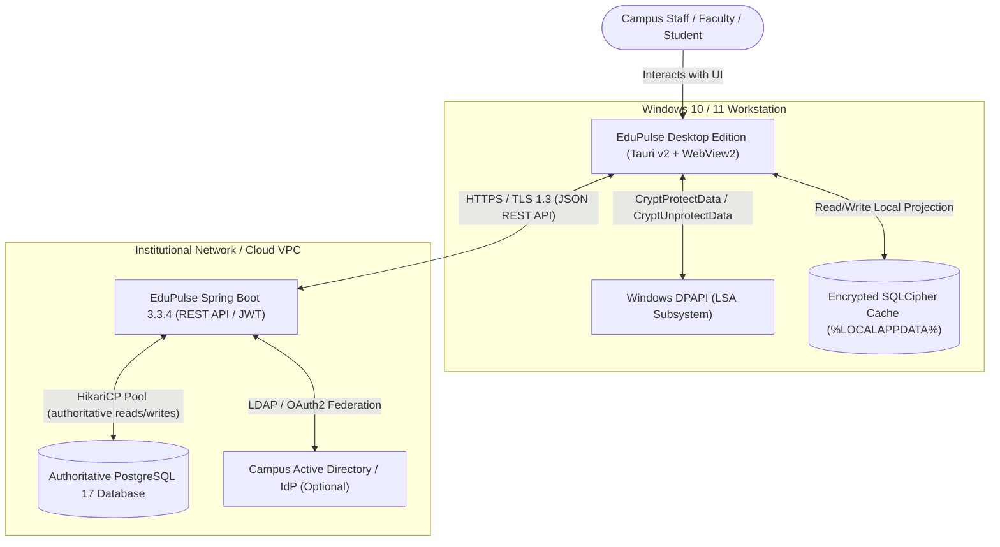
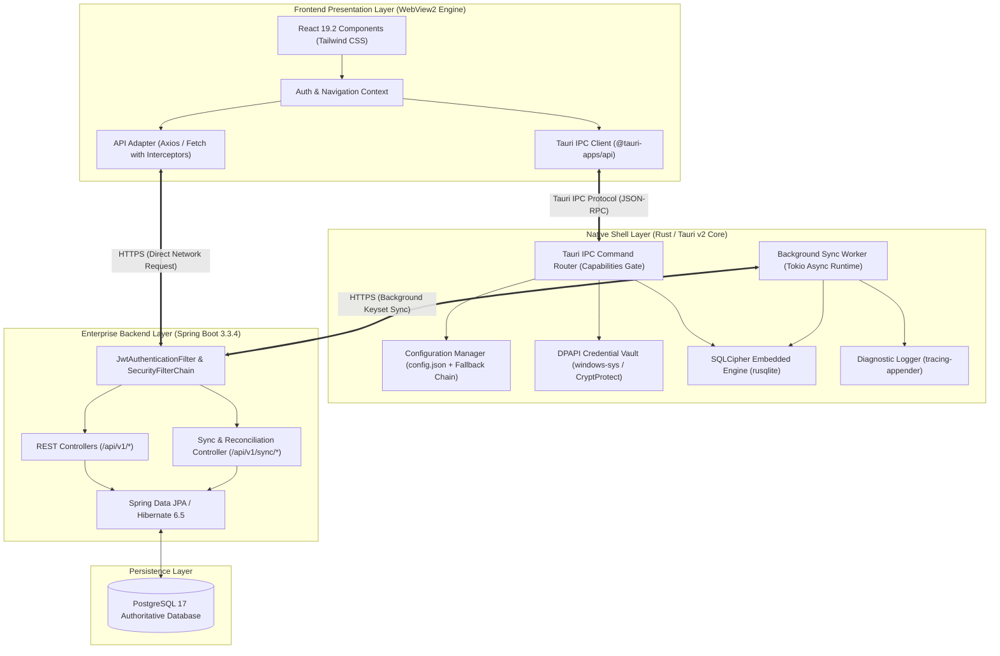
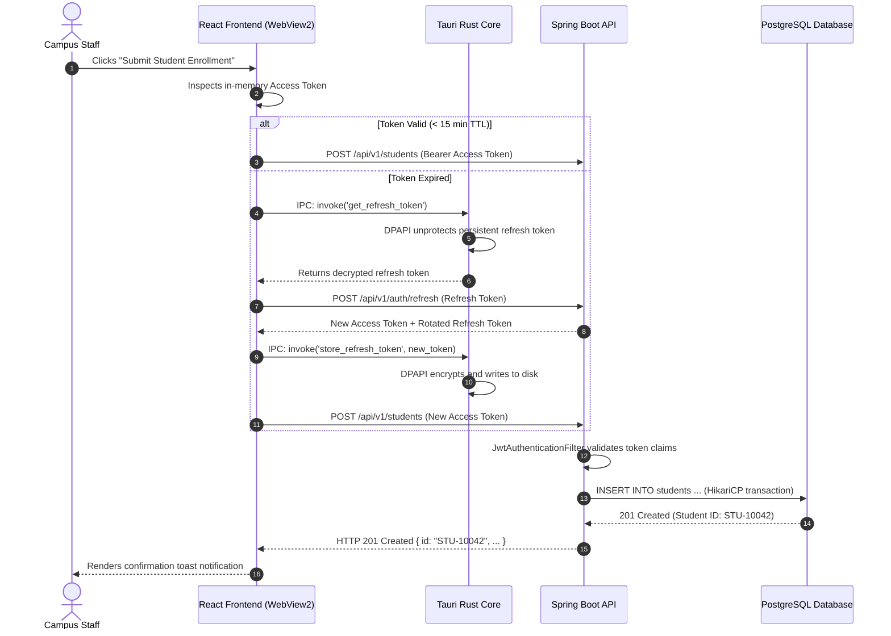
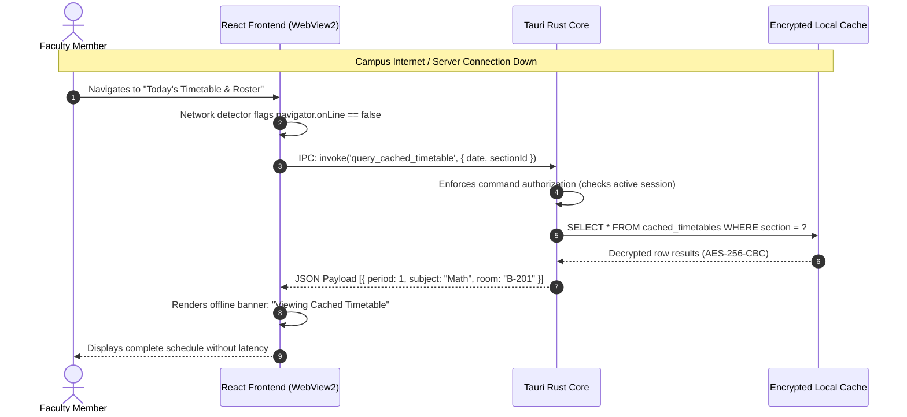
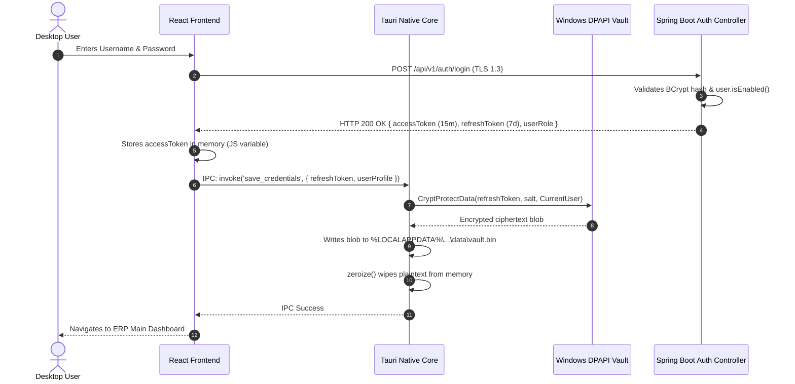
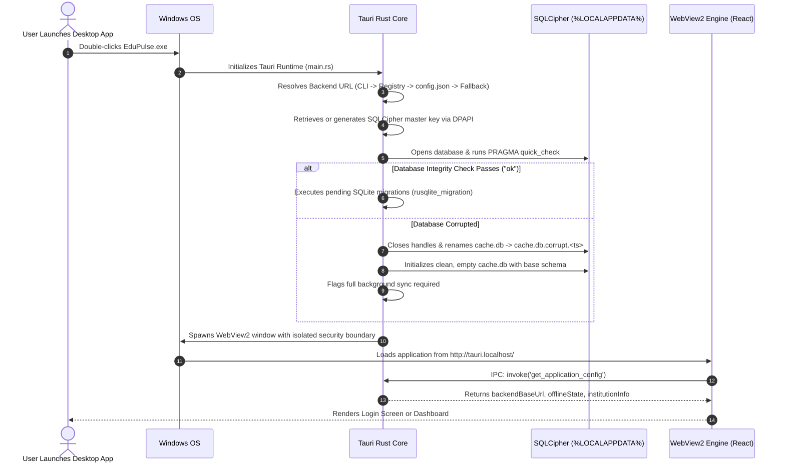
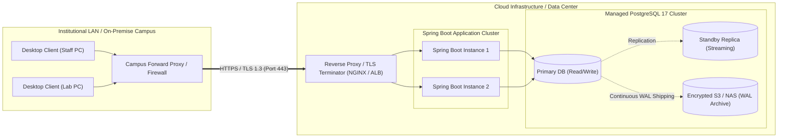

# EduPulse ERP — Day 02, Work Package 10
# Deliverable 10a: Consolidated Desktop Architecture Blueprint

## 1. Executive Summary & Document Purpose

This document serves as the authoritative, primary technical reference for the **EduPulse ERP Windows Desktop Edition**. It consolidates the architectural decisions, structural models, interface contracts, and security boundaries formulated across Work Packages WP01 through WP09.

```
+-----------------------------------------------------------------------------------+
|                        CORE ARCHITECTURAL PREMISE & INVARIANTS                   |
|                                                                                   |
|  1. Authoritative Backend System of Record:                                       |
|     Java 21 + Spring Boot 3.3.4 + PostgreSQL 17 remain the authoritative truth.    |
|     All financial ledgers, grading, and authentication policies live server-side. |
|                                                                                   |
|  2. Downstream Ephemeral Projection:                                              |
|     The Windows desktop client (Tauri v2 + Rust + React 19) is a downstream       |
|     read-only operational replica. Zero offline writes are permitted in v1.       |
|                                                                                   |
|  3. Hardware-Backed & OS-Bound Credential Security:                               |
|     No raw credentials or tokens exist in browser localStorage on desktop.        |
|     Persistent refresh tokens and cache keys are protected by Windows DPAPI.      |
|                                                                                   |
|  4. Strict Native-Web Isolation:                                                  |
|     The React frontend runs inside an isolated WebView2 sandbox. All privileged   |
|     native capabilities (disk, DPAPI, SQLCipher) require validated Tauri IPC.     |
+-----------------------------------------------------------------------------------+
```

### 1.1 Implementation Status Distinction
To maintain technical integrity across developer handoffs, this architecture enforces a strict classification of all architectural elements:

1. **Existing & Verified Implementation:** Production code verified in the repository (`backend/` Spring Boot 3.3.4, 54 JPA entities, 9 Flyway migrations, `frontend-v2/` React 19.2 + Vite 8.3).
2. **Approved Architectural Decisions:** Decisions evaluated and accepted during Day 02 (Tauri v2 over Electron, Windows DPAPI storage, SQLCipher embedded cache, WiX MSI + NSIS packaging).
3. **Proposed but Unimplemented Functionality:** Designed desktop mechanisms awaiting implementation (Tauri Rust harness, DPAPI IPC bridge, delta sync endpoints, local SQLite schema).
4. **Unresolved Decisions & Proofs of Concept:** Open engineering questions requiring empirical validation (WebView2 fixed runtime bundling, MSI custom action property ingestion, SHA-256 ID reconciliation performance).
5. **Production Blockers:** Identified security and backend flaws that must be remediated prior to desktop release (in-memory token revocation, username-only session map, missing refresh-token revocation on logout, wildcard CORS).

---

## 2. Product Functional Scope

EduPulse ERP encompasses a comprehensive institutional management scope designed for educational organizations. The architecture supports the complete suite of **259 functional modules across 23 core domains**:

```
+-----------------------------------------------------------------------------------+
|                          EDUPULSE ERP: 23 CORE DOMAINS                            |
|                                                                                   |
|   1. Admissions & Enrollment               13. Human Resources & Payroll          |
|   2. Student Information Management (SIS)  14. Staff Recruitment & Onboarding     |
|   3. Academic Planning & Curricula         15. Library Management System          |
|   4. Course & Subject Management           16. Transport & Fleet Telematics       |
|   5. Class Scheduling & Timetabling        17. Hostel & Residential Living        |
|   6. Daily Student Attendance              18. Procurement & Inventory            |
|   7. Faculty & Staff Attendance            19. Facilities & Asset Management      |
|   8. Examination & Assessment Cycles       20. Institutional Communication        |
|   9. Grading, GPA & Transcripts            21. Statutory & Regulatory Compliance  |
|  10. Student Discipline & Behavioral Logs  22. System Security, RBAC & Auditing   |
|  11. Tuition, Billing & Fee Structures     23. Institutional Analytics & Reports  |
|  12. General Financial Accounting (Ledger)                                        |
+-----------------------------------------------------------------------------------+
```

### 2.1 Desktop Functional Boundary & Offline Scope (Release v1)
While the web application requires continuous network access to interact with all 259 modules, the Windows Desktop Edition establishes a focused operational envelope:

- **Fully Online Operation:** Full interactive access to all implemented modules via live HTTPS REST calls to the Spring Boot backend.
- **Offline Read-Only Capability:** A curated subset of high-frequency operational data is cached in an encrypted local database to support low-latency daily workflows during network drops:
  - *Cached Offline:* Student basic demographics & photos, daily section timetables, faculty teaching schedules, 30-day historical attendance records, published circulars/notices.
  - *Excluded from Offline Cache:* Fee collections, general ledgers, cash register entries, examination grading submissions, disciplinary records, user credentials, and password hashes.
- **Zero Offline Writes Invariant:** The desktop client does not permit offline write transactions. Any modification to student data, attendance, or finance must be executed online against the authoritative PostgreSQL database.

---

## 3. Seven Mandatory Architecture Diagrams

### Diagram 1: System Context Diagram (C4 Level 1)



---

### Diagram 2: Component Architecture Diagram (C4 Level 2)



---

### Diagram 3: Online Request Lifecycle



---

### Diagram 4: Offline Data Access Lifecycle



---

### Diagram 5: Authentication & Token Rotation Lifecycle



---

### Diagram 6: Application Startup & Integrity Verification Lifecycle



---

### Diagram 7: Deployment & Network Architecture



---

## 4. Core Subsystem Architectural Blueprint

### 4.1 React Frontend Architecture (`frontend-v2/`)
- **Direct Codebase Reuse:** The desktop application directly bundles the production build (`npm run build`) generated by Vite 8.3 from `frontend-v2/`.
- **Runtime Environment Detection:** The frontend detects desktop mode via `window.__TAURI_INTERNALS__`. In web browser mode, standard Axios calls and browser routing are used; in desktop mode, requests route through the backend configuration manager and offline fallback handlers.
- **State Management & In-Memory Isolation:** Authentication tokens exist solely within a React Context in memory. Zero tokens or institutional records are stored in browser `localStorage` or `sessionStorage` in desktop mode.

### 4.2 Tauri v2 and Rust Native Layer
- **Memory & Resource Efficiency:** Unlike Electron, which bundles a complete Chromium instance and Node.js runtime (~150 MB baseline RAM), Tauri leverages the Windows evergreen `WebView2Loader.dll` and a compiled Rust binary, achieving ~35–45 MB baseline memory usage and an installer size under 15 MB.
- **Tauri IPC Command Gate:** Sensitive operations (reading credentials, modifying server configurations, accessing local cached tables) are exposed through strictly typed Rust commands guarded by Tauri v2 capability configuration files (`capabilities/default.json`).
- **Asynchronous Tokio Runtime:** Long-running I/O operations (such as background delta synchronization and periodic network health monitoring) execute on background Tokio worker threads, ensuring the UI thread remains at 60 FPS.

### 4.3 Spring Boot Backend & API Authority
- **Authoritative System of Record:** Java 21 and Spring Boot 3.3.4 maintain sole authority over business logic, authorization rules, financial ledgers, and database transactions.
- **Stateless JWT Validation:** Every incoming HTTPS request is authenticated via `JwtAuthenticationFilter` verifying HMAC-SHA256 signatures, subject claims, and expiration timestamps.
- **Downstream Read-Only Invariant:** The desktop application never bypasses the Spring Boot REST API. Direct connections from desktop workstations to PostgreSQL port 5432 are strictly prohibited by campus network firewalls.

### 4.4 PostgreSQL Authoritative Database
- **Schema & Migrations:** 54 relational tables managed across 9 Flyway migrations (`V1` to `V9`).
- **Target Version:** PostgreSQL 17 (aligned with CI container image).
- **Single-Tenant Deployment Model:** The existing database architecture operates as an institution-specific instance. Tables lack `tenant_id` columns and enforce global table uniqueness constraints (`roll_number`, `email`, `username`).

### 4.5 Encrypted Local SQLCipher Cache
- **Storage Engine:** SQLite 3 with 256-bit AES encryption via SQLCipher (`rusqlite` bundled).
- **File System Location:** `%LOCALAPPDATA%\com.edupulse.erp\data\cache.db`.
- **Key Derivation & Protection:** 256-bit cryptographic key generated on initial launch, protected via Windows DPAPI (`CryptProtectData`), and held in Rust memory with `zeroize` wiping.
- **Pragmas:** `PRAGMA journal_mode = WAL;`, `PRAGMA temp_store = MEMORY;`, `PRAGMA auto_vacuum = INCREMENTAL;`.
- **Storage Limit:** Hard quota of 250 MB with LRU eviction of historical attendance and cached thumbnails.

### 4.6 Windows Credential Storage (DPAPI)
- **Persistent Token Protection:** Refresh tokens are encrypted with `CryptProtectData` bound to the active Windows user profile (`CurrentUser` scope) and an application entropy salt.
- **Short-Lived Access Tokens:** 15-minute access tokens remain strictly in memory and are discarded upon window closure.
- **Shared Windows Account Limitation:** When multiple staff members share a single Windows login, DPAPI decrypts for any process in that user session. EduPulse mitigates this via an administrative "Shared PC Mode" that purges the DPAPI vault on explicit application logout.

### 4.7 Backend Configuration & Precedence Hierarchy
The desktop application resolves its target backend endpoint through a deterministic, four-tier fallback chain:
1. **Tier 1 (CLI Override):** `--backend-url <URL>` (diagnostic and test automation use).
2. **Tier 2 (Enterprise Registry / GPO):** `HKLM\SOFTWARE\Policies\EduPulse\BackendUrl` (IT administrative policy).
3. **Tier 3 (User Configuration):** `%APPDATA%\com.edupulse.erp\config.json` (persisted user selection).
4. **Tier 4 (Hardcoded Default Fallback):** `https://api.edupulse.org` (cloud production default).

### 4.8 API and CORS Architecture
- **Desktop Origin Scheme:** Tauri v2 on Windows loads web assets under `http://tauri.localhost` by default, or `https://tauri.localhost` when `app.windows.useHttpsScheme` is enabled.
- **Production CORS Policy:** The Spring Boot backend must transition from its development wildcard (`allowedOriginPatterns("*")`) to an explicit whitelist containing the registered production web domains and the exact Tauri Windows origin.
- **Direct Transport Security:** All API communication between WebView2 and Spring Boot occurs over HTTPS/TLS 1.3 with certificate validation.

### 4.9 Offline Synchronization & Deletion Reconciliation
- **Keyset Delta Synchronization:** Incremental polling passes `?since=<ISO_TIMESTAMP>` and HTTP `If-None-Match` headers, receiving `304 Not Modified` when data is current.
- **No-Soft-Delete Gap Solution:** Because the existing backend executes hard SQL deletes, EduPulse uses a dual-phase deletion propagation strategy:
  - *Phase 1 (Short-Term):* Cryptographic module hash reconciliation (`GET /api/v1/sync/{module}/reconciliation-hash`). If local hash diverges, the client pulls active IDs and removes missing rows.
  - *Phase 2 (Long-Term):* Introduction of a backend `deletion_tombstones` table populated by JPA entity listeners.
- **Server-Always-Wins Policy:** Any conflict between local cached state and server payload is unconditionally resolved in favor of the server.

### 4.10 Enterprise Packaging, Distribution & Updates
- **Dual Installer Architecture:**
  - *WiX Toolset v3/v4 (.msi):* Machine-wide enterprise installer (`Program Files\EduPulse ERP\`) supporting silent Active Directory GPO deployment and `BACKEND_URL` command-line properties.
  - *NSIS (.exe):* Per-user standalone installer (`%LOCALAPPDATA%\Programs\EduPulse ERP\`) requiring zero administrative privileges.
- **Code Signing:** Windows Authenticode signing using standard OV/EV certificates or Azure Trusted Signing to eliminate SmartScreen warnings.
- **Cryptographic Auto-Updater:** In-app updates delivered via `tauri-plugin-updater` with Ed25519 digital signature verification.

---

## 5. Security Boundaries and Threat Containment

```
+-----------------------------------------------------------------------------------+
|                           SECURITY BOUNDARY ENFORCEMENT                           |
+-----------------------------------------------------------------------------------+
|                                                                                   |
|  [ LAYER 1: WebView2 Sandbox ]                                                    |
|  - Content Security Policy (CSP): Blocks inline scripts and untrusted domains.   |
|  - Origin isolation: Local assets served from tauri.localhost.                   |
|  - No Node.js integration: JavaScript has zero raw file system or OS access.      |
|                                                                                   |
|  [ LAYER 2: Tauri IPC Command Gate ]                                              |
|  - Capability configuration restricts commands to declared frontend origins.      |
|  - Rust commands enforce session validation and argument sanitization.            |
|  - Minimizes sensitive data returned to JavaScript to prevent XSS exfiltration.  |
|                                                                                   |
|  [ LAYER 3: Windows OS DPAPI & Local Storage ]                                    |
|  - Credentials encrypted with CryptProtectData bound to Windows user profile.     |
|  - SQLite database encrypted with SQLCipher 256-bit AES at rest.                 |
|  - Temp storage forced to memory to prevent plaintext spillover in %TEMP%.       |
|                                                                                   |
|  [ LAYER 4: Network & API Transport ]                                             |
|  - Enforced HTTPS / TLS 1.3 with strict hostname verification.                    |
|  - CORS whitelist restricted to production domains and tauri.localhost.          |
|  - Short-lived in-memory access tokens (15-min TTL) prevent persistent theft.     |
+-----------------------------------------------------------------------------------+
```

---

## 6. Cloud vs. On-Premise Institutional Deployment Models

EduPulse ERP Desktop Edition supports both multi-tenant SaaS cloud backends and air-gapped on-premise institutional servers without requiring separate installer builds:

| Dimension | Multi-Tenant Cloud SaaS | Institutional On-Premise Deployment |
| :--- | :--- | :--- |
| **Backend Hosting** | Managed AWS / Azure Kubernetes Cluster | Institution Server Room / Private Campus VM |
| **Database Model** | Dedicated PostgreSQL instance per institution or RDS | Local PostgreSQL 17 on campus Linux server |
| **Desktop Configuration** | Pre-configured to `https://api.edupulse.org` | Configured via MSI property or GPO to `https://erp.campus.edu` |
| **Network Connectivity** | Public internet via TLS 1.3 | Private Campus LAN / Isolated Intranet |
| **Offline Cache Role** | Smooths public internet latency & bandwidth | Preserves operations during campus power/Wi-Fi drops |
| **Data Residency** | Cloud datacenter compliant with national standards | 100% on-premise within campus physical perimeter |
